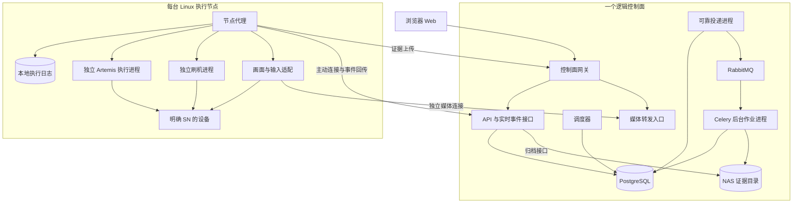

# Artemis UI 测试平台 M0 技术选型与仓库方案

> 当前发布基线（2026-11-11）：平台名称为 Kraken，不提供工作区划分；默认免登录、免节点 Token；认证由部署方扩展；节点采用单进程 runtime 和中央状态对账，不依赖 SQLite。下文早期规划按日期保留，Google Workspace 内置登录、双进程节点等旧条目不再作为当前交付要求。

日期：2026-10-21。状态：M0-D01、M0-D02 均已确认 A：Python/FastAPI 控制面 + Python 节点；React + TypeScript + Vite + Ant Design 前端。M0-D03 已确认 B：PostgreSQL + RabbitMQ + Celery，保留业务调度器与节点恢复机制。M0-D04 已确认 A：HTTPS + 节点主动建立 WSS 双向连接。M0-D05 已确认 A：控制面 Docker Compose，Linux 节点 systemd + 独立 Python 环境。M0-D06 已确认 A：优先适配现有 API/CLI，必要时在原工程做最小兼容扩展。M0-D07 已确认：artemis-platform 独立本地仓库，远端暂不配置。

2026-11-11 实现调整：节点不再维护 SQLite；执行命令、启动许可、结果统一由控制面持久化，节点以 HTTP 运行接口对账与补报，WSS 保留远控视频。以下已确认选型条目保留原决策日期；当前部署以 [节点运行说明](../runbooks/node-runtime.md) 为准。

建议采用独立单仓库，包含 Web、控制面和节点代理。控制面按业务模块组织，API、调度器和后台作业分别运行，共享业务数据库；每台 Linux 执行机部署节点代理，监督多个独立 Artemis 执行进程。一个逻辑控制面不等于一个操作系统进程。

本方案承接[需求草案](../requirements/platform.md)与[任务规划](../requirements/task-plan.md)。既定的独立仓库、指定 SN、Stable、运行中禁止人工介入等规则保持不变；以下技术建议按第 8 节逐项确认后实施。约 60 台设备是容量验证目标，不能仅由技术栈选择推导为已具备的并发能力。

## 1 建议技术组合

| 范围 | 建议选择 | 对应职责与取舍 |
| --- | --- | --- |
| 控制面后端 | Python + FastAPI 已确认；Pydantic 作为配套建议 | 处理业务 API、协议校验及事件接口；与现有 Artemis 的 Python 技术栈衔接。采用模块化组织，设备执行移交节点。 |
| 节点代理 | Python 已确认；asyncio + 子进程监督作为实现建议 | 管理设备发现、租约、进程、事件和上传；ADB、Fastboot 和 Artemis 在执行机本地运行。 |
| Python 版本与依赖 | 初始兼容基线 Python 3.12，uv 管理平台依赖 | 以当前 Artemis 的最低 Python 要求作为起点，FND-04 验证后锁定具体版本；平台、Artemis、刷机工具各自保留部署环境。 |
| Web | React + TypeScript + Vite + Ant Design，已确认 | 覆盖用例编辑、表格、任务树、设备墙、配置和报告；以 SPA 交付。路由与请求缓存纳入前端基础任务。 |
| 业务数据库 | PostgreSQL 已确认；SQLAlchemy + Alembic 作为配套建议 | 保存用例版本、Stable、任务、设备占用、定时记录、审计和证据索引；使用事务、约束和迁移管理一致性。 |
| 调度与后台作业 | 已确认 B：PostgreSQL + RabbitMQ + Celery，保留独立业务 scheduler | PostgreSQL 保存业务状态和可靠投递记录；RabbitMQ 分发消息；Celery 运行后台作业、派发协调和对账；设备调度与恢复由业务规则管理。 |
| 节点本地记录 | 待上报事件和证据文件目录 | 当前实现已移除节点 SQLite；命令、启动许可、作业状态和租约统一保存在控制面，节点恢复时对账。 |
| 控制面与节点通信 | 已确认 A：HTTPS + 节点主动建立 WSS 双向连接 | HTTPS 处理注册、查询及文件；WSS 传递命令、确认和事件。命令先持久化，断线后补传与对账；浏览器不直接操作 Artemis 接口。 |
| 浏览器实时过程 | REST + SSE | REST 处理命令和查询，SSE 推送状态与日志事件；支持游标补读和断线重连。 |
| 手机画面与输入 | 独立 WebSocket 通道及媒体适配接口 | 画面流量与持久命令分开；输入仍校验租约。编码方式与延迟在真机原型后确定，不能据此预先承诺视频质量。 |
| 文件与证据 | NAS 共享存储 + 节点受控缓存 + 业务库存索引 | 保留既定集中存储方案；大文件通过独立上传/下载路径传输，不经任务队列或 SSE。 |
| 认证与权限 | 仓库内独立 identity 包 | 提供开放模式和 Google Workspace 接入、访问主体与角色策略；独立维护边界，首期随控制面部署。 |
| 部署 | 已确认 A：控制面 Docker Compose；Linux 节点 systemd + 独立 Python 环境 | Compose 承载控制面服务；节点直接使用 USB 与工具链，设备仍采用 SN/租约及独立进程。 |
| 质量工具 | pytest、类型检查、lint；前端单元检查与 Playwright | 测试重点为状态、版本、幂等、互斥、恢复和真实操作链；macOS 验证与 Linux 真机验收分别记录。 |

框架的能力与本平台的设计取舍分别考虑：FastAPI 提供 OpenAPI、JSON Schema 与客户端生成所需的标准描述，适合统一接口契约。[FastAPI 官方文档](https://fastapi.tiangolo.com/features/)

React 官方文档列出 Vite 的 React/TypeScript 构建路径，同时说明自行组合路由、数据获取等能力的维护成本。本平台当前没有服务端渲染需求，因此建议采用 SPA，并把这些基础能力明确纳入 FND-05。表格与表单组件采用 Ant Design。[React 官方文档](https://react.dev/learn/build-a-react-app-from-scratch)、[Ant Design 官方文档](https://ant.design/docs/react/introduce/)

平台 Python 包可以使用 uv workspace 统一解析依赖与锁文件；Artemis 和 PhoneAutomationTest 不加入平台 workspace，避免其设备、模型和界面依赖进入控制面部署环境。[uv 官方文档](https://docs.astral.sh/uv/concepts/projects/workspaces/)

## 2 控制面与节点的运行结构



控制面入口可以来自同一后端发布包：API 提供交互，scheduler 做设备分配与定时计算，可靠投递进程将待发消息发送到 RabbitMQ，Celery worker 做后台作业和执行协调。首期可部署在同一台控制机，分别重启和观察；媒体入口先作为单独模块，负载验证后决定是否独立进程。业务模块共享代码和事务边界，不逐个拆成网络服务。

节点代理是设备操作的统一入口。所有测试、刷机、远控和维护共享本机设备互斥；控制面记录业务占用和租约代次，节点执行本机原子互斥。数据库锁不能替代本机锁，指定 SN 也不能单独提供独占。

节点主动连接控制面，机器身份与开放模式的人类访问策略分开。免登录全权限保持可用；节点注册凭据仍用于识别事件属于哪台机器，避免其他节点冒报执行结果。节点不直接连接控制面数据库。

## 3 调度和数据一致性

已确认采用 PostgreSQL + RabbitMQ + Celery，以现成的消息分发、任务重试、路由和运行事件能力作为基础。PostgreSQL 保留业务状态、设备租约、尝试记录和待投递记录；Celery 任务状态不作为测试结果的唯一来源。调度器仍负责设备匹配、并发预算、定时排队和补跑规则。

数据库事务同时保存业务变更与待发送消息，形成事务发件箱（Outbox）。投递进程从发件箱发送消息，收到 RabbitMQ 的发布确认后更新记录；确认丢失允许重发，消费者按稳定的业务命令 ID 去重。消息不能只在数据库提交后的临时回调中发送，否则进程退出可能留下未派发业务记录。

RabbitMQ 需要配置持久队列、持久消息和发布确认，并验证消息实际路由到目标队列。消费者在完成相应持久化责任后确认消息；该机制允许重复投递，业务仍须幂等。[RabbitMQ 可靠性说明](https://www.rabbitmq.com/docs/reliability)

Celery 的延迟确认、worker 异常退出处理和重试策略按任务类型配置，并通过崩溃测试验证；不能把默认设置当作所有故障都会自动恢复。尤其是子进程异常退出，延迟确认本身不保证重新入队；需要评估 `task_reject_on_worker_lost` 等策略及重复失败的隔离方式。[Celery 任务文档](https://docs.celeryq.dev/en/stable/userguide/tasks.html)

业务与节点还需实现以下规则：

1. 命令以 `command_id` 去重，执行以 `attempt_id` 标识，节点事件带顺序号；节点记录命令后再确认接受，启动前写入执行意图，重启时先核对进程和设备事实。同一个 Celery task ID 本身不保证业务去重。
2. Celery 任务以导入、报告、投递协调、状态推进和对账等有边界的作业为主。手机上的长时间测试/刷机由节点监督，Celery worker 退出不直接杀掉设备执行进程。
3. 节点接受记录与执行完成分开。投递协调任务成功只代表命令可靠交接，不代表设备测试 PASS；后续由节点事件或对账继续推进业务状态。
4. 调度器有单活约束与持久检查点；数据库连接或调度所有权丢失时停止新派发。旧动作未确认停止前不释放设备占用，未知状态进入恢复流程。
5. 每条定时规则持久化计划触发时刻、排队记录和已处理区间，落实同规则排队、只补最近一次。Celery 的周期触发能力不能直接替代这些业务语义。
6. 每次 attempt 真正开始前读取当前 Stable，并重新校验其设备约束；若排队期间 Stable 改变导致预选设备不再匹配，阻塞或重新调度。执行中保持内容快照；恢复跟踪同一 attempt 时也不重新读取 Stable。
7. APK/固件在每次定时触发时解析具体内容身份；同 Run 排队和重跑保持包不变，与 Stable 的读取时点分开。
8. 后台作业重试、消息重投和设备用例重跑分别记录。导出重试不重放设备操作，NAS 补传不重跑测试；新的用例 attempt 才按约定重新读取 Stable，并计入配置的用例重跑次数。
9. 取消通过平台状态机和节点取消命令完成；确认设备操作停止、清理及健康检查后才释放租约。Celery 的 revoke 或 worker 终止不能直接充当测试/刷机的安全取消。

数据库事务只覆盖短时状态更新，图片、录像和大文件经独立文件通道传输。导入、报告等后台作业可分队列和 worker 资源池，避免占满执行协调的处理能力。RabbitMQ/Celery 属于同一逻辑控制面的基础设施，不改变一个控制面管理多节点的模型。

## 4 独立仓库结构

以下以已确认的 `artemis-platform` 为仓库名，采用已确认的 Python 控制面与节点路线。前端采用已确认的 React/TypeScript/Vite/Ant Design；名称、位置和远端已在 M0-D07 确认，其他配套技术按后续决策调整。

```text
artemis-platform/
├── apps/
│   ├── control-plane/
│   │   ├── pyproject.toml
│   │   └── src/control_plane/
│   │       ├── entrypoints/       # api、scheduler、worker 入口
│   │       ├── api/               # 路由、SSE、节点协议、媒体入口
│   │       ├── modules/
│   │       │   ├── cases/         # 用例、不可变版本、Stable、测试集
│   │       │   ├── runs/          # 计划、运行、任务链、尝试和重跑
│   │       │   ├── devices/       # 节点、设备、租约及恢复
│   │       │   ├── scheduling/    # 设备分配、定时、队列与补跑
│   │       │   ├── artifacts/     # APK、固件、包身份与来源
│   │       │   ├── reports/       # 断言结果、证据索引、看板与留存
│   │       │   ├── imports/       # 飞书、Excel、差异和采纳
│   │       │   ├── models/        # 模型配置与引用
│   │       │   ├── freestyle/     # 平台 Agent、方案和确认
│   │       │   └── audit/         # 操作及配置审计
│   │       └── infrastructure/    # DB、消息投递、NAS、外部服务的实现
│   ├── node-agent/
│   │   ├── pyproject.toml
│   │   └── src/node_agent/
│   │       ├── transport/         # 注册、命令、事件与补传
│   │       ├── devices/           # 发现、身份、模式切换与本机锁
│   │       ├── supervisor/        # 进程、工作区和取消
│   │       ├── spool.py           # 待确认事件与证据文件
│   │       ├── adapters/          # Artemis、刷机、ADB、媒体
│   │       └── artifacts/         # 下载、缓存、校验与上传
│   └── web/
│       ├── package.json
│       └── src/                  # 页面、组件、路由、查询与设备画面
├── packages/
│   ├── contracts/                # 协议 DTO、状态枚举、错误码与版本
│   ├── identity/                 # 独立身份、开放模式、SSO 和角色策略
│   └── web-api-client/           # 从 API 契约生成的 TypeScript 客户端
├── contracts/
│   ├── generated/                # 导出的 OpenAPI 与节点 JSON Schema
│   └── examples/                 # 命令、事件和兼容性样例
├── migrations/                   # 业务数据库迁移
├── config/                       # 示例配置和配置校验，无真实密钥
├── deploy/
│   ├── compose/                  # 控制面部署
│   ├── systemd/                  # Linux 节点服务
│   └── manifests/                # 平台、引擎与工具链兼容版本
├── scripts/                      # 启动、构建、契约生成与检查
├── tests/
│   ├── contracts/                # 协议、兼容与状态约束
│   ├── integration/              # PostgreSQL、节点模拟与故障注入
│   ├── e2e/                      # 平台浏览器流程
│   └── hardware/                 # Linux 真机验收
├── docs/
│   ├── requirements/
│   ├── architecture/
│   ├── decisions/                # 已确认的技术决策记录
│   └── runbooks/
├── pyproject.toml
├── uv.lock
├── pnpm-workspace.yaml
├── pnpm-lock.yaml
└── README.md
```

业务模块内部再按需要分领域规则、应用服务、存储实现和路由，避免为每个目录提前堆空文件。M0 只创建最小可运行骨架，业务模块随任务进入开发再填充。

共享契约只包含线上传输模型和公共枚举，不包含数据库 ORM、设备操作或引擎依赖。建议以受版本管理的协议 DTO 为定义来源，导出 OpenAPI/JSON Schema 和前端客户端，CI 检查生成结果是否一致；生成文件不能独立手改。数据库表结构与公开 API 分别演进。

`identity` 是独立模块，提供访问主体与权限判断，业务入口调用它，节点和用例模块不各自复制角色逻辑。只有出现独立团队维护或独立部署需求时，再评估拆服务。

## 5 现有工程的接入边界

| 现有工程 | 当前可核实基础 | 平台方案 |
| --- | --- | --- |
| Artemis | Python 最低要求 3.12，已有 FastAPI；独立 `artemis-client` 通过 HTTP 调用 daemon，支持明确设备参数 | 控制面只依赖平台协议；节点中的适配器负责与 Artemis 交互。优先核验现有客户端/daemon 的提交、查询、取消、事件和并发能力，再决定复用入口或由进程包装补齐。 |
| Artemis 设备锁 | `DeviceExecutionLock` 已按设备和 ADB endpoint 范围组织文件锁，并有进程身份信息 | 平台租约与内核锁明确唯一获取者或交接关系；禁止平台父进程先占锁、子进程再次取同一非重入锁造成死锁。所有写入入口必须协调到同一互斥域。 |
| PhoneAutomationTest | 所检查的 `FlashEngine` 仍依赖 tkinter 窗口；不能仅凭类名认定它是现用无界面入口 | FLA-01 查清 Linux 当前实际 CLI、参数、工作目录、合并步骤和取消边界；节点优先包装确认的 CLI，必要改造放回原工具工程。 |
| 现有 Web | Artemis showcase 使用 Angular | 新平台已确认使用 React/TypeScript/Vite/Ant Design，独立实现业务界面与状态管理；现有 showcase 保持原有技术栈。 |

源码依据：Artemis 工作树提交 `44ecce8`，PhoneAutomationTest 工作树提交 `21313fd`；2026-10-21 静态核验。Artemis 工作树存在本地修改，因此提交号不是整个工作树内容的唯一标识。设备与刷机集成仍需后续真实环境验证。

- Artemis 依赖定义（`<CHECKOUT_ROOT>/AutoDeviceChecker/artemis/pyproject.toml`）
- Artemis 客户端与现有接口说明（`<CHECKOUT_ROOT>/AutoDeviceChecker/artemis/packages/artemis-client/README.md`）
- Artemis 设备锁（`<CHECKOUT_ROOT>/AutoDeviceChecker/artemis/artemis/runtime/device_lock.py`）
- PhoneAutomationTest 刷机引擎（`<CHECKOUT_ROOT>/PhoneAutomationTest/NothingRefactor/flash_tool/flash_engine.py`）

新平台仓库只保存平台代码和适配器。Artemis 与刷机工具继续独立发布；通过固定构建版本、兼容清单及节点能力上报关联，避免运行期间自动更新执行内核。控制面部署包不安装完整 Artemis 的模型、图像和 Android 工具依赖。

## 6 macOS 开发与 Linux 验证

macOS 本地运行 Web、控制面入口和模拟节点，PostgreSQL 与 RabbitMQ 用开发 Compose 环境启动；模拟节点能注入断连、重复指令、响应丢失、设备忙和清理失败。所有自动检查使用独立数据与目录，设备操作由明确的硬件测试入口启用。

Linux 节点由 systemd 监督代理。平台代理、Artemis 和刷机工具使用分别可复现的环境；每次 attempt 有独立工作区、环境配置、端口与停止标记，共享经核验的设备锁路径。平台通过部署清单引用外部工具版本，升级先排空相关执行。

Mac 可以验证平台规则和页面；USB Hub、Fastboot 模式转换、中文输入、画面性能以及多手机并发在 Linux 真机上验收。Google Workspace 登录还需要确认内网浏览器与控制面的认证网络路径；开放模式不依赖该接入完成。

## 7 M0 的交付与验收

| 原任务 | 本阶段交付 | 完成条件 |
| --- | --- | --- |
| FND-01 | 技术决策记录、确认后的仓库、最小 API/Web/节点模拟骨架、依赖边界 | 各入口可启动、健康检查可访问、平台依赖安装可复现；仓库名称和位置已确认 |
| FND-02 | 领域对象、状态表、第一版迁移与约束 | Case/Version/Stable、Run/Attempt、设备租约、Schedule、证据/审计可解释；并发与唯一性约束有数据库验证 |
| FND-03 | 控制面/节点 v1 协议、错误码、示例和兼容规则 | 注册、心跳、命令、接受确认、结果、补传、取消与对账可在模拟环境串通；异常状态有确定处理 |
| FND-04 | macOS 启动流程、Linux 检查流程、CI 和模拟故障夹具 | 新环境按说明启动；契约与故障样例可重复；明确真机验收入口 |
| FLA-01 | 实际 CLI 接入记录、工具链和输入输出规范、适配差距 | 找到正在使用的 Linux 命令与参数，确认可封装边界；未核实入口不算此任务完成 |

M0 演示目标：创建一个模拟任务，控制面持久化命令，模拟节点按租约接收并回传事件；重复投递不重复启动，断开后能补传和对账。此演示用于证明平台协议，不以模拟 PASS 替代 App/OS 真机验收。

## 8 按顺序确认的决策

| 顺序 | 决策 | 推荐方向 | 状态 |
| --- | --- | --- | --- |
| M0-D01 | 控制面与节点后端路线 | A：Python/FastAPI 控制面 + Python 节点 | 已确认 A，2026-10-21 |
| M0-D02 | 前端技术与组件库 | A：React/TypeScript/Vite/Ant Design | 已确认 A，2026-10-21 |
| M0-D03 | 数据库与后台调度基础 | B：PostgreSQL + RabbitMQ + Celery，保留业务 scheduler | 已确认 B，2026-10-21 |
| M0-D04 | 控制面与节点通信及数据通道 | A：HTTPS + 节点主动建立 WSS 双向连接 | 已确认 A，2026-10-21 |
| M0-D05 | 开发和部署方式 | A：控制面 Docker Compose、节点 systemd + 独立 Python 环境 | 已确认 A，2026-10-21 |
| M0-D06 | 现有执行工具适配入口 | A：节点适配现有 API/CLI，必要能力在原工程最小兼容扩展 | 已确认 A，2026-10-21 |
| M0-D07 | 独立仓库名称、位置和托管 | 建议 artemis-platform，放在 workspace 下独立目录，先初始化本地 Git | 已确认，2026-10-21 |

## 9 已确认的后端路线

M0-D01 于 2026-10-21 确认选 A：控制面使用 Python/FastAPI，节点代理使用 Python。选择依据为现有 Artemis 执行生态与接入维护成本；平台可共享 Python 协议模型和工程工具。

该决定确定后端语言与控制面框架。前端已在 M0-D02 确认，数据库和后台调度已在 M0-D03 确认；通信已在 M0-D04 确认；部署已在 M0-D05 确认；工具接入已在 M0-D06 确认；M0-D07 已确认独立仓库名称、位置与托管。Python 具体版本和依赖版本在开发环境验证后锁定。设备独占、Stable 与执行状态规则保持不变。

## 10 已确认的前端路线

M0-D02 于 2026-10-21 确认选 A：React + TypeScript + Vite + Ant Design。平台以 SPA 建立独立业务界面，用统一组件处理用例、任务、配置等表格和表单；设备画面与操作使用专用组件。

路由、请求缓存、实时事件状态、错误及空状态在 FND-05 中统一设计。具体依赖版本经前端构建验证后锁定；本项确认不扩展为数据库或部署方案的确认。

## 11 已确认的数据库与后台调度方案

M0-D03 于 2026-10-21 确认选 B：PostgreSQL + RabbitMQ + Celery，保留独立业务调度器。选择依据为完整任务能力、中断恢复和长期运维；具体可靠投递与幂等规则见第 3 节，恢复责任见第 12 节。

PostgreSQL 保存业务状态、租约和可靠投递记录；RabbitMQ 分发消息；Celery 执行后台作业、派发协调和对账；节点监督设备进程与本地执行事实。Celery worker 或控制面重启不能直接导致已接受的设备任务被重新启动。

Celery 的 worker 和任务事件用于运维观察，平台业务过程页展示 Run/Attempt、原始断言及设备事实。[Celery 监控文档](https://docs.celeryq.dev/en/stable/userguide/monitoring.html)

RabbitMQ 集群拓扑仍需结合部署与可用性目标确定。M0-D04 已确认节点通过 HTTPS/WSS 平台协议通信，RabbitMQ/Celery 用于控制面内部；部署方式已在 M0-D05 确认，具体服务放置及可用性门槛结合实际环境与 D18 确定。

## 12 中断后的恢复责任

| 中断情形 | 推荐方案中的恢复方式 | 判定依据 |
| --- | --- | --- |
| 业务已提交，消息尚未送达 | Outbox 恢复发送，发布确认后记录已投递；重复消息由消费者去重 | 数据库记录、消息确认和命令 ID |
| Celery worker 在作业中途退出 | 按已验证的确认/重投策略重领；检查作业进度与已有结果，再继续或重试 | 后台作业状态及幂等记录；不能只看消息是否被重投 |
| 控制面重启，节点仍执行 | 恢复对账和事件接收，继续跟踪原 attempt；节点按预定失联策略托管当前执行 | 节点执行日志、进程身份、租约和事件序号 |
| 网络中断，任务接受响应丢失 | 使用原 command_id 查询已接受/已启动事实；不直接新建执行 | 节点持久记录与控制面命令记录 |
| 节点代理重启，执行进程存活 | 核对进程身份、控制通道和设备后恢复监督；无法可靠接管则进入恢复状态 | 进程启动身份、工作区、执行记录；PID 单独不足 |
| Artemis 或节点机器退出 | 先核验设备状态和证据；只有可靠检查点及环境允许时续跑，否则按配置新建 attempt 重跑或阻塞 | 业务阶段、设备实际状态及已确认的重跑规则 |
| Fastboot 刷写中断或状态未知 | 保留占用/隔离，核实分区、模式、版本与工具状态，按专用恢复方案处理 | 刷机阶段和设备事实；不能依靠消息重投自动续刷 |
| 人工取消任务 | 持久取消意图并通知节点，等待安全停止与清理；重投消费者先检查取消状态 | 平台取消状态与节点停止确认，避免取消后再次启动 |

恢复跟踪、重新投递、重新执行用例和从检查点继续是不同操作。Celery 不会保存任意 Python 函数执行到一半的内存状态，也不知道手机是否已经完成点击、安装或刷写；相应事实需要节点与业务状态机记录。不能承诺任意步骤无缝续跑。

B 也不自动等于整机高可用。单机 RabbitMQ 的持久化恢复与跨机器故障切换是不同目标；消息副本、PostgreSQL 备份/高可用和控制面部署分布在 M0-D05 及 D18 中结合可用性要求确定。[RabbitMQ 可靠性与副本说明](https://www.rabbitmq.com/docs/reliability)

M0 的故障验证应覆盖：数据库提交后发布进程退出、发布确认丢失、worker 接收后退出、节点已经接受但控制面未收到响应，以及重复重投后的命令去重。后续真机验证补充执行进程退出、USB 断连和刷机中断。只有故障注入结果证明对应路径有效，才能将其列为已具备的恢复能力。

## 13 已确认的控制面与节点通信

M0-D04 于 2026-10-21 确认选 A：HTTPS + 节点主动建立 WSS 双向连接。HTTPS 用于注册、配置查询和文件传输；WSS 承载命令、确认、心跳及执行事件。RabbitMQ/Celery 继续承担控制面内部后台任务基础设施，节点与浏览器通过平台接口访问。

WebSocket 提供双向消息传输，持久化、幂等和恢复仍由应用协议实现。[WebSocket 协议](https://datatracker.ietf.org/doc/html/rfc6455)

协议要求：

1. 命令先持久化，再通过在线连接发送；节点落盘后回应用级接受确认，任务完成另外上报。Celery 作业状态、网络发送成功与节点接受是三个不同事实。
2. 断线重连携带节点身份、连接代次、未结束执行及事件游标，先核对已有命令，再补传。多 API 进程不能各自持有互相冲突的节点连接归属；通过共享归属记录与定向路由协调，持久记录可补偿唤醒丢失。
3. 消息带协议版本、command_id、attempt_id、租约代次及有效期，过期或失效命令被拒绝；事件按顺序号去重，数据落库后确认。
4. 命令与心跳优先于日志批次，大量日志使用受限缓冲和批量上传，避免日志积压阻塞取消及状态查询；不可丢弃的证据在节点保留并按归档规则处理。
5. 画面使用独立媒体连接，证据与固件使用独立文件接口。空闲远控输入按会话、序号和短有效期处理，断线后不自动重放旧点击或滑动。
6. 节点主动连接控制面，不要求控制面主动访问每台节点的入站监听端口；注册凭据与设备操作权限保持统一校验。

## 14 已确认的开发与部署方式

M0-D05 于 2026-10-21 确认选 A：控制面使用 Docker Compose，Linux 节点使用 systemd + 独立 Python 环境。macOS 开发、Linux 执行、指定 SN 与共享设备租约保持不变；不使用每设备 Docker，不预设增加第四台 Linux 机器。

| 环境 | 运行方式 |
| --- | --- |
| macOS 开发 | 前后端、模拟节点本地运行，PostgreSQL/RabbitMQ 用开发 Compose 环境 |
| Linux 控制面 | Compose 管理网关/Web 静态资源、API、业务 scheduler、Outbox 投递器、Celery worker、PostgreSQL 和 RabbitMQ |
| Linux 节点 | systemd 管理平台代理与执行监督，Artemis、ADB、Fastboot 和刷机工具在宿主机独立环境运行 |

Compose 使用应用定义配合不同环境的配置部署；生产定义固定构建镜像和版本，数据库迁移、服务健康检查及备份恢复仍作为独立交付内容。[Docker Compose 部署文档](https://docs.docker.com/compose/how-tos/production/)

开发与发布边界：

- macOS 本地启动 Python 控制面各入口、React/Vite 和模拟节点，便于调试；PostgreSQL/RabbitMQ 用开发 Compose 环境，和真实环境使用独立数据。具体容器运行时先核验并复用本机已有环境。
- Linux 控制面发布固定版本镜像与配置；数据库和消息数据挂持久卷，证据使用既定 NAS 目录。容器重建不清除业务数据，也不将整个 NAS 当作清理范围。
- Linux 节点原生安装 ADB/Fastboot 和核验后的刷机依赖；平台代理、Artemis 与刷机工具各自维护可复现的环境，任务工作区与设备锁按既定规则管理。
- 节点代理和实际执行进程分开生命周期管理，使用独立服务单元或等价的监督机制。systemd 默认会在停止服务时清理同一控制组中的进程，因此必须验证代理重启不连带杀掉正在刷机或测试的进程；不能仅通过放弃进程管理来保活。[systemd 进程终止规则](https://www.freedesktop.org/software/systemd/man/latest/systemd.kill.html)
- 控制面服务重启后依靠持久化状态、Outbox 和节点对账恢复；节点升级先排空相关执行，再替换版本。数据库迁移有备份与兼容策略，不能只回退镜像就宣称已回滚数据。
- 生产镜像、Python 依赖和前端资源提供内网获取路径，运行不依赖公共 CDN。Google Workspace 与已选云模型的网络访问条件另外核验；开放模式仍可独立使用。

打包和运行方式已确定。控制面落在哪台主机或虚拟机、是否与某执行节点共用资源、数据库及 RabbitMQ 是否使用已有服务，由真实环境清单决定；共用时须预留资源并验证执行负载。Compose 单机部署不提供主机故障自动切换，跨机器高可用与备份门槛按 D18 确认。

## 15 已确认的执行工具接入边界

M0-D06 于 2026-10-21 确认选 A：节点优先适配现有公开 API/CLI；遇到无法通过适配满足的平台必要能力，在 Artemis 或 PhoneAutomationTest 原工程做最小兼容扩展，保留现有接口。

平台、Artemis、PhoneAutomationTest 保持工程职责独立；控制面调用节点协议，设备执行在节点侧独立进程中完成。原工程的具体改动由 FLA-01 与 ENG-01 的接入核验结果决定，平台不复制一套执行内核。

节点适配器对平台提供统一的能力查询、提交、查询、取消、事件和产物接口，具体实现隔离在适配器内：

- Artemis 优先核验已有独立客户端与本机 daemon HTTP 接口；对不满足独立进程、精确 SN、事件完整度或取消语义的路径，核验公开 CLI/独立 runner 方案，必要扩展进入 Artemis 原工程。控制面不安装完整 Artemis，也不直接导入其内部 agent 对象。
- PhoneAutomationTest 优先封装实际正在使用的 Linux CLI，命令以明确参数和 SN 执行，采集结构化阶段、日志、退出状态与刷后验证。若入口依赖 GUI，将必要无界面能力留在原工具工程，平台保存调用适配器。
- 引擎内部调度只负责已分配设备上的执行；设备跨机器选择、任务链、Stable、重跑、租约与业务结果由平台统一负责。平台与引擎的设备锁协调到同一互斥域，不重复获取同一个非重入锁。
- 平台与引擎版本通过构建产物、固定版本及能力协商绑定。验证通过后发布兼容组合，运行中的任务不自动切换引擎或工具版本。

当前源码依据：独立 artemis-client（`<CHECKOUT_ROOT>/AutoDeviceChecker/artemis/packages/artemis-client/README.md`） 已列出 HTTP 提交、查询、停止与设备查询接口；所检查的 FlashEngine（`<CHECKOUT_ROOT>/PhoneAutomationTest/NothingRefactor/flash_tool/flash_engine.py`） 仍依赖 tkinter。实际 Linux 刷机 CLI 的路径与参数尚待 FLA-01 核实，不能把该界面类直接当成已经可用的无界面入口。

本项确认只确定接入策略和工程边界。具体源代码改动应由可复现的能力缺口驱动，保留现有 CLI/API 契约与无关本地修改；M0 的方案确认不代表适配或真机验证已经完成。

## 16 已确认的独立仓库位置与托管

M0-D07 于 2026-10-21 确认如下：

| 项目 | 建议 |
| --- | --- |
| 仓库名称 | artemis-platform |
| 本地路径 | <CHECKOUT_ROOT>/artemis-platform |
| Git 边界 | 新建独立 Git 仓库，与 AutoDeviceChecker、PhoneAutomationTest 各自管理 |
| 初期托管 | 先初始化本地 Git，远端地址暂不配置；有指定托管位置后再绑定 |
| 工程内容 | 按本方案的 apps、packages、contracts、migrations、deploy、tests、docs 结构建立 M0 骨架 |
| 规划文档 | 将需求草案、任务规划和 M0 技术方案复制到新仓库，整理相互引用；现有文档先保留作为迁移入口 |

2026-10-21 检查结果：当前 Artemis 所在 Git 仓库根目录为 `<CHECKOUT_ROOT>/AutoDeviceChecker`；`<CHECKOUT_ROOT>` 本身不属于 Git 仓库，建议目标目录尚不存在。因此新平台放在 workspace 下，可以保持独立仓库边界并避免嵌套在现有仓库内。

本项确认后初始化目录与本地 Git，按已选技术栈建立最小可运行骨架，并继续 FND-02/03/04 的领域模型、协议和开发环境工作。现有工程源码不复制进新仓库，源代码扩展按 M0-D06 的核验结果开展。

M0 的技术决策确认不代表五项 M0 任务已验收；真实刷机 CLI、实际 Linux 接入与开发环境验证仍需对应完成记录。远端托管地址缺失不阻塞本地骨架和协议工作。
