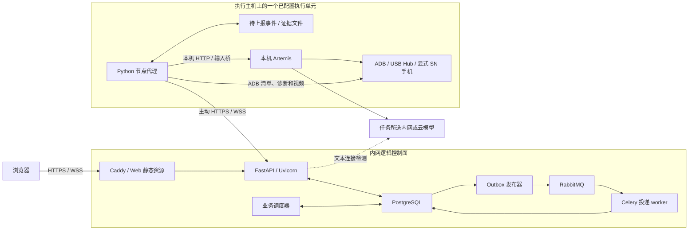
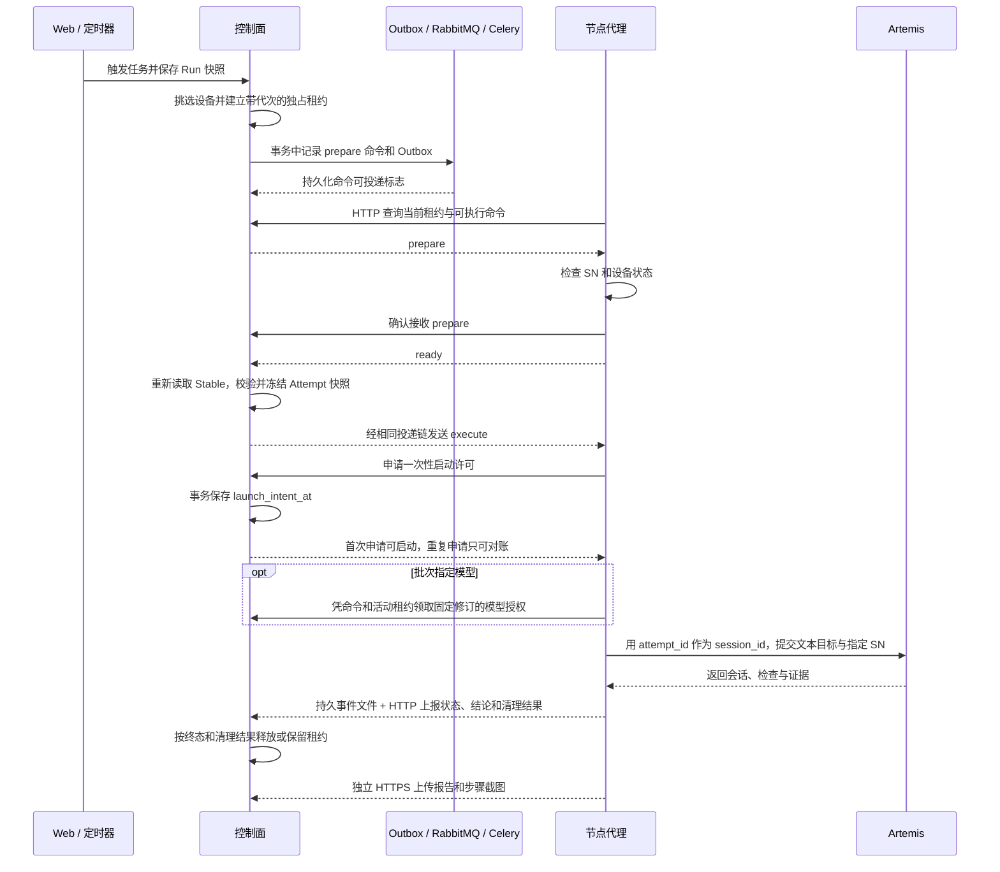

# Kraken 测试平台架构与技术说明

**基线日期** 2026-11-11

**适用范围** 独立的 `Kraken` 控制面、节点代理与 Web，以及当前对接的 Artemis 执行内核。本文依据本地工作树、已确认需求和可追溯的验证记录编写。

## 1. 建设边界

平台在内网提供一个逻辑控制面，统一管理 App 和 Android OS 用例、测试任务、定时计划、设备占用、执行证据及远程手机。Artemis 保留为设备上的执行内核，平台通过节点代理协调多个 Artemis 实例。平台使用独立仓库，Panoptes 不参与依赖链。Fastboot 全量刷机以 PhoneAutomationTest 为接入依据。

已确认的部署目标是约 3 台 Linux 执行主机，每台经 USB Hub 连接约 20 部手机。节点持有本机工具链和 Artemis，以明确的设备 SN 执行，设备互斥由中央租约和节点锁共同约束。macOS 用于开发和本地验证。约 60 台真机是容量验收目标。

当前已经形成两条执行路径。模拟路径验证多节点调度和故障恢复，真机路径由一个节点监督进程绑定一个显式 SN，并且测试任务固定选择一台真机。扩大到同一 Linux 节点管理多部手机，以及让同一批次跨多台真机分配，是目标架构与当前实现之间的主要差距。

| 能力 | 当前实现 | 已确认的后续边界 |
| --- | --- | --- |
| 用例与版本 | App 和 Android OS 结构化字段、基础数据、组合检索、不可变版本、显式 Stable。步骤和预期结果支持 Markdown 输入与预览 | 既有 Instrumentation、Python 测试迁移成文本步骤和 UI／日志断言。迁移须保留准备、清理及原断言含义 |
| 数据来源 | Excel 上传、工作表和字段映射、预览差异、逐行采纳、来源追溯 | 飞书普通电子表格支持手动及定时读取，统一生成待采纳预览。平台版本由人工采纳，Stable 另行设置 |
| 任务与计划 | 用例集合、任务配置修订、批次、定时、顺序或并发、有限自动重试、批次取消、按任务查执行记录 | 多阶段任务链、跨真机设备池选择、按能力准备环境。固定计划由任务链决定操作，Freestyle 对未明确的刷机或清数据操作在执行前征询 |
| 设备与执行 | ADB 清单、指定 SN 的真机执行、模拟器隔离、多节点通信协议 | 按用例约束或标签动态选择真机，单主机多设备与跨主机并发。适用机型由用例约束决定 |
| 远程手机 | 流式画面、截图兼容模式、点击、滑动及停留、输入文字、系统按键。空闲设备可取得独占输入租约 | 执行占用期间仅观看。Linux 真机上的编码兼容性、Hub 负载和断线行为需单独验收 |
| Fastboot 全量刷机 | 任务可配置刷机要求和包来源，执行预检会阻塞尚无适配器的任务 | 通过 PhoneAutomationTest 的无界面入口按 SN 刷机，支持内网 SMB／Windows 共享目录和 FTP，并执行刷后核验 |
| 报告与看板 | 总览、按任务筛选执行记录和批次报告、逐项用例结果、批次 HTML／JSON 导出、每次尝试的图文步骤、判定、ANR／Crash 和诊断日志 | 趋势、任务可选全程录像、证据文件统一 NAS 和自动留存 |
| 模型与访问 | 八字段模型配置、按批次固定模型版本、节点侧模型下发。人类访问使用独立权限模块中的免登录开放模式 | 部署方自行接入 LDAP 等目录服务及角色授权 |

通话类用例独立执行，已确认可呼叫运营商客服电话并检查通话界面。当前实现可承载文本用例，SIM／账号资源分配和专项通话验收仍需单独完成。详见[平台需求](../requirements/platform.md)、[任务规划](../requirements/task-plan.md)及[M0 决策](../decisions/m0.md)。

## 2. 组件、技术栈与部署拓扑

同一控制面可接收多个逻辑节点连接。图中的执行单元可分布在不同主机上。当前真机监督器以单 SN 为启动参数，证据目录绑定节点身份及该 SN。相同 `NODE_ID` 的新运行会话会使旧连接代次失效，因此不能把多个绑定不同 SN 的真机进程以同一个 `NODE_ID` 启动后视为一台主机的多设备代理。

| 组件 | 技术栈 | 职责与源码 |
| --- | --- | --- |
| Web | React、TypeScript、Vite、Ant Design、pnpm | 用例、任务、导入、设备、模型及执行详情。重型编辑和远控用独立路由，轻量确认和选例用居中弹窗。[前端入口](../../apps/web/src/app.tsx) |
| 控制面 API | Python、FastAPI、Uvicorn、Pydantic | REST 节点运行协议、视频 WSS、模型授权、远控请求、报告及截图接口。[API 入口](../../apps/control-plane/src/control_plane/entrypoints/api.py) |
| 调度与投递 | PostgreSQL 事务调度、事务 Outbox、RabbitMQ、Celery | 调度器管理定时、重试和租约。Celery 处理内部投递交接，节点经控制面接收命令。[调度器](../../apps/control-plane/src/control_plane/entrypoints/scheduler.py)、[发布器](../../apps/control-plane/src/control_plane/entrypoints/publisher.py)、[投递 worker](../../apps/control-plane/src/control_plane/entrypoints/worker.py) |
| 持久化 | PostgreSQL、SQLAlchemy、psycopg、Alembic | PostgreSQL 保存业务状态、命令、启动许可、租约和事件。节点仅保存待确认事件及报告文件，确认后删除队列文件。[迁移](../../migrations/versions/)、[文件缓冲](../../apps/node-agent/src/node_agent/spool.py) |
| 执行节点 | Python、httpx、websockets、ADB、PyAV | HTTP 对账与上报、清单、真机监督、诊断、远控输入、视频和证据上传。独立虚拟环境，Artemis 由主机另外部署。[真机监督器](../../apps/node-agent/src/node_agent/supervisor/artemis.py) |
| 共享契约与权限 | Pydantic、JSON Schema、OpenAPI、生成的 TypeScript API 类型 | `packages/contracts` 提供 v1 协议，`packages/web-api-client` 提供前端客户端，`packages/identity` 管理人类访问主体。[契约导出](../../scripts/export_contracts.py)、[访问策略](../../packages/identity/src/platform_identity/policy.py) |

### 2.1 打包和运行方式

- **控制面部署模板**使用 [Compose](../../deploy/compose/control-plane.yaml) 启动 API、scheduler、publisher、Celery worker、PostgreSQL 18.6、RabbitMQ 4.2.1、一次性迁移和 Caddy。Caddy 在 443 提供 Web、HTTPS／WSS 和反代。PostgreSQL、RabbitMQ 和 Caddy 使用持久卷。模板是单主机部署，视频会话位于单个 API 进程内。需单独配置内网证书信任、模型主密钥挂载。
- **节点代码**以 `platform-node-agent` Python 工作区包安装，和 `platform-contracts` 一起从同一份平台锁文件构建。例如 `uv sync --frozen --package platform-node-agent --no-dev`。节点代理代码与主机上的 Android 工具链、Artemis 源码和 Artemis Python 环境分别部署。指定 SN 及本机锁负责设备独占。
- **真机进程入口**为 `python -m node_agent.supervisor.artemis --serial <SN>`。用 `NODE_ID`、`NODE_STATE_DIR`、`API_URL` 指定节点身份和控制面，用 `ARTEMIS_URL`、`ARTEMIS_ROOT`、`ARTEMIS_PYTHON` 指定本机引擎和输入桥。使用自定义轨迹目录时设置 `ARTEMIS_TRACES_DIR`，供节点读取该尝试的启动日志。只做资产观察可用 `node_agent.devices.observe --serial <SN>`，该模式不上报可执行状态。
- **Linux 交付边界**中，[systemd 单元](../../deploy/systemd/)和 [Node.Dockerfile](../../deploy/podman/Node.Dockerfile)当前面向模拟代理与模拟监督器。[Podman 实验室](../runbooks/podman-lab.md)提供 1 个控制面 Pod 和 3 个节点 Pod，用于验证 Linux 用户态、HTTPS／WSS、并发和故障恢复。USB、Fastboot 和真机 systemd 托管需独立部署与验收。
- **macOS 开发栈**使用仓库锁文件和 [README](../../README.md) 的启动命令，Python 以 3.12 为基线，前端构建使用 Node 22+。本地 Web 使用 5178，API 使用 8100。指定的本机 Artemis 执行器使用 8001，来源为 `<CHECKOUT_ROOT>/artemis`，基线提交 `1d6d28c` 加当前工作树中的按任务选择模型适配。平台工作树在本次检查时没有可引用的 Git HEAD，故本文用源码路径和数据库迁移 `0014` 标识当前基线。

## 3. 领域对象与版本策略

| 对象 | 生命周期与关键规则 |
| --- | --- |
| `Case`、`CaseVersion` | Case 保存固定编号、名称和 Stable 指针。版本保存目的、前置条件、步骤、预期结果、模块、级别、状态及适用范围。数据库约束保证 Stable 属于同一 Case，历史版本不可变。保存或采纳生成新版本，显式设置才移动 Stable |
| App 与 OS 用例 | OS 管理系统模块、Android 版本、机型和芯片。App 管理 App、自身版本、归属该 App 的模块及适用机型。详情显示创建版本时记录的基础数据标签。列表支持编号、模块、级别、测试目的、状态及相应的 Android／App 版本筛选 |
| Markdown | `steps_markdown` 和 `assertions_markdown` 随版本保存，供预览、详情和差异展示。节点的执行命令保留原有 `steps`、`assertions` 文本数组。旧版本可直接查看、编辑和执行。Excel 来源替换某一文本字段时丢弃该字段旧格式，其他字段的格式可保留 |
| `TestTask`、`TaskRevision` | 可复用的有序用例集合。先建立任务，再筛选添加已启用的用例，最后保存执行目标、模型、定时、并发、刷机要求和重试策略。保存用修订号防止覆盖他人改动 |
| `Run`、`CaseRun`、`Attempt` | 触发时固化任务修订、配置、用例集合和模型版本。每个用例在批次下有一个 CaseRun，首跑与重试各有独立 Attempt。**实际授权开始时**读取当前 Stable，并冻结本次执行的 `version_id` 和内容快照。重试可读到后来发布的 Stable，同时仍使用该批次固定的模型版本 |
| 设备、租约、命令、事件 | 真机资产以节点、ADB endpoint 和 SN 区分。租约为设备分配与输入互斥的依据。每台设备及每次尝试各最多一个活动测试租约，代次随重新分配递增。命令和节点事件持久化，支持重连校验 |
| 模型配置与凭据 | 配置包含模型 ID、名称、API schema、URL、Key、供应商、上下文窗口大小及思考强度。修订保存模型定义与凭据引用，Run 固化两者。Key 加密并只写，平台列表和历史版本只返回是否设置 |

Excel 入口使用工作表字段映射和来源身份，保留上传文件、摘要、预览和采纳结果。来源身份由来源键、工作表和用例编号组成。来源未变时保留平台版本，来源与平台均有改动时要求确认。采纳时再次校验最新版本，避免覆盖预览期间的修改。飞书接入应复用这一版本与采纳边界。详见[导入实现](../../apps/control-plane/src/control_plane/modules/imports.py)和[操作说明](../runbooks/case-imports.md)。

## 4. 调度、执行与故障处理

### 4.1 分配、定时和重试

- 调度器每轮先补定时触发和可重试尝试，再分配设备。默认周期为 1 秒，以 PostgreSQL 事务级 advisory lock 约束同轮竞争。设备选择使用行锁和活动租约唯一索引。候选设备须心跳新鲜、没有活动测试租约或远控占用，并满足 Stable 的标签约束。同一适用维度匹配任一值，不同维度同时满足。真机路径还要求 ADB 在线且 Artemis 就绪。清单当前上报 ADB 状态、型号和产品标识，结构化适用范围到设备标签的自动映射尚待接入。
- 真机任务以一个 `target_device_id` 为目标。未选真机时运行模拟批次，模拟设备可以跨节点并发。任务配置的并发上限默认 4，可设 1 至 60。该参数限制批次内同时活动的用例，固定选择一台真机时，该批次仍受该设备独占约束。
- 计划支持每日或每周、IANA 时区和本地时间，默认时区 `Asia/Taipei`。同一任务的批次按创建顺序推进，前批次有未结束的尝试或活动租约时，后批次继续排队。恢复时补最近一次错过的触发，已有队列仍保留。
- 可按任务设置 0 至 10 次自动重试及重试间隔。断言失败、阻塞或结论不充分，在清理已核对且租约释放时才进入重试。所有尝试保留。要求 Fastboot 的任务在手动触发时返回预检冲突，定时触发则记录阻塞批次。

### 4.2 投递、重连和设备互斥

- 业务事务同时写入 `commands` 和 `outbox`。发布器发送带持久投递设置的 Celery 消息，Celery worker 幂等设置 `dispatch_ready`。未确认或未就绪的命令可再次投递。节点不直连 RabbitMQ，Celery 也不调用 ADB。
- 节点以启动 UUID 获取运行代次，HTTP 查询中央活动租约和可投递命令；新启动代次使旧进程的启动和事件请求失效。事件以 UUID 幂等，控制面在同一事务内更新结果并记录去重信息，提交后返回确认。视频继续使用 WSS。旧 WSS 命令接口仅用于滚动升级，升级过的节点不能再走旧协议。
- 真机节点在调用 Artemis 前请求控制面持久化启动许可。相同执行命令只有首次申请返回可启动；任何重复请求或节点重启都只允许查询原有 `attempt_id` 会话，核对 SN、会话 ID 和目标内容。许可已提交但响应丢失也不重发执行。120 秒后仍无法确认会话时进入待恢复并保留租约。当前能力覆盖对账与补传，不等于任意 UI 步骤断点续跑。
- 人工输入走独立远控租约。控制面拒绝给正在测试、准备或清理的设备授予控制权，节点还会用 Artemis 的设备锁二次校验输入。离线、失联或状态未知时不得仅凭心跳过期回收已有测试占用。

PostgreSQL 是业务状态唯一来源。节点进程内缓存当前工作，磁盘只保留待上报事件、待上传报告及证据，不维护第二套作业数据库。文件通过写临时文件、fsync、原子替换保存；收到控制面确认才删除。断网期间不接受新启动，已启动的 Artemis 继续执行，节点收集结果后补报。重启从控制面恢复工作并查询引擎会话。本地盘损坏仍可能丢失未上传证据；控制面备份回退也不可能靠 HTTP 上报自动修复所有历史，须暂停调度并核对设备和引擎会话，不能把未知执行当成空闲。升级与恢复操作见[无 SQLite 节点运行说明](../runbooks/node-runtime.md)。

### 4.3 结论与清理的含义

Attempt 分别记录执行状态、断言结论、清理和证据。Artemis 会话结束后，节点结合原生检查台账和 `case_result.md` 中的逐项证据生成结论。PASS 要求真实执行、已证实的检查、原预期覆盖和完整证据，并经控制面的清理状态约束。明确断言失败记 FAIL，启动失败或前置阻塞可记 BLOCKED，检查或证据不足记 INCONCLUSIVE。模拟执行只用于生命周期验证。

真机适配器的 `cleanup=verified` 依赖会话终止、设备在线且原生占用已释放等核对。具体测试设置、应用数据或账号是否复原，应由用例清理步骤及相应证据覆盖。详情中的单步操作校验、用例断言和整个批次是否结束分别呈现。

## 5. 模型授权、远控与证据

### 5.1 模型授权

- 控制面把模型定义与加密后的 Key 分开保存，主密钥通过 `PLATFORM_SECRET_KEY_FILE` 从独立文件加载。版本变更后，已有批次继续使用原修订和凭据引用。控制面连接检测发送固定文本请求，检测范围是控制面与所配接口的文本连通性。
- 真机命令仅携带模型配置 ID 和修订号。节点凭有效的 `execute` 命令、节点身份、设备及活动租约，通过 `POST /api/nodes/{node_id}/execution-model/{command_id}` 领取该修订定义和 Key。节点通过内网直接请求，响应标记 `Cache-Control: no-store`。
- 节点检查本机 Artemis 的 `task_model_override` 能力，将 Key 作为独立请求头下发，并验证 Artemis 启动回执回显的配置 ID 与修订。Key 只进入该次 worker 环境。未选择模型时走节点默认配置。模拟批次仅记录模型选择。详见[控制面模型服务](../../apps/control-plane/src/control_plane/modules/model_configs.py)与[节点适配器](../../apps/node-agent/src/node_agent/adapters/artemis.py)。

已确认的云模型调用范围包含执行所需的用例文本、截图和日志片段。执行调用由 Artemis 发往任务配置的模型服务，控制面连接检测仅发送固定文本。

### 5.2 远程手机

浏览器通过控制面订阅设备画面。节点按 SN 采集 H.264，通过独立 WSS 上行，控制面按设备转发，浏览器使用 WebCodecs 解码。多个观看者可共用一条采集，慢观看者的缓存有界。当前默认后端是 scrcpy，`screenrecord` + PyAV 是兼容路径，另有手动切换的截图模式。当前 A142P 开发设备采用 `screenrecord`。实时视频转发在内存中进行，和用例执行录像的留存是两条链路。

远控输入使用 `remote_actions` 请求和节点回执，与测试任务命令分开处理。控制权 30 秒未续期会过期，节点确认无进行中的输入后释放。离开远程手机页会主动发起释放。输入包括点击、滑动及停留、文字粘贴、亮屏、Home、返回、最近任务、音量和熄屏。当前页面允许只读观看执行中的设备。详见[远控说明](../runbooks/remote-control.md)与[视频验证记录](../reports/remote-stream-validation-20261103.md)。

### 5.3 日志、截图、ANR／Crash 与留存

| 证据 | 节点侧 | 控制面与界面 |
| --- | --- | --- |
| 原生会话与执行日志 | 按尝试 UUID 留存 `command.json`、`submission.json`，可用时追加 `session.json`、`checks.json` 和 `notes.json`。Artemis 原始轨迹留在引擎工作目录。启动失败时可提取同一尝试的日志尾部 | 原生结果笔记、检查和有限启动日志保存在报告 JSONB 中，默认折叠。展示范围受采集结果和字段大小限制 |
| 步骤截图与判定 | 从同一 Artemis 会话读取步骤、摘要、操作指令、校验结果及真实前后截图。点击和手势轨迹用原始坐标叠加 | 尝试报告存在 `execution_reports`，JPEG 存在 `execution_frames`。截图按尝试和 SHA-256 寻址，单图最多 1 MiB。默认展示图文步骤，可切换尝试与放大。操作校验和断言分开，缺帧显示缺失 |
| ANR 与 Crash | 在执行窗口内以 `adb -s <SN> logcat -b events` 读取 ActivityManager 的 `am_anr`、`am_crash`，用起始时钟差对齐主机时间，并按事件指纹去重 | 绑定尝试与租约的诊断事件经 HTTP 幂等上报同步到 `attempts.diagnostics`。展示进程、时间、详情、原始行和采集状态，标识部分采集与截断 |
| 实时视频与执行录像 | 远控按需采集和转发实时流。已确认任务可配置全程录像 | 当前有实时视频和步骤截图。全程录像归档、完整日志／附件下载、统一 NAS 和自动过期策略待接入 |

报告在尝试结束后写入节点报告文件队列，独立重试。控制面验证上传者对应原始执行命令、真机和租约，并按尝试处理重复提交。尝试终态和证据补齐可能先后到达，页面按选中的尝试读取报告。

批次导出从控制面读取同一份事务快照，HTML 和 JSON 都包含汇总及所有用例的逐项结论。未结束批次标注为导出时快照。导出的文件归档到控制面的 `REPORT_EXPORT_DIR/<run_id>/`，本地默认 `.runtime/report-exports`。Compose 使用 `REPORT_EXPORT_HOST_DIR` 指向宿主机已挂载的 NAS 目录。证据截图和日志仍由尝试详情管理。

已确认的保留目标为证据按结果分层，全部首跑通过保留 3 天，失败、阻塞、证据不足或重跑通过保留 30 天，结构化报告保留 3 个月。截图和检查所需日志始终采集，是否全程录像由任务配置。PostgreSQL、节点轨迹和导出目录的自动清理作业待接入。详见[报告采集与上传](../../apps/node-agent/src/node_agent/adapters/execution_report.py)、[诊断采集](../../apps/node-agent/src/node_agent/devices/diagnostics.py)及[平台需求中的留存策略](../requirements/platform.md#10-看板-报告与平台管理)。

## 6. 接口、权限与运行检查

| 场景 | 当前接口 |
| --- | --- |
| 用例与导入 | `GET /api/cases`，`POST /api/cases/{case_id}/versions`，`PUT /api/cases/{case_id}/stable`，`/api/imports/excel`、`/api/imports/preview` 和批次采纳 |
| 任务及结果 | `/api/tasks`，`POST /api/tasks/{task_id}/execute`，`GET /api/executions?task_id=...`，`GET /api/executions/{run_id}` |
| 节点和模型 | `/api/nodes/adb-inventory`，`/api/nodes/{node_id}/ws`，`/api/nodes/{node_id}/execution-model/{command_id}` |
| 报告与远控 | `GET /api/reports` 按任务和分页查询批次，`GET /api/reports/{run_id}` 返回结果汇总与全部用例结论。`POST /api/reports/{run_id}/export?format=html|json` 生成并归档当前批次。尝试证据使用 `GET /api/attempts/{attempt_id}/report` 及其 `/frames/{digest}`。节点报告和图片走独立上传端点。远控租约、输入与视频分别使用 `/api/devices/{device_id}/remote/*` 和 `/api/devices/{device_id}/video` |
| 健康与契约 | `/healthz` 查看进程，`/readyz` 查看数据库和消息队列。直连 API 时可在 `/openapi.json` 查看契约。[导出契约](../../contracts/generated/openapi.json) |

平台当前不提供工作区划分，人类访问采用免登录开放模式，经 `packages/identity` 解析为 `anonymous`、`admin`。人类操作审计记录保留，但开放模式无法把行为归因到具体用户。LDAP 等登录由部署方在 `packages/identity` 实现。节点通过内网 HTTP／HTTPS 和 WS／WSS 直接连接，使用 node_id、命令归属及租约代次核对执行。node_id 由调用方声明，当前接口没有节点身份认证。模型 Key 和私钥不进入报告。PostgreSQL 备份与模型主密钥须分别保管，并在恢复时使用配套版本。

## 7. 验证证据与待验收范围

| 证据 | 可确认的结论 | 适用边界 |
| --- | --- | --- |
| 本次读取运行中的开发 API | `/readyz` 返回数据库及 broker 就绪，数据库 Alembic 为 `0012 (head)`，原生 8001 提供 `task_model_override: 1` | 服务和能力探针的点时观察 |
| Podman 实验室，2026-10-29 | 3 个 Linux 节点 Pod 各 20 个模拟设备，曾同时有 60 个 running 尝试，验证了代理重启、容器重建、断网补传和租约释放 | Linux ARM64 容器与模拟设备。详见[验证记录](../runbooks/podman-validation.md) |
| macOS 单真机 | A142P 直连验证真机调度、H.264 观看和远控输入。2026-11-06 的 `REAL-SMOKE-001` 使用 `qwen3.8-27b` 修订 1，执行记录为 `completed / pass`，清理已核对、证据完整，原验证记录包含租约释放 | 单设备、当时的执行器配置和只读用例。详见[远控说明](../runbooks/remote-control.md)及本机 `.runtime/model-bound-smoke.json` |
| 批次 `RUN-B6BC2100` | API 返回 5 个用例均结束，各有 4 次尝试。最后结论为 3 个 BLOCKED、2 个 INCONCLUSIVE。`SystemUI-040` 第 4 次尝试有 27 条步骤记录，其中 26 条有截图 | 说明批次、重试和证据链路可追溯。该批次无用例 PASS |
| 本次仓库自动验证 | Python 测试 111 项通过，覆盖 PostgreSQL 隔离 schema 下的调度、导入、模型、远控、诊断和报告等。TypeScript／Vite 生产构建通过 | 自动测试和构建的覆盖范围独立于真机、外部服务和上线验收 |

### 后续交付与验收

1. **多真机和 Linux 部署**。建立主机、代理实例及设备池的映射，按候选设备能力匹配。验证同主机多部手机与跨主机并发，覆盖 USB Hub、端口与 ADB 锁域、模型吞吐、进程恢复及设备再分配。
2. **刷机和任务链**。从 PhoneAutomationTest 提取 Linux 无界面调用边界，以已校验的包清单、SN 和租约执行全量刷机。现有源码可定位 `Fastboot_Flash_*.sh`、`merge_super.sh` 和按 SN 的刷机调用，现有入口仍包含 Tkinter。接入范围包括 SMB／FTP 取包、固定包版本、刷后核验和失败隔离。详见[静态接入核验](flash-intake.md)。
3. **飞书、访问控制和证据治理**。飞书手动／定时读取进入人工采纳流程，LDAP 等用户认证及角色策略由部署方实现独立权限模块。任务录像、证据 NAS、分层留存和趋势看板分别验收。
4. **用例迁移和业务验收**。将已有 Instrumentation／Python 用例转换为文本动作与 UI／日志断言，保留来源对应关系。单独验证通话类用例的 SIM、运营商号码和通话界面，记录前置条件、实际断言与清理证据。

工程操作入口见 [README](../../README.md)。早期协议设计与取舍见[领域与协议](domain-protocol.md)和 [M0 提案](m0-proposal.md)，其历史能力描述以本文的当前实现边界为准。
