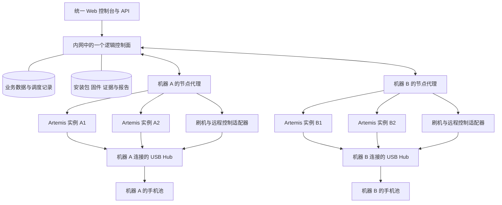

# Artemis 一站式 UI 测试平台需求草案

> 当前发布基线（2026-11-11）：平台名称为 Kraken，不提供工作区划分；默认免登录、免节点 Token；认证由部署方扩展；节点采用单进程 runtime 和中央状态对账，不依赖 SQLite。下文早期规划按日期保留，Google Workspace 内置登录、双进程节点等旧条目不再作为当前交付要求。

最新确认于 2026-11-11。控制面与节点在内网直接通信，移除节点 Token 认证，保留数据库密码、节点标识、命令归属与设备租约校验。平台默认免登录，LDAP 等用户认证由部署方按自身目录服务实现，扩展入口为独立身份与权限模块。此决定替代下文早期版本中平台内置 Google Workspace 登录及节点独立凭据的要求。

日期：2026-10-20。状态：D01、D02、D04、D06、D07、D10 已确认；D03 已确认约 3 台 Linux 节点、每节点约 20 部手机且必须并发执行，暂按每节点约 20 路、全平台约 60 路作为容量设计目标；D05 核心规则已确认：控制面维护最终用例，通过 Stable 指向稳定版本，仅“设为稳定版本”时更新指针，执行时读取当前 Stable。D06 采用文本操作步骤、受控 ADB 与 UI/日志检查，现有 Instrumentation 和 Python 测试转换为文本用例。D07 采用单设备独立执行、跨设备并发。D08 核心规则已确认：平台全流程、Fastboot 全量刷机、内网 Windows 共享目录/FTP 包来源、Linux 节点命令行接入；设备范围由 Case 约束或用于设备匹配的标签动态确定，无须预先列出固定机型清单。D09 核心规则已确认：固定定时任务由任务链配置决定操作，Freestyle 由平台 Agent 就未明确的刷机/清数据等操作询问用户。D10 已确认五项基础远控能力，执行期间只读，禁止人工接管或修改执行内容；仅设备空闲且未被任务占用时允许远控输入。D11 已确认包括断言失败在内，可按任务链配置有限次数重跑，保留首次结果及全部尝试。D12 已确认支持内网和云模型，自定义模型配置仅含 ID、名称、API schema、URL、Key、供应商、上下文窗口大小和思考强度。D13 核心已确认：统一工作空间，支持免登录且开放全部操作权限的开放模式，以及 Google Workspace 登录并按管理员/测试人员/只读成员授权的模式；认证与权限作为独立模块实现。D14 已确认录像策略选择 C：由任务配置是否全程录像，检查所需截图和日志始终采集并保存。证据默认期限可配置：全部首跑通过 3 天，失败/阻塞/证据不足及重跑后通过 30 天；结构化报告默认保留 3 个月。证据及报告导出文件集中保存到内网 NAS／共享存储；调用已配置云模型时允许发送测试所需的用例文本、设备截图和日志片段。D14 核心规则已确认。D15 已确认重叠策略选择 B：同一定时规则的上一轮未结束时，新触发任务排队，上一轮结束后按触发顺序执行；单轮内保留多设备并发。补跑策略也选择 B：调度恢复后，每条规则只补最近一次错过的触发，已有队列保留。APK/固件策略选择 B：每次触发解析符合条件的最新可用版本，记录具体输入；排队和同一 Run 重跑不静默换包。D15 核心规则已确认。D16 已确认首期同时交付飞书同步和 Excel 导入；飞书载体选择 A，仅接入普通电子表格（Sheets），多维表格（Base）不纳入首期。同步触发方式已确认支持手动和定时，两者均只生成预览，需人工采纳；其他外部集成后续逐项讨论。

建设目标是以一个统一控制面管理多台执行机器及其 Artemis 实例，让 App 和 Android OS 测试从用例维护、版本和设备选择、按需刷机、环境准备、调度、操作前确认、自动执行到结果复核均在平台形成完整流程；远控调试仅在设备空闲时进行。Artemis 继续承担设备上的智能操作和轨迹采集，平台承担业务模型、资源协调和结果治理，PhoneAutomationTest 提供刷机能力。现有命令行操作由节点适配器封装，日常测试通过平台完成配置、发起、监控和结果查看。

已确认采用独立的新平台仓库，Artemis 保持执行内核，不复用 Panoptes。平台仓库负责控制面、节点代理及执行适配；本草案已迁入独立的 artemis-platform 仓库。

实施拆解见[任务规划](task-plan.md)：12 个工作包、63 项开发与验证任务，包含依赖、交付物、完成条件和需求/验收映射。未决事项只影响对应任务，确认后更新相应范围。

本草案依据当前本地源码制定。除明确标为已确认的决策外，容量、时延、阶段划分及默认策略均为评审建议；不代表现有实现已经支持，也不代表真机验收结果。

## 1 当前能力与建设缺口

| 能力 | 当前本地源码基线 | 平台需要补齐 |
| --- | --- | --- |
| 执行入口 | CLI、MCP、HTTP 和轻量 Python 客户端；提交参数包含 goal、profile、device_serial、app_path 等 | 稳定的执行适配协议、能力协商、任务与用例映射、幂等提交 |
| 本机并发 | `DeviceExecutionLock` 使用文件与 PID 信息实现设备互斥和排队，支持不同设备并发 | 跨机器资源分配；多个实例、刷机、人工控制共用同一设备占用规则；隔离工作区不能各自认为设备空闲 |
| 本地任务 | 有内存队列、运行中任务集合、会话与轨迹存储、定向停止、恢复入口 | 中央持久化调度、节点重连对账、运行未知状态、按任务的控制语义 |
| 执行结果 | `run_outcome` 可包含检查项统计；客户端 `TaskResult.succeeded` 只判断 completed/success 状态 | 原始断言逐项映射、证据充分性检查、执行状态与测试结论分离 |
| 实时画面 | 当前 `DeviceStreamService` 枚举并选取首个在线设备；有实时截图流 | 每设备独立会话、低延迟输入、单一控制者、鉴权和执行期间只读规则 |
| 暂停与恢复 | `/api/resume` 没有任务参数，恢复逻辑移除共享 `PAUSE_FILE` | 多实例环境中以具体 attempt 为对象的暂停、确认停稳、恢复能力；不支持时明确拒绝 |
| 云端示例 | `playground/backend_manager` 有容器、用户会话和 Cuttlefish 分配相关实现 | 只能作为特定部署参考，不能直接视为物理设备实验室的生产控制面 |
| 刷机 | PhoneAutomationTest 的 `FlashEngine` 包含 HTTP/本地/SMB 包处理、解压、merge_super、按 SN 并行调用刷机脚本 | 脱离 Tkinter 的服务接口、固定包版本、受控取消、设备租约、刷后版本和健康校验 |

源码依据见文末。平台建设应优先增加适配层和必要扩展，保留 Artemis 现有 CLI、MCP、SDK 使用方式。

## 2 控制面与执行机器职责

已确认控制面与执行节点均部署在内网；当前执行节点均为 Linux，开发环境为 macOS。每个节点具备完整工具链和 Artemis，通过本机连接的 USB Hub 接入手机。机器 A、机器 B 分别代表这样的执行节点，组件关系按下图设计。

首期规模按约 3 台 Linux 节点、每节点约 20 部手机规划，总计约 60 部，并发执行是已确认的必要能力。结合设备规模，暂按每节点约 20 路、全平台约 60 路同时执行设计，这是容量目标，不是现有硬件的实测能力。平台提供全局和单节点并发配置；CPU、内存、USB、录像和模型服务需要按目标负载验证并补足资源，不能以串行排队替代并发能力。下图的 A、B 仅示意多节点结构，实际节点通过注册扩展。

节点代理是执行机器上的常驻管理服务，可以和 Artemis 一起安装。它管理本机实例、设备、刷机进程、远程控制会话以及断网时的证据缓存。

依据已确认的部署方式，设备发现、ADB/fastboot、UI 执行、刷机及画面采集均在手机所属节点执行；控制面通过节点协议派发和管理工作。节点注册时检查并上报工具链版本和可用性。控制面和执行节点部署在内网；模型服务按 D12 配置 URL，可接内网或云服务。接入时验证实际调用节点的网络可达性与鉴权，具体网络出口按部署环境配置。

USB 接入需记录设备与所属节点的关系；可获取时记录 Hub 和端口拓扑，辅助识别整组掉线。Hub/设备重新连接后重新核对设备身份与占用，不因连接恢复就自动释放运行中的设备；Hub 电源控制仅在实际硬件支持并纳管时提供。

开发与交付要求按两种环境划分：macOS 支持平台代码开发、本地启动、自动化检查及连接内网 Linux 节点联调；Linux 承担正式节点部署和真机集成验收。环境配置、文件路径和进程管理需要适配各自系统，设备工具链相关实现集中在节点适配层。USB Hub 多设备、ADB/fastboot、刷机、进程停止和断连恢复须在实际 Linux 节点验证；macOS 上的开发检查单独记录结果。

| 对象 | 职责 | 需要避免的混淆 |
| --- | --- | --- |
| 控制面 | 统一工作空间与成员权限、用例版本、计划与任务、调度策略、定时触发、中央资源占用、报告和审计 | 一个逻辑控制面不要求永远只有一个进程；将来增加副本仍须共享唯一调度事实 |
| 执行机器 Host | USB/ADB/fastboot、算力、存储、网络与模型可达性 | 一台机器可以运行多个 Artemis 实例 |
| 节点代理 Host Agent | 注册、心跳、实例监督、本机设备互斥、执行命令和事件上传 | 代理负责本机执行事实，不独立创建业务测试任务 |
| Artemis 实例 Worker | 固定版本与配置的执行服务，暴露可用并发槽位和能力 | 实例数、并发槽位数、手机数是三个指标 |
| 设备 Device | 稳定资产 ID、所在机器、ADB/fastboot 身份、实测机型/产品标识、系统、能力、设备标签、资源和占用 | 属性由节点采集上报，标签可配置；SN 或 IP:port 不是跨所有机器的唯一资产 ID，刷机切换模式要保持资产关联 |

建议节点主动连接控制面；任务指令、事件、文件上传与画面传输使用独立通道和限流，避免录像传输阻塞心跳。控制面数据库保存业务事实、结构化报告及文件索引；截图、日志、录像和报告导出文件集中保存到内网 NAS／共享存储；节点保留可恢复的本地执行日志和待归档缓存，完成校验归档后按策略清理。消息队列与具体数据库选型后续确定。

D04 已确认采用指定 SN、节点统一设备锁和独立执行进程。首期设备执行使用 Linux 宿主机进程模型，每个活动测试绑定一部手机，节点同时管理约 20 路执行；设备独占由控制面预占与节点原子互斥协同实现，不以每设备 Docker 容器作为执行边界。

节点为每次执行绑定稳定设备资产 ID、节点 ID、ADB endpoint 和当前 SN，在所有设备操作中显式传递目标。`adb -s` 用于选择目标设备，不能单独禁止另一个客户端操作同一设备。[Android 指定设备说明](https://developer.android.com/tools/adb#directingcommands)

| 层次 | 责任 |
| --- | --- |
| 控制面 | 持久化业务状态、任务与设备分配、占用记录及节点上报的事实；统一调度、取消和查询入口 |
| 节点代理 | 原子取得本机设备占用，绑定目标 SN，监督执行进程；协调测试、刷机、远控和维护，共享设备锁并上报状态 |
| Artemis 执行进程 | 执行绑定设备的测试，使用独立配置和工作目录，生成按 attempt 归属的事件与证据 |

执行要求如下：

- 控制面预占设备；节点原子取得本机占用后才启动独立执行进程。同设备上的测试、刷机和远控输入必须经过同一占用入口，其他设备可同时执行。
- 运行参数和 SN 通过各子进程独立环境及参数传递，配置、临时文件、端口、暂停/取消标记和证据目录按执行范围隔离。依赖按发布版本固定，任务不能临时修改共享安装环境。
- 当前 Artemis 已有按设备的跨进程文件锁，以及每任务启动子进程的实现，可作为适配基础。锁依赖共同的路径和目标标识；平台接入必须让统一节点占用与 Artemis 内部锁协同，不能每个隔离工作区各维护一份互不相见的设备锁，也不能重复取锁造成自锁。
- 设备不存在、身份不匹配或状态未知时拒绝执行，不回退到其他设备。拔插、重启及 ADB/fastboot 模式切换后保持资产关联并重新核对目标。
- 宿主机 ADB Server 由节点统一管理。服务重启、`adb kill-server` 等节点级操作只能由维护入口协调，不能当作某个 SN 的局部修复动作；进程终止和输出清理同样要精确定位。
- 刷机与测试按任务链在同一节点占用记录下交接操作权。人工远控仅在任务已结束、相关动作已停止、清理完成并释放设备占用后取得独立租约；暂停或等待状态不能开放人工输入。只读观看可以按采集预算并行进行。
- 进程退出、节点重启或设备失联后先对账、检查设备并恢复证据，再判断是否可释放设备；不自动重新执行结果未知的用例。
- 这是平台管理流程内的逻辑独占，不构成针对同权限外部进程的设备访问隔离。保留的 CLI/MCP、刷机和远控入口均须接入节点占用；D06 已确认文本用例可使用受控 ADB，操作决策按 D09 的任务链配置/Freestyle 确认模式执行，访问权限按 D13 的开放模式或登录角色模式处理。

控制面持久化业务状态、调度决策和节点上报的最新事实，是用户查询和操作的统一入口；节点代理保存本机执行记录并执行互斥与进程检查，不另建一套业务调度。状态至少分开记录执行进程生命周期、任务执行、设备连接/健康/占用：进程存活不能直接推导任务正在有效执行或设备健康。控制面发出启动/停止请求后，要等待节点确认实际变化；节点失联时保留未知状态，不能仅凭超时把同一设备重新分配。

运行环境使用固定版本的 Artemis、依赖和工具链；代码与依赖按发布版本安装，任务只写各自的工作目录。APK/固件缓存由节点维护并以只读方式提供，日志和证据按 attempt 独立持久化；需要修改的刷机工作文件使用执行批次专属目录。任务结束后清理临时状态与残留进程，保留未确认归档的证据。执行批次可以是一项任务分配给某设备的用例集合，环境复用与重置由任务链配置，重跑按 D11 的次数和准备/清理策略执行。

手机上的应用数据、权限、账号、系统设置和媒体文件仍由用例的准备/清理流程管理；重建执行进程或工作目录不会重置实体手机。

约 20 部手机节点的容量验证按同一 Artemis 版本和模型配置，分 1、5、10、20 路测量峰值内存、CPU、启动时间、单步延迟、任务完成耗时、录像/上传吞吐及设备掉线率。测量后设置进程资源预算并为节点服务保留余量；完成真实节点验证后才报告达到目标吞吐。测试并发与刷机并发分别设置；约 60 路测试目标不自动要求同时刷机约 60 部手机；D12 支持按 URL 配置内网或云模型，所选服务的实际吞吐需纳入容量验证。

## 3 业务对象与关联

D13 已确认平台使用一个共享工作空间。用例按 App/OS、模块和标签组织，设备按设备池及标签组织；这些分类用于检索和调度，不建立项目间的数据隔离。访问支持免登录全权限的开放模式，以及 Google Workspace 登录后按管理员、测试人员、只读成员授权的模式。认证与权限独立成模块，业务模块通过统一接口获取访问者和操作权限；登录模式的成员准入及具体接入配置在接入阶段细化。

| 对象 | 必要信息与规则 |
| --- | --- |
| 工作空间 Workspace | 单一共享工作空间；成员共享用例、任务、设备池、模型配置和报告，统一管理运行限额与数据保留策略；不按项目划分访问边界 |
| 访问上下文 Access Context | 由独立认证与权限模块提供当前访问模式、主体类型、主体/会话标识及操作权限；开放模式使用匿名主体与独立会话标识，登录模式关联 Google Workspace 成员；业务记录不强制依赖真实登录用户 |
| 模型配置 Model Configuration | 用户配置 ID、名称、API schema、URL、Key、供应商、上下文窗口大小、思考强度；控制面管理配置记录和密钥引用，任务使用选定配置 |
| 测试对象 Test Target | 每个用例版本选择 `APP` 或 `ANDROID_OS`；按对象类型填写对应的模块与版本范围 |
| App | 名称、包名、负责人、模块；发布版本关联实际 APK 元数据、签名信息、versionCode 和文件摘要 |
| Android OS | 产品/机型、系统分支、构建标识、fingerprint、Android 版本、区域；关联固件摘要和适配刷机方案 |
| 用例容器 Case | 稳定 case_id、唯一编号、名称和 stable_version_id；用例内容与状态保存在版本中。Stable 指向该用例当前稳定版本，仅通过“设为稳定版本”操作更新；未设置时为空 |
| 导入/同步批次 Import Batch | 来源类型与位置、源快照/文件摘要、字段映射、来源用例标识、逐条预览/差异/错误、采纳结果和目标 Case/Case Version；重复提交与重试可去重，保留操作归属 |
| 用例版本 Case Version | 每次新增或修改保存形成的独立内容实体，包含设备适用约束/匹配标签、文本操作步骤、UI/日志检查、前置条件、清理等完整定义及创建者、时间和来源；历史实体不原位覆盖 |
| 测试集 Suite 与版本 | 一组 case_id、顺序、参数、共享准备范围、失败后策略；测试集配置版本化，用例内容在执行时读取各自当前 Stable |
| 测试计划 Plan | 测试目标、测试集、版本矩阵、设备选择规则、任务链和报告要求，可重复使用 |
| 测试任务 TestTask | 可复用的用例集合与执行配置容器。先创建名称/说明，再通过含筛选条件的弹窗添加已启用用例，最后配置定时、并发/顺序、刷机及重试等规则；可调整用例顺序或移除，保存配置版本，创建本身不执行 |
| 任务链 Task Chain | 准备、按需刷机、初始化、用例执行和清理等阶段的顺序、条件、参数、允许操作范围，以及失败类型、最大重跑次数、重跑准备/清理策略和录像开关；配置版本化，实际运行保存所用链路配置 |
| 执行批次 Run | 测试任务的一次手动/API/定时触发，冻结任务配置版本和有序用例集合，历史批次不随任务修改而变化；保存任务链/Freestyle 执行模式、计划、环境、模型、调度和录像配置。引用用例时只保存 case_id，不在提交时绑定具体用例版本 |
| 用例运行 Case Run | 一个用例容器 × 一个环境组合 × 一个重复序号；可包含多个 attempt，各次实际执行读取当时的 Stable |
| 执行尝试 Attempt | 一次真实执行，绑定一台机器上的一个实例、一部手机、租约、引擎 trace/session 和证据；各设备独立执行，重跑新增记录 |
| 环境规格 Environment Spec | 用例设备约束与标签规则、App/OS 目标版本、设备能力、语言、区域、网络、SIM、账号和准备/清理策略；区分设备固有能力与可通过准备流程达到的环境 |
| 刷机任务 Flash Job | 可独立运行，也可作为测试准备依赖；绑定设备、固件摘要、方案版本和授权范围 |
| 定时规则 Schedule | 时区、触发规则、计划及任务链配置版本、重叠/补跑策略、启停与运行记录；重叠默认排队，同一规则按触发顺序串行启动各轮任务，单轮内可多设备并发；调度停机恢复默认每条规则只补最近一次错过的触发 |
| 操作确认 Operation Confirmation | Freestyle 中的平台 Agent 询问及用户答复，关联任务/阶段、目标设备、操作参数、影响范围、操作者和确认状态；供控制面校验后执行 |
| 设备租约 Lease | 持有者、用途、有效期、递增代次；测试、人工写操作与刷机共享互斥规则 |
| 证据 Evidence 与复核 Review | 对应原始 step/assertion、采集时间、设备、attempt、摘要；复核结论追加保存 |

例如：Settings 的亮度控制属于 Android OS；应用通知可关联 App 与 SystemUI；拨打电话涉及 Telephony 与 SystemUI。单部手机上的 OS 测试可以覆盖多个系统模块，不能被强制限制在单一包名内。

版本矩阵展开前显示数量和资源需求。例如 20 个用例 × 3 个 OS 版本 × 2 种语言 × 2 次重复产生 240 个 Case Run；设备池大小影响并发，不默认再乘以池内设备数。测试全部设备与按规格选取设备必须是两个显式选项。

## 4 用例与环境管理需求

以下需求 ID 可用于后续拆分开发任务。优先级：P0 为可信执行闭环必须具备，P1 为一站式平台完整能力，P2 为规模化增强。

### 4.1 结构化字段与基础数据（2026-10-21 补充）

用户确认 App 使用 **App 自身版本**，不使用 Android 版本和芯片平台。两个类型的字段如下：

| 字段 | Android OS | App |
| --- | --- | --- |
| 编号、名称、模块、测试目的、前置条件、步骤、预期结果、级别、状态、适用机型 | 支持 | 支持 |
| 适用 Android 版本、适用芯片平台 | 支持 | 不提供 |
| 所属 App、适用 App 版本 | 不提供 | 支持；模块与版本必须属于所选 App |

基础数据入口维护系统模块、App、App 模块、App 版本、Android 版本、机型、芯片平台，提供新增、编辑、启用、停用和删除未引用条目。已被版本或子级引用的条目不能删除；停用后不能用于新版本，历史版本保留原名称和引用。名称变更不能改写历史内容。

当前实现约定：编号跨版本固定且大小写不敏感唯一，可自填或自动生成；模块、测试目的、步骤、预期结果必填。级别先提供 P0–P3，状态先提供草稿、启用、停用。机型及版本等范围支持多选，留空表示不限，同一维度任一匹配、不同维度同时匹配。App 版本维护的是用例适用范围；APK 文件、摘要及安装流程仍由后续包管理实现。

用例列表按最新编写版本提供服务端组合检索和分页：编号、模块、级别、测试目的、状态，以及 OS 的 Android 版本或 App 的自身版本；App 另可按所属 App 筛选。执行仍读取当前 Stable，列表展示最新版本不代表该版本已供执行。草稿、停用的 Stable 不能开始新执行；保存一个停用版本不会自动移动 Stable 或终止已有执行。

### 4.2 版本、导入与环境规则

D05 核心规则已确认：飞书同步或 Excel 导入后，由控制面维护最终内容。用例本身是稳定容器，新增或修改产生具体版本实体；保存版本不改变 Stable，只有显式“设为稳定版本”才移动 Stable 指针。执行时直接读取当前 Stable，无需逐次选择或预先绑定版本。D16 已确认首期同时交付飞书普通电子表格（Sheets）同步和 Excel 导入；同步触发支持手动和定时，两者均先生成预览、经人工采纳后形成平台版本，不默认向飞书回写。

用例与执行关系按以下规则设计：

- Case 保存稳定身份和 stable_version_id；Case Version 保存完整内容及来源信息。Stable 必须指向同一 Case 下的有效版本。当前稳定版本以此唯一指针为准，不能用最大版本号、最新创建时间或多个版本上的独立标记替代。
- 新增、编辑保存或导入采纳只产生新的版本实体，历史内容保留，Stable 保持不变。选择某个已有有效版本并执行“设为稳定版本”时才更新 Stable；首次导入也遵循此规则。尚无稳定版本的用例不能进入实际执行；无须默认添加审核环节，开放模式下所有访问者均可设置稳定版本；登录模式下管理员和测试人员可设置，只读成员不可设置。
- 测试集、计划和任务引用 case_id。按每个 attempt 开始准备前读取一次当前 Stable 设计，同时检查对应的设备、能力和参数要求；排队期间的 Stable 更新对尚未开始的执行生效。读取失败或没有可用 Stable 时阻塞，不使用节点缓存中的旧版本代替。
- 本次执行使用读取到的完整内容，执行过程中不逐步重新读取 Stable 替换步骤。后续重跑、新 attempt 和其他尚未开始的用例再次读取当前 Stable；暂停后继续同一 attempt 沿用已读取内容。
- 历史报告保留执行时实际采集的步骤、断言和证据，不能按查看报告时的 Stable 重建历史结果。报告留痕不要求任务预先绑定版本，也不要求重跑固定使用旧版本；比较结果时应提示用例内容差异。
- 建议设置稳定版本时原子更新 Stable，并校验操作发起时的指针值，避免多人同时设置造成静默覆盖；记录操作者、时间、变更原因和前后指向。保存新版本与设置稳定版本是两个独立操作。

| ID | 优先级 | 需求与验收行为 |
| --- | --- | --- |
| CASE01 | P0 | 支持统一工作空间 → App/OS → 模块 → 用例组织、标签和负责人；明确区分分类标签与设备匹配标签，只有配置为筛选条件的标签参与调度。创建 App/OS 与模块使用简短表单，用例使用完整编辑页。组合筛选由服务端执行，分页不能造成漏查。 |
| CASE02 | P0 | 用例保存目的、优先级、设备适用约束/匹配标签、前置条件、准备步骤、文本操作步骤、每步预期、最终检查和清理步骤；机型限制是可选条件，通用用例可按能力或标签匹配。每个步骤、检查项有稳定 ID；检查声明 UI、日志或二者组合及判定规则。导入、代码用例迁移和 AI 整理不得默默删除或弱化原始操作与断言。 |
| CASE03 | P0 | 用例采用稳定容器、不可变内容版本和 Stable 指针；每次新增或修改保存形成新实体，保存不改变 Stable，仅“设为稳定版本”才更新指针。任务无需绑定版本，实际执行读取当前 Stable；尚无稳定版本时阻塞。支持查看历史与差异、停用和归档，并发编辑或设置稳定版本时提示冲突，不默认添加审核流程。 |
| CASE04 | P0 | 用例统一使用文本操作步骤，由 Artemis 执行 UI 操作并使用受控 ADB 完成必要的环境准备、操作与证据采集；检查支持 UI、日志或二者组合。现有 Instrumentation 和 Python 测试须迁移为文本步骤及检查定义，平台不直接作为这些测试代码的运行器。能力不足在预检或准备阶段标记 BLOCKED，不在运行中静默降级。 |
| CASE05 | P0 | 参数区分普通值、数据集、运行变量和密钥引用；顺序为工作空间默认、环境、计划、显式运行覆盖，最终解析结果冻结。密钥只记录引用和版本，不进入明文报告。 |
| CASE06 | P0 | 首期同时支持飞书普通电子表格（Sheets）同步和 Excel 导入，用例经任一入口进入平台后由控制面维护最终内容；两个入口共用用例容器、版本、Stable 和来源追溯规则。接入支持字段映射、预览、稳定来源 ID 与重复检测、逐行错误；保留来源原文、位置和版本，无原生版本时保存文件摘要或同步快照。再次接入展示与平台内容的差异，采纳后的改动形成新版本，不原位覆盖平台历史；导入和同步本身不移动 Stable，采纳后的版本需另行设为稳定版本才供后续执行使用。来源删除不自动删除平台用例。 |
| CASE07 | P1 | 测试集按 case_id 组织用例，支持顺序、独立并行、参数化和版本差异查看；各用例执行时读取当前 Stable。用例依赖显式声明；禁止依赖上一次运行碰巧留下的设备状态。 |
| CASE08 | P1 | 模块知识、操作指导和工具能力单独版本化，执行前组装到 Artemis 上下文；保留组装结果摘要。知识规则不得覆盖原始预期结果。 |

D16 已确认首期同时交付两个用例入口：

- 飞书电子表格同步：登记 Sheets 来源，选择工作表、表头/数据范围并映射用例字段，读取来源内容、展示与平台版本的差异，采纳后新增 Case 或 Case Version。首期只接入普通电子表格，不接入多维表格（Base）；手动及定时读取均支持，定时读取也只生成待采纳预览，不自动更新平台版本或 Stable。来源编号字段与来源范围共同定位用例，插行或排序不应产生重复用例；缺少编号或编号重复时在预览中提示，不能静默按行号或标题覆盖平台内容。
- Excel 导入：在平台上传文件，选择工作表并配置字段映射，预览解析结果及逐条错误后采纳有效内容；保留原文件摘要、工作表和来源位置。文件解析失败不影响已存在的用例。
- 两者使用统一导入批次和字段校验，完整保留目的、准备、原始步骤、UI/日志断言及清理内容。来源编号与来源范围共同标识用例，不仅凭标题或可变行号匹配；跨入口指向同一 Case 时明确展示对应关系和差异，无法确定时不自动合并。
- 同一批次重试不得重复创建 Case 或版本；来源内容未变时记录同步/导入结果，不制造新的内容修改。存在修改时展示差异，采纳为新版本；批次展示新增、更新、未变化、冲突和错误记录及原因。
- 两个入口都不自动修改 Stable；首次导入也需要显式设置稳定版本后才可执行。平台内编辑保留为最终内容，后续来源更新不直接覆盖它；来源删除不删除平台历史，不默认向飞书回写。

飞书 Sheets 同步和 Excel 导入均属于首期交付验收，不能以其中一个可用替代另一个完成。飞书来源访问凭据与权限按来源配置，不要求平台使用者必须改用飞书登录，开放模式和 Google Workspace 登录模式均可使用已配置的同步入口。具体表格样例、字段映射模板、读取一致性与批量上限在接入设计中细化。

环境准备与清理要求如下：

| ID | 优先级 | 需求与验收行为 |
| --- | --- | --- |
| ENV01 | P0 | 按用例约束或匹配标签动态选择设备，可涉及机型/产品标识、能力、OS、App、语言、网络、SIM/运营商、root/解锁状态等。约束与设备筛选标签同属版本内容，随 Stable 生效。区分设备固有能力与准备后的目标环境：存在可满足目标的已支持准备方案时可进入准备，完成后核对实际状态；不满足时展示原因。安装后读设备上的真实包信息校验。 |
| ENV02 | P0 | 准备流程支持安装被测 App 和所需辅助应用、授权、测试数据、系统设置、辅助服务及日志采集准备。各项以文本描述目标和完成条件，由受控节点工具执行并核对结果；迁移用例中原有 setup/teardown 必须落实为可执行的准备与清理步骤。 |
| ENV03 | P0 | 清理记录每项状态；失败时尽量执行已授权且安全的清理。清理失败不改写已证实的测试断言，但设备不能自动回到可调度池。 |
| ENV04 | P1 | 建立账号、SIM 和其他实际需要的共享资源目录及互斥占用。账号不可同时分给不兼容任务；OTP 等瞬时数据绑定具体执行、步骤和超时。通话用例配置适用运营商、SIM 及客服电话参数，执行前核对所需电话服务条件。 |

D06 已确认采用统一的文本用例模型，操作与检查分别描述：

- 操作说明在哪个前置状态下完成什么动作及其参数，由 Artemis 使用 UI 和受控设备工具执行。已有 Instrumentation、Python 测试迁移时，需逐项保留准备、动作、原始断言、清理及其来源对应关系；转换为文本不代表已完成真机验证。
- UI 检查描述页面、文本、控件或视觉状态及预期，保存对应截图或界面证据。日志检查描述来源、采集范围、步骤关联、时间窗口和匹配规则，保存原始片段及判定依据；可按用例要求组合 UI 与日志检查，并明确是否两者都必须满足。
- 日志必须对应本设备、本次执行及相关步骤，避免用历史日志证明当前操作成功。完整窗口内不满足预期可判 FAIL；采集缺失或证据不足时标记 INCONCLUSIVE，不能把“没有采到”直接当成检查通过。
- 迁移时遇到代码内部对象、mock 状态或其他无法映射到真实 UI/日志的断言，保留原始意图并标记迁移缺口；已知缺少验证能力时阻塞执行，不能删除断言或用相似 UI 现象替代。音视频、传感器等结论同样必须有足以支持原始预期的 UI/日志证据。
- 迁移完成的文本内容作为新版本保存在控制面，设为稳定版本后供执行使用。节点上的 ADB、刷机和日志采集仍由平台工具实现；现有测试代码不会作为另一条用例执行路径直接运行。

设备匹配按以下规则设计：

- 节点上报机型、产品标识、OS 和可检测能力；平台可维护设备标签。用例通过结构化约束或设备筛选标签表达适用范围，未声明机型限制的用例可匹配所有满足其他条件的设备。
- Case 的设备约束与筛选标签保存在版本实体中，设置 Stable 后生效。模块、冒烟、回归等分类标签仅用于用例组织；参与设备筛选的标签需显式配置，并明确组合规则。
- 候选设备同时满足任务设备范围、用例条件、当前访问模式下的操作权限、设备健康与占用要求；如需刷机，还需满足固件/方案的产品兼容条件和节点能力。可经安装或刷机达到的 OS/App 目标由准备方案保证，并在准备后验证。
- 预览显示逐用例匹配结果及排除原因；实际开始前依据当时 Stable 和最新设备事实重新校验。指定 SN 时始终受该限制，其他情形可在允许设备池中重新匹配；不得默默放宽条件。

## 5 任务与测试过程管理需求

| ID | 优先级 | 需求与验收行为 |
| --- | --- | --- |
| RUN01 | P0 | 先创建测试任务（用例集合），再通过弹窗浏览全部已启用用例并按编号、名称、模块、级别、测试目的、对象和 Android/App 版本筛选，支持分页、多选和跨筛选保留选择；任务内支持移除及排序。随后配置手动/定时、并发/顺序、刷机要求、失败重试等执行规则，保存后才生效；空任务不能执行。每次触发生成独立 Run，保存配置快照；编辑任务不改变历史或排队批次。用例引用容器，不要求选择具体版本，执行前校验可用 Stable。完整任务链后续还需提供 App/OS 目标版本、环境矩阵、设备池/指定设备及录像配置，提交前预览匹配设备、排除原因、展开数量、刷机/清理影响和资源不足。执行开始时重新读取当前 Stable 并重新校验设备，不放宽条件。 |
| RUN02 | P0 | 任务链和 Freestyle 共用同一任务服务；手动、API、定时、CI 为触发来源，与执行模式分别记录。固定定时任务使用已配置任务链；Freestyle 对话形成任务操作计划，引用已有 Case 时沿用 Stable 规则。幂等键重复提交只返回同一任务，各入口共用设备调度、占用和结果记录。 |
| RUN03 | P0 | 支持顺序、分片、全量矩阵、循环次数、超时、失败后继续/停止、指定设备。指定设备不可用时排队或失败，绝不替换成另一台同型号设备。 |
| RUN04 | P0 | 运行视图展示队列、准备、刷机、执行、断言、清理、上传和汇总各阶段，显示当前原始步骤、尝试次数、设备、实例及等待原因。AI 自主动作数量不等同于已完成原始用例步骤数。 |
| RUN05 | P0 | 取消按任务/Case Run/attempt 定位，返回已请求、执行端确认、清理中、已结束等事实；请求返回成功不等于手机动作已停止。超时采用执行器声明的取消策略。 |
| RUN06 | P1 | 暂停分为暂停派发和暂停某次执行；暂停不开放人工远控或执行内容编辑。执行暂停必须得到安全点确认，等待模型响应或不可中断命令时展示 pending。恢复前重读设备状态；不支持可靠续跑时建立新 attempt。已取消或结束的执行不能在人工调试后续接原 attempt。 |
| RUN07 | P0 | Freestyle 中平台 Agent 在刷机、清数据等未明确操作开始前展示方案并询问用户，以 waiting_human 记录待确认；确认后在范围内自动执行，不重复询问。控制面保存确认/拒绝及参数并校验派发，重复答复不重复执行。已启动的 Case 不允许人工遥控、接管或追加指令改变执行内容；调整目标或操作范围须结束受影响的执行，再为后续任务/attempt 确认方案。 |
| RUN08 | P0 | 支持包括断言失败在内的失败按任务链配置有限次数自动重跑；最大重跑次数不含首次执行，0 表示不自动重跑，达到上限或通过即停止。每次创建新 attempt 并读取当时当前 Stable，重新校验用例内容、依赖和环境，按配置完成准备/清理；保留首次结果及全部尝试。内容变化时提示差异，不解释为同一版本的恢复；不从未经验证的任意中间步骤恢复。取消及结果未知状态不能直接触发自动重跑。 |
| RUN09 | P1 | 广告/权限等允许的干扰恢复有明确场景、次数、动作和时间预算。记录恢复前失败、恢复行为及 `recovered`；遇到被测功能异常或预算超限停止恢复，不能通过绕过缺陷获得 PASS。 |
| RUN10 | P0 | 首期每个用例独立在一部手机上执行，多部手机、多个节点之间并发调度；同一用例需要覆盖多台设备时展开为独立 Case Run。首期不实现主叫/被叫角色编排、设备成组预占和跨手机步骤同步。通话界面测试使用本机拨打配置的运营商客服电话，检查后执行挂断清理。 |

D07 已确认单设备独立执行，不改变 D03 的多节点、多设备并发目标。通话用例示例为：核对 SIM 与电话服务条件 → 打开拨号界面 → 拨打用例配置的运营商客服电话 → 按预期检查本机通话界面并保存 UI 证据 → 挂断并确认通话结束。检查项可包括号码或联系人显示、通话状态及挂断控件，具体以用例定义为准；该场景的验收目标是本机通话界面。

D11 已确认自动重跑允许覆盖断言失败，具体按任务配置执行：

- 最大重跑次数指首次执行以外可新增的尝试数，例如配置 2 次重跑时，最多执行 3 次；0 表示关闭自动重跑。成功、次数用尽或任务取消时停止自动重跑。
- 重跑以完整用例为单位，新建 attempt，重新读取当前 Stable 并按任务链完成所需准备/清理；重跑间隔、适用失败类型和环境复用策略可配置。是否再次刷机或清数据由链路显式决定，重跑本身不自动扩大操作范围。
- 上一次设备动作必须已结束，依赖、设备健康和环境满足条件后才能开始下一次；失联、刷机结果未知或清理失败时先对账/恢复，不能直接并行启动替代执行。基础设施重试与模型调用重试分别计数。
- 首次失败、每次尝试和最终结果分别展示；失败后通过标记“重跑后通过”。Stable 内容或环境已变化时明确提示，保留每次实际执行内容和证据。Freestyle 的重跑次数及涉及操作应在开始前明确，并遵守 D09 的确认范围与 D10 的无人介入要求。

D09 的两种执行模式共用任务状态、节点调度、设备租约和结果体系：

- 固定定时任务使用任务链配置，声明设备范围、固件选择规则、是否刷机/清数据、初始化、用例执行和清理条件。启动后保存本次链路配置，范围内自动执行；Case 仍在实际执行时读取 Stable。新用例内容若要求超出链路范围的操作，按配置不匹配阻塞并显示原因，平台 Agent 不临时扩大范围。
- Freestyle 由平台 Agent 根据用户目标提出具体操作方案。常规 UI 操作按用户目标执行；刷机、清数据等尚未明确的操作，先展示实际设备、固件/方案、动作及影响范围，待用户确认后继续。用户可以一次确认清楚列明的一组操作，覆盖范围内无需重复询问。
- Freestyle 确认结果由控制面持久化并关联任务和操作参数，节点执行前校验；拒绝、超时未回复或连接中断都不视为确认。等待期间以 waiting_human 展示，超时策略需可配置；重复答复按同一请求处理。相关操作开始前，设备、固件或影响范围不再被原确认覆盖时重新询问，并重新校验设备与资源。已开始的 Case 若需改变执行内容，结束受影响的执行后为后续任务/attempt 确认；waiting_human 不开放设备远控输入。
- 两种模式均执行已配置的权限和设备兼容规则。任务链的配置与用户确认决定操作范围，用例 Stable 只决定当前测试内容；具体解锁、debug 变更等能力需由方案声明，不从一般刷机配置推导。

推荐把执行和判定分开存储：

- 执行状态：queued → reserved → preparing → running → finalizing → finished；另有 waiting_human、cancel_requested、cancelled、error、needs_recovery。只有适配器具备能力且已确认停稳时才显示 paused。
- 断言结果：PASS、FAIL、BLOCKED、INCONCLUSIVE、NOT_RUN、NOT_APPLICABLE。已执行但证据不足为 INCONCLUSIVE，前置条件不满足为 BLOCKED，有足够证据证明不符预期才为 FAIL。
- 其他独立信息：清理状态、证据完整度、操作前确认记录、已知外部干预、是否恢复、是否允许释放设备、失败归因与错误代码。

一个用例只有全部必需断言得到合格证据且通过，才能判为 PASS。必需断言被跳过、缺少证据或执行数量不符时不能通过。执行结束后出现基础设施错误可以与已确认的 FAIL 同时存在；保留两个维度，不能用统一红绿状态覆盖事实。

人工复核只追加复核结论、理由和证据，不修改原始模型/规则结果。执行期间禁止人工介入；如发现外部干预，记录影响并复核证据有效性，不能当作正常的无人干预自动通过。操作前确认与执行中干预分开记录。发布准入的证据、清理和恢复要求仍由 D18 确认。

## 6 多实例和多机器调度需求

| ID | 优先级 | 需求与验收行为 |
| --- | --- | --- |
| SCH01 | P0 | 机器注册后上报位置、系统、版本、CPU/内存/磁盘、ADB/fastboot、模型可达性、设备和 Worker 能力。节点授权可撤销，过期信息标记 stale。 |
| SCH02 | P0 | 在工作空间共享设备池/任务指定范围内，按 Case 当前 Stable 的设备约束与标签规则匹配设备；同时满足实例在线、槽位、设备健康/占用和模型配额条件。返回具体属性或标签不符、无槽位、模型限流等原因；必需属性未知时不能视为匹配。 |
| SCH03 | P0 | 全局队列按优先级、公平性和提交时间分配，支持任务并发上限、机器上限和优先级老化。缓存命中可作排序因素，不能违反设备/系统版本等硬约束。 |
| SCH04 | P0 | 同一物理设备的测试、刷机、人工输入、安装和维护共用排他租约。只读观看可以并行，但必须控制采集开销。设备所有入口均受本机代理约束。 |
| SCH05 | P0 | 控制面预占、节点确认、本机锁获取、开始执行分阶段记账；指令包含 attempt_id、command_id、设备 ID 和租约代次。重复投递不能重复启动，过期指令必须拒绝。 |
| SCH06 | P0 | 未开始任务在确认未启动后可重排；已开始但失联的任务进入 needs_recovery。控制面超时不能证明原进程已停止，因此不能立即把同一设备交给新任务。 |
| SCH07 | P0 | 节点持久化开始记录、进程身份、状态与事件序号。重连后按已确认序号补传、去重、对账；控制面重启不能清空任务或自动重放运行中任务。 |
| SCH08 | P1 | 支持节点维护、排空和版本升级。排空后停止接收新任务，现有任务按策略结束；Worker 崩溃后先检查进程与设备，再释放资源。 |
| SCH09 | P1 | 设备独立记录连接、纳管、健康、占用状态；在线不等于健康或空闲。离线、未知、清理失败、刷机异常设备不可自动调度，恢复后要健康检查。 |
| SCH10 | P1 | 控制全局模型请求并发、速率和运行预算，同时限流本机截图、录像、USB、下载和刷机；这些属于平台调度策略，不增加 D12 模型表单字段。模型排队不应引发无限占用，可按任务策略在安全点结束。 |

节点设备锁在所有执行进程间统一，不能随工作目录隔离为互不相见的多份。接入时要让现有 Artemis 锁与节点租约协同，避免节点先获取锁、内部 Worker 再排队等自锁问题。平台管理中的设备不允许通过未纳管入口绕开占用；若保留本地 CLI/MCP，也应通过同一代理或共享租约入口。

失联默认策略建议为：节点停止领取新工作；普通 UI 执行在预设本地期限内到安全点停止并保留证据与设备占用；刷机关键阶段按照刷机方案继续到可停止点。控制面将状态标记为未知，不迁移正在进行的手机交互。确认旧执行终止并完成检查后，才允许开启新 attempt。

## 7 定时任务需求

| ID | 优先级 | 需求与验收行为 |
| --- | --- | --- |
| TIME01 | P1 | 支持一次性、每日、每周和 Cron，显式保存时区、开始/结束日期、下几次触发时间、负责人；夏令时重复或缺失时刻要有确定策略。 |
| TIME02 | P1 | 每个触发时刻拥有唯一触发 ID；调度服务重启或重复投递只创建一个 Run。规则编辑、停用、删除不删除历史运行。 |
| TIME03 | P1 | 重叠策略支持跳过、排队、限制并行，默认采用 D15 已选 B：同一规则的上一轮未结束时，每次有效新触发各自持久化入队，按触发时间顺序在上一轮结束后启动，不合并或静默跳过。单轮内仍按计划多设备并发，不同规则共用资源调度。补跑策略支持不补、只补最近一次、有上限补跑，默认采用 D15 已选 B：调度服务恢复后，每条有效规则只补最近一次错过的触发，加入同一持久队列；已有队列继续保留。 |
| TIME04 | P1 | 区分等待上一轮结束与无可用设备，分别展示排队原因和时长。支持配置队列上限、排队期限及资源等待超时，具体默认值在配置设计中确定；超限或超时必须留存明确状态和原因，不静默丢弃触发。可配置维护窗口、节假日和通知条件；任务失败、失联及需要人工处理才触发相应通知。 |
| TIME05 | P1 | 固定定时任务按任务链配置自动决定是否刷机、清数据、安装和初始化，保存本次所用链路配置；缺少必需配置或超出范围时阻塞并记录原因。用例按 case_id 引用，在各次执行开始时读取当前 Stable。APK/固件采用 D15 已选 B：每次触发解析符合配置条件的最新可用版本，并保存具体工件身份、来源、版本与校验信息；排队和同一 Run 重跑沿用已确定的包。无法解析或已选包校验失败时阻塞，不静默换成旧包或另一个新包。 |

D15 已确认同一定时规则的重叠处理选择 B，默认排队：

- 每次正常触发产生独立触发记录及对应 Run，以规则 ID 和计划触发时刻去重，按触发时间顺序进入持久队列。重复投递不会追加一份相同任务，后续正常触发不合并为“只保留最新一次”。
- 同一规则上一轮尚未结束时，后续各轮只等待，不预先占用设备。上一轮的配置内重跑仍属于该轮；上一轮完成或真正取消、相关设备动作停止并完成清理与状态对账后，队首任务才可进入设备调度。取消请求已接收不等于上一轮已结束，执行状态未知时先对账。
- 规则级排队不改变一轮内部的跨设备、跨机器并发，也不要求其他定时规则等待；所有实际启动继续遵守设备互斥和平台资源上限。
- 队列展示计划触发时间、入队时间、等待原因、顺序及实际开始时间；控制面重启后恢复队列，避免重复启动。任务链等配置按 Run 保存的生效配置执行，用例仍在每次 attempt 实际开始时读取当前 Stable。
- 正常触发后的排队与调度服务停机期间错过触发分别处理：已有队列按原顺序恢复，不合并或删除；尚未生成的错过触发按以下补跑策略处理。队列超限和排队期限的默认值在配置设计中细化。

D15 已确认停机恢复的补跑处理同样选择 B，默认每条规则只补最近一次：

- 调度服务恢复后，依据持久化检查点、规则时区和有效区间，计算停机期间错过的触发；仅为最近一次未生成任务的有效触发创建补跑 Run，记录原计划触发时间和实际补建时间。人为停用的时段不作为服务停机漏触发补跑。
- 较早错过的触发记录为未补跑，可按区间汇总原因，并持久化本次已处理到的截止时刻；再次重启不得逐次把此前已决定不补跑的旧触发重新补出。
- 补跑与正常触发使用同一规则 ID/计划触发时刻去重；补建任务和推进检查点须保持一致，避免恢复中途再次重启或与正常触发竞争时产生重复 Run。已经入队、执行或结束的触发不重复补建，正在执行但状态未知的任务先对账。
- 补跑任务加入原有持久队列，按原计划触发时间排序，不抢占正在执行的上一轮；仍遵守同一规则逐轮启动、单轮内多设备并发的规则。节点失联但控制面已正常创建的任务属于已有任务恢复，不再为同一触发另建补跑任务。
- 补跑不放宽任务链的操作范围、设备匹配和用例 Stable 规则；包版本按以下已确认的触发时取最新策略处理。

D15 已确认定时任务的 APK/固件选择 B，每次触发获取符合条件的最新可用版本：

- 任务链声明所需 App/OS、包源及筛选条件。按各目标环境组合选择适配的最新版本，不能跨不同产品、分支、区域或 App 把所有包作一次全局排序；具体字段按包源元数据和现有命名规范适配，不要求用户预先维护固定机型清单。
- “最新可用”须同时满足发布完整、可获取及目标兼容要求。排序依据采用明确的构建版本或发布时间规则，并记录筛选/排序依据；不以目录中第一个文件代替，不在候选身份或顺序有歧义时猜选。新包仍在上传时不作为可用候选。
- 正常触发在创建本轮任务时解析并记录所选具体包，保存解析时间、来源、工件/构建身份、版本、大小和摘要等校验信息。包源缺少稳定身份或摘要时，先对所选包做受控入库与校验后固化输入，未完成校验不得安装或刷写；不为确定最新版本批量下载整个包源。
- 排队等待、重复触发投递、控制面重启及同一 Run 的自动重跑使用已记录的包。新发布不修改已有任务输入；同名路径内容变化、包消失或下载校验不符时明确阻塞，不静默换包。下一次正常触发会重新解析最新可用版本；没有新包时可以再次使用仍符合条件的同一版本。
- 停机补跑在恢复后实际补建任务时解析当时最新可用包，同时保留原计划触发时刻和实际解析时间；不声称它就是停机时原触发点的最新版本。停机前已入队的任务继续使用原包记录。
- 用例仍在每次 attempt 实际开始时读取当前 Stable；排队期间 Stable 变化导致其要求与已选包不兼容时，按环境校验明确阻塞，不擅自改用例或换包。触发时取最新只决定所用包，不自动增加任务链未配置的安装、刷机或清数据操作。

手动选择具体 APK/固件及独立刷机流程继续保留。具体包源字段、排序适配、发布完成标记与受控缓存容量在接入设计中细化。

测试定时规则属于平台数据，节点只执行控制面下发的具体任务，避免每台机器维护独立 Cron 后发生重复执行。

## 8 远程手机控制需求

D10 已确认首期远控范围为实时画面、点击、滑动、文字输入和系统按键，采用仅空闲时操作的模式。测试执行过程只允许观看，禁止人工遥控、暂停后接管或追加指令修改执行内容。音频、多指、独立长按/拖动操作、剪贴板同步和远控文件传输不列入首期交付；用例和固件的文件管理仍按各自模块需求实现。

| ID | 优先级 | 需求与验收行为 |
| --- | --- | --- |
| REM01 | P1 | 设备墙与详情页按资产 ID 打开准确设备，展示画面时间、延迟、分辨率、旋转、状态及占用者。断流时标记冻结画面，不能把旧截图展示成实时。 |
| REM02 | P1 | 首期输入能力为点击、单指滑动、文字输入和 Home/Back/最近任务/音量等系统按键。坐标随显示缩放和设备旋转正确映射；文字输入验证中文、英文、数字及常见符号。输入只发送到所选设备及当前获权会话，平台展示发送失败或连接中断状态。 |
| REM03 | P1 | 单设备允许多个获权用户观看；只有空闲且未被任务占用的设备可授予人工输入权，同一时刻只有一个控制者。会话超时、用户离开、权限撤回会撤销输入权；每条输入同时验证控制令牌与设备租约，手动控制期间调度器不能派发新任务。 |
| REM04 | P1 | 任务占用期间远控严格只读，覆盖准备、刷机、执行、暂停/等待、取消处理中及清理阶段；前端禁用输入，服务端与节点拒绝输入请求。需要人工调试时先结束当前执行，确认进程与设备动作停止、清理完成并释放占用后，才能建立独立远控会话。结束远控并完成设备检查后可启动新执行，不恢复已结束的原 attempt。 |
| REM05 | P1 | 远程操作使用短期设备会话授权，记录访问模式、操作者或匿名会话、设备和关键动作。图片、下载、日志和控制入口统一调用认证与权限模块：开放模式无须登录，登录模式校验身份及操作权限。两种模式的输入控制均须取得独占租约；不同匿名会话拥有独立控制令牌，不能因全部开放权限而共用设备输入权。 |

远控实现围绕这五项能力验证准确选机、实时画面、输入坐标、文字传递、系统按键、输入互斥和断网撤销；媒体通道方案在实际内网与 Linux 节点上做小规模实测。运行中只读限制须在前端、控制面和节点共同落实；取消请求已接收不等于设备已空闲，状态未知时继续禁止远控输入。

## 9 PhoneAutomationTest 刷机接入需求

D08 已确认线刷即 Fastboot 全量刷机，刷机包从内网 Windows 共享目录或 FTP 获取，当前主要通过命令行执行。测试全流程通过平台完成，由手机所属 Linux 节点经 USB 调用现有 Fastboot 全量刷机流程，并将执行纳入控制面的任务、设备占用、进度与结果管理。具体命令、脚本路径、参数及工具版本在接入验证时核实；首期不纳入 OTA 升级流程。设备范围由 Case 约束或标签动态确定，无须预先列出固定机型清单。固件与 Fastboot 方案另行声明产品兼容条件，刷机前对实际设备校验；具体分区、清数据及初始化行为由方案声明，是否执行按 D09 的任务链配置或 Freestyle 用户确认决定，访问权限按 D13 的开放模式或登录角色模式处理。

平台刷机流程按以下方式设计：

- 用户在平台选择设备、线刷包和适配机型的 Fastboot 全量刷机方案，可单独发起刷机，也可将刷机作为测试任务的准备阶段；随后由平台衔接初始化、文本用例执行、清理和报告。
- 平台配置内网包源，支持 Windows 共享目录（按 SMB 接入设计）和 FTP，记录服务器、共享目录/路径及访问凭据引用。Linux 节点从所选包源读取指定文件，包源访问失败时在准备阶段展示原因。
- 节点将包下载到临时路径，完成完整性检查后进入按摘要标识的缓存；同一节点并发任务复用已校验包，解压、合并和其他可写工作文件按执行批次隔离。任务记录实际包路径、大小、摘要和目标版本，源目录中的同名文件更新不能静默改变已选定的刷机内容。
- 控制面保存 Flash Job 及其与测试任务的关联，完成资源分配；节点取得同一设备租约后执行。不同手机独立返回结果，并受节点刷机并发上限控制。
- 节点将平台表单参数映射到版本化的命令模板，显式传入目标 SN、已校验的固件路径及方案参数，并使用独立工作目录。模板同时声明运行依赖、阶段、超时和可取消位置。
- 命令行输出的 stdout/stderr 持续回传平台，结合适配器事件展示真实阶段、耗时和可测进度；无法测量的阶段显示正在进行，不推算虚假百分比。结束后同时核对退出状态、实际设备状态和目标版本。
- 刷机失败时，平台展示失败设备、阶段、日志和后续处理入口；按已确认的恢复策略处理后才能继续测试。命令行刷机适配属于节点基础能力，D06 的文本迁移规则适用于测试用例定义。

| ID | 优先级 | 需求与验收行为 |
| --- | --- | --- |
| FLASH01 | P1 | 首期固件库管理 Fastboot 全量刷机包，支持内网 Windows 共享目录/SMB 与 FTP 包源，记录来源路径、版本、适用机型/区域、摘要、大小、方案和清数据行为，凭据使用受控引用。手动操作由用户选择具体文件，定时任务按 D15 在触发时解析符合条件的最新可用包；节点完成下载与完整性校验后缓存复用；不按目录中“第一个匹配包”选包，也不将下载未完成的文件提供给刷机进程。包源无摘要时需在入库校验阶段计算并记录摘要，再固定为任务输入。 |
| FLASH02 | P1 | 刷机请求绑定动态匹配后确定的精确设备集合、固件和方案版本。对设备真实产品标识与固件/方案兼容条件进行校验，并核对解锁状态、电量/连接、磁盘空间和工具能力；未知或不满足则拒绝。用例标签匹配不能替代固件兼容校验。刷机使用独立操作权限项；开放模式允许该操作，登录模式的管理员和测试人员具有该权限。 |
| FLASH03 | P1 | 固定定时任务由任务链配置决定刷机和清数据等操作，配置范围内自动执行；Freestyle 由平台 Agent 展示目标设备、固件/方案、清数据及其他影响，询问用户后执行。两种执行模式均受当前访问模式的权限规则、设备占用和兼容校验约束；解锁、debug 变更等支持范围由具体方案声明，不因允许刷机而自动扩展。 |
| FLASH04 | P1 | Linux 节点适配器调用现有 Fastboot 全量刷机命令行入口，通过本机 USB 连接操作目标手机，提供从 SMB/FTP 取包、校验、解压/合并、切换模式、刷写、重启、开机等待、环境初始化和校验事件；只报告可测进度。平台实时显示每设备 stdout/stderr、阶段和耗时，并保存最终结果。 |
| FLASH05 | P1 | 下载/未刷写阶段可取消，刷写关键阶段只标记取消待处理并运行到方案声明的安全点。不能套用普通 UI 任务的超时强杀策略。失败进入待恢复，禁止自动循环重刷。 |
| FLASH06 | P1 | 脚本退出成功后仍校验设备身份、开机完成、目标 fingerprint/build、ADB 可用、必要服务及 Artemis Helper 状态。全部达到目标才宣布环境准备完成。 |
| FLASH07 | P1 | 在平台支持独立刷机和刷机后自动执行测试，两者共用同一设备预占链；从参数配置、发起、进度查看到刷后初始化、测试和报告均由平台串联。多设备刷机逐台返回结果；默认只对准备成功设备启动其测试，不影响其他机器已有任务。 |
| FLASH08 | P1 | 首期支持 Fastboot 全量刷机，通过可配置产品兼容规则和方案注册适配设备，Linux 节点上报工具与包源访问能力；平台不硬编码固定机型清单，未经适配验证的设备/固件/方案组合不能直接刷写。保留刷前状态和 debug 等变更，刷后按批准策略恢复；OTA 升级不纳入首期范围。 |

接入验证应先定位用户当前实际使用的命令行路径。若该入口复用此前检查过的 `FlashEngine`，需将执行与事件输出从 GUI 依赖中分离；若流程包含 `merge_super`，其执行结果必须成为后续刷写的硬前置条件，不能仅输出错误后继续寻找刷机脚本。首期刷机适配围绕 Linux 节点的实际工具和机型脚本验证，开发者可在 macOS 编写代码并连接 Linux 节点联调。

## 10 看板 报告与平台管理

| ID | 优先级 | 需求与验收行为 |
| --- | --- | --- |
| REP01 | P0 | 单次任务报告包含用例身份、实际执行的文本步骤、环境矩阵、执行状态、逐项 UI/日志检查、证据、清理、操作前确认、已知外部干预、全部尝试及失败原因；从汇总能跳到检查对应截图/视频时间段/日志片段及匹配依据。录像由任务配置启停，检查所需截图和日志不随录像关闭而省略；报告区分未启用录像、已完成、采集缺口和上传未完成。Stable 后续更新不改写历史报告，报告不得临时读取当前 Stable 替换历史步骤或预期。 |
| REP02 | P0 | 汇总完整展示 PASS、FAIL、BLOCKED、INCONCLUSIVE、未执行及取消/错误计数。断言结果与执行状态分别统计，不能把不同维度直接相加。 |
| REP03 | P1 | 质量看板按对象、模块、机型、OS/App 版本和日期对比首跑通过率、最终通过率、重跑次数、重跑后通过率、阻塞率、证据不足率、波动用例和缺陷分布。重跑后通过单独标记，保留原失败；用例内容或环境变化时提示不可直接归为同条件下恢复。 |
| REP04 | P1 | 运行看板展示队列等待、执行耗时、设备利用率、节点健康、模型耗时和调用量、证据上传延迟、刷机成功率。缺少模型计费数据时不伪造精确费用。 |
| REP05 | P1 | 报告支持结构化 JSON 和可阅读导出；JUnit 等映射保留自定义字段，并标明无法原样表达的结果。缺陷平台/飞书/邮件等按选定接入范围提供报告链接，访问遵循当前开放或登录模式。 |
| ADM01 | P0 | 首期采用统一工作空间，不做项目隔离。支持开放模式：无须登录、注册或配置 Google Workspace，所有访问者可使用全部平台操作；支持登录模式：Google Workspace 认证并按管理员、测试人员、只读成员授权。认证与权限作为独立模块，统一提供主体上下文和权限判断，业务模块不自行实现登录或硬编码角色；所有入口遵循同一模式。设置 Stable 不默认要求他人审核，两种访问模式均保留设备互斥、执行期间只读及 D09 操作范围规则。 |
| ADM02 | P0 | 审计包括版本创建、Stable 变更、任务链配置、Freestyle 方案与用户确认/拒绝、执行、取消、调度、控制权转移、刷机和人工复核；可追溯某次操作由哪项链路配置或哪次确认允许。登录模式记录真实成员标识；开放模式记录匿名会话、请求及操作时间，不伪称可追溯到真实人员。自动任务记录系统主体及来源链路。模型/API/账号密钥通过受控引用注入，展示和日志脱敏。 |
| ADM03 | P1 | 支持自行新增、编辑内网和云模型配置，表单严格使用 D12 的八个字段，API schema 选择 OpenAI 或 Anthropic；允许按任务所选云模型发送测试所需用例文本、设备截图和日志片段，提供连接及协议适配检查并显示失败原因。管理 Worker 版本、模型配置记录、节点升级及能力兼容性，运行期间不静默更换模型、引擎或工具；配置历史及密钥引用由平台维护。 |
| ADM04 | P1 | 任务可配置是否全程录像，检查所需截图和日志始终采集并保存。截图、日志和录像的默认保留期限可配置：任务全部首跑通过 3 天，失败/阻塞/证据不足及重跑后通过 30 天；重跑后通过保留全部尝试证据。结构化报告默认保留 3 个月，与证据文件分别清理；文件集中保存到内网 NAS／共享存储，结构化报告及索引保存在控制面数据库；支持期限、容量、下载权限及删除策略配置，具体存储协议、目录和容量在接入阶段核实。“始终保存”指不受录像开关影响，不预设永久保留。清理后台任务不得删除被运行中任务引用的包和证据，或尚未确认归档的唯一副本。 |
| ADM05 | P1 | 提供备份、恢复、节点注册撤销、监控和容量报警；分别定义业务数据和媒体的恢复目标。控制面故障不能促成重复设备执行。 |

D13 已确认支持两种平台访问模式，通过显式配置选择：

| 访问模式 | 登录与操作行为 |
| --- | --- |
| 开放模式 | 无需登录、注册或 Google Workspace 配置，打开平台即可使用全部功能，包括用例、任务、刷机、空闲设备远控、模型和系统配置；前端和服务端均按全权限处理 |
| 登录模式 | 通过 Google Workspace 验证身份并关联平台成员，按下表三种角色授予操作权限；首期不增加平台独立账号密码登录方式 |

开放模式是完整可用的运行模式，不以完成 SSO 接入为启动前提。登录模式下，具体协议、公司域/允许账号、初始管理员及成员准入/角色分配方式在接入设计时细化。登录失败、会话失效或 SSO 服务异常不能自动把登录模式降为开放模式。

D13 已确认登录模式采用以下三种角色：

| 角色 | 操作范围 |
| --- | --- |
| 管理员 | 全部测试操作，以及成员/权限、模型配置、节点、包源和系统配置管理 |
| 测试人员 | 维护用例并设置 Stable、配置任务链和定时任务、发起/取消/重跑测试、按 D09 执行刷机及操作确认、空闲设备远控、查看和复核报告 |
| 只读成员 | 查看共享用例、任务、设备状态、实时画面和报告，不修改配置或执行操作 |

认证与权限模块的边界如下：

- 独立维护访问模式、身份接入、会话、成员、角色和操作权限映射，提供统一访问上下文及权限判断接口。先作为独立代码模块设计，不因模块独立而强制增加一个部署服务。
- 用例、任务、调度、刷机、远控、模型、报告等业务模块声明操作权限项，服务端通过统一接口判断；前端使用同一权限结果展示入口。业务模块不散落 Google Workspace 逻辑或开放模式分支。
- 开放模式由该模块统一授予全部操作权限，同时自动生成匿名会话标识，无须用户登录。设备租约、远控会话和 Freestyle 确认仍绑定具体任务及会话，不能把所有匿名访问者视为同一个控制会话。历史记录保留匿名归属，之后启用登录不回填为某位真实成员。
- 两种访问模式均执行设备互斥、执行期间只读、任务链范围/Freestyle 操作前确认和固件兼容规则。这些是业务执行规则，不随全权限开放而关闭；模型和包源 Key 继续脱敏保存与展示。
- 开放模式针对平台使用者的登录与操作权限；节点注册和控制面到节点的命令身份校验单独处理，不因免登录而取消节点通信校验。

所有角色和匿名访问者均受 D10 执行期间只读和设备互斥规则约束；资源归属仍为同一共享工作空间。

D12 模型配置表单仅包含以下八个用户字段：

| 字段 | 含义与行为 |
| --- | --- |
| ID | 请求使用的模型标识；平台内部配置记录主键自动管理，无需额外填写 |
| 名称 | 页面展示及任务选择时显示的名称 |
| API schema | OpenAI 或 Anthropic，决定请求、响应与工具调用的协议适配 |
| URL | 模型服务地址，支持内网和云服务；具体地址格式由所选适配器校验 |
| Key | 服务鉴权凭据；受控保存、界面脱敏，日志和报告不输出明文；无鉴权服务可留空 |
| 供应商 | 用户填写的提供方标识，用于展示和筛选；协议仍以 API schema 为准 |
| 上下文窗口大小 | 以 token 为单位填写，作为上下文预算依据；配置值需与服务能力相符，不能通过填写更大值扩大服务实际能力 |
| 思考强度 | 配置所需强度或使用服务默认值，由适配器校验并映射；实际支持范围在连接验证时确认，不支持时明确反馈 |

实现要求：

- 内网与云模型使用同一配置模型，用户通过 URL 指定服务位置；不增加部署类型、价格、温度、并发等表单字段。平台内部的记录标识、配置历史与密钥引用自动维护。
- 任务链和 Freestyle 使用所选模型配置，执行记录保存实际模型与配置信息；正在执行的任务不因配置编辑而静默切换模型。模型配置在统一工作空间共享，开放模式下所有访问者均可编辑，登录模式下仅管理员可编辑；Key 仍按既定规则脱敏与受控保存。
- 从实际调用节点检查服务可达、鉴权、协议、所需 UI/工具调用能力与思考参数，显示具体失败原因；不得仅凭供应商名称推断协议，也不将 URL 可访问视为完整模型接入成功。
- 按上下文窗口预算组织文本、画面和工具结果，压缩历史信息时保留用例必要步骤、断言及当前执行状态；无法容纳必要上下文时明确报告。思考强度与 API schema 的具体参数映射在实现阶段按服务能力验证，不要求用户再填写额外字段。

D14 已确认录像策略选择 C：由任务配置是否全程录像，检查所需截图和日志始终采集并保存。

- 固定任务及定时任务在任务链中配置录像开关；Freestyle 在执行前形成同样的任务配置。Run 保存生效配置，同一次任务的各 attempt 按该配置执行；后续编辑配置不改变正在执行的任务。
- 开启录像时，按设备和 attempt 保存测试过程视频并关联步骤时间轴；关闭录像时仍保存 UI 检查对应截图、日志检查所需原始片段、执行事件及判定依据。成功、失败和重跑均遵守，不以是否有人打开实时画面决定是否采集。
- 全程录像以设备画面可采集的阶段为范围；重启、Fastboot 或断连期间无法取得画面时，记录实际缺口及原因，以阶段日志说明过程，不以旧画面填补。准备、刷机和清理仍保留各自事件与日志。
- 录像或上传失败单独标记证据完整度，不直接改写已有产品断言；必需断言证据不足仍为 INCONCLUSIVE，不能宣布完整通过。报告区分按配置未录像与采集失败，不将两者混为一类。
- 录像、截图和日志按设备、attempt、步骤/断言关联，不覆盖首次失败证据。开启录像和关闭录像都纳入 Linux 节点并发验证；分辨率、帧率和容量在后续配置及容量验证中确定；证据期限按下表配置。

D14 证据文件与报告分别设置保留期限，默认值如下，期限均可在平台配置：

| 任务结果 | 截图、日志、录像默认保留期限 |
| --- | --- |
| 全部首跑通过 | 3 天 |
| 失败、阻塞、证据不足 | 30 天 |
| 重跑后通过 | 30 天，保留全部尝试的证据 |

结构化报告默认保留 **3 个月**，包括任务和用例结果、执行内容、断言结论、耗时及报告统计。按任务实际结束时间计算 3 个自然月，到期时间单独记录；不将 3 个月固定换算为 90 天。

- 按整个任务的结果选择保留策略；同一任务存在失败或重跑时，不将其中已通过用例的证据单独按 3 天提前清理。未执行、取消、结果未知不能当作全部首跑通过。
- 设计上按任务实际结束时间计算到期时间并记录生效策略；运行中任务和仍被其引用的证据不清理。上传未确认完成时不得删除节点上的唯一副本，上传失败不能通过到期清理变成“上传成功”。
- 到期清理针对证据文件；报告中的证据索引保留已到期/已清理状态，界面不再提供失效下载链接。文件按保留策略到期与执行时采集失败分别展示，证据到期不改写历史判定。
- 结构化报告在其 3 个月保留期内仍可查看，即使所引用的截图、日志或录像已经按 3 天/30 天期限清理；到期媒体明确标记，不能让报告提前消失。报告到期后按自身期限清理，页面显示记录已过期。
- 报告清理不级联删除仍有效的 Case/Case Version/Stable、任务链、计划、定时规则、设备或模型配置；平台操作审计单独管理，不将本次报告期限直接扩展为全平台审计删除期限。
- 录像开关默认值和容量在配置及接入设计中细化；D14 的主要产品规则已确认，接入参数在部署设计中细化。

D14 已确认云模型输入范围：调用已配置并由任务选定的云模型时，允许发送完成测试所需的用例文本、设备截图和日志片段。

- 执行器按当前任务、设备及步骤组织模型输入；这三类必要内容无须逐次请求用户确认，不在 D12 八字段模型表单之外新增必填项。
- 模型请求使用任务选定的端点及生效配置，保持运行中不静默更换模型的规则；平台和 NAS 等访问凭据不作为测试上下文，模型 Key 只用于对应请求鉴权，展示及日志继续脱敏。
- 文件仍按约定集中保存到内网 NAS；允许必要模型输入不改变证据 3 天/30 天、报告 3 个月的本地管理期限，也不自动增加整份录像、完整日志库或其他文件的云端归档能力。

D14 已确认文件存储选择 B：截图、日志、录像及平台保存的报告导出文件集中放在内网 NAS／共享存储。结构化业务结果、报告记录、保留策略和文件索引仍由控制面数据库管理；选择共享存储不表示把数据库数据目录迁移到 NAS。

- 节点先保存按 run/attempt/设备区分的本地证据，再异步上传归档；文件完成大小/摘要校验后才能标记可用并释放对应缓存。重复上传不覆盖其他 attempt，同一文件重试不生成相互冲突的记录。
- 共享存储配置包括协议、地址、平台专用根目录、凭据引用及容量阈值。NFS、SMB 等具体协议与控制面归档/节点受控上传路径在接入时按现有设施和并发吞吐核实；不默认与刷机包源共用目录或凭据。
- 平台使用文件 ID 和受控相对路径定位证据，页面下载及视频读取沿用 D13 的开放/登录权限模式，不把 NAS 凭据或宿主机路径交给浏览器。共享目录中的临时、未校验或损坏文件不能显示为完整证据。
- NAS 不可用时保留节点唯一副本并排队重传，报告显示待归档/存储不可用；本地缓存达到配置阈值时停止接收新任务，并按既定策略在安全点处理运行任务，刷机仍遵守安全取消规则。恢复后重传和对账，不重新执行测试来补传文件。
- 证据按已确认的 3 天/30 天清理，报告及其导出副本按 3 个月管理。导出若包含证据副本，这些副本沿用对应证据期限；导出不延长原报告或证据的到期时间。清理只作用于平台登记的自有文件，不扫描删除共享目录中的其他业务文件。
- 约 60 路目标并发的节点缓存、上传和 NAS 读写能力需要实测；NAS 可用容量、剩余空间阈值及备份恢复方案分别在部署设计和 D18 细化，不假定选择 NAS 即达到吞吐或备份要求。

建议同时展示以下口径，并显示分母及排除项：

- 判定通过率：PASS / (PASS + FAIL)，只反映有明确结果的用例，必须同时展示 BLOCKED、INCONCLUSIVE 和未执行数量。
- 计划兑现率：PASS / 本次计划应执行的 Case Run 数；有依据的 NOT_APPLICABLE 由报告解释如何处理。
- 首跑通过率：仅统计每个 Case Run 的首次尝试；最终结果不得覆盖首跑结果。
- 重跑后通过：首次未通过、后续尝试通过时保留该标记和全部证据；相关比率须说明分母，并将用例内容或环境已变化的尝试单独标注。
- 设备利用率：执行/准备/刷机等占用时长除以纳管且可用时长，细分占用类型；维护和离线独立显示。

分母为零显示不适用，不显示 100%。被取消、未执行或证据不足的任务不能通过筛选让看板默认呈现为“全绿”。

建议的 Web 页面划分：

| 页面 | 用户主要操作 |
| --- | --- |
| 工作台 | 查看待处理任务、待人工确认、失败摘要、可用资源和最近报告 |
| 测试对象 | 管理 App、OS 产品、模块、负责人和版本 |
| 用例中心 | 搜索、飞书 Sheets 来源与同步、Excel 导入、查看批次预览/差异/错误、编辑生成版本、查看与对比历史、展示当前稳定版本、将选定版本设为稳定版本、维护测试集与模块知识；保存版本与设置稳定版本分开操作 |
| 计划与任务 | 配置任务链及允许操作、失败重跑类型/次数与准备策略、录像开关、版本矩阵、预览展开结果、提交、克隆、取消和选择性重跑 |
| Freestyle | 与平台 Agent 对话形成任务、查看具体操作方案、确认或拒绝待决操作，跟踪执行过程并查看结果 |
| 执行详情 | 左侧用例树，中间设备画面与原始步骤，右侧事件/日志/断言；底部显示阶段、控制状态、录像配置/采集状态和证据 |
| 设备中心 | 设备墙、能力与健康、预约/占用、维护、远程观看和控制 |
| 节点与实例 | 纳管机器、查看槽位和版本、设置并发、排空与升级 |
| 版本与刷机 | 管理 APK/固件、批准方案、提交刷机、跟踪逐设备进度和处理异常 |
| 定时任务 | 选择计划与任务链配置、编辑触发规则、配置最新可用 APK/固件的包源与筛选条件、预览触发、配置重叠策略（默认排队）与补跑（默认只补最近一次）、查看队列、触发历史和本轮解析包版本 |
| 报告与看板 | 查看单次报告、质量趋势、资源利用率、模型调用与成本、导出和关联缺陷 |
| 模型配置 | 管理内网/云模型，使用八字段表单新增或编辑配置，查看连接验证结果；Key 脱敏显示 |
| 访问与权限 | 查看当前开放/登录模式，配置 Google Workspace 接入、成员与角色；开放模式无需登录即可进入，模式配置由独立认证与权限模块管理 |
| 工作空间设置 | 共享模型配置、外部系统、密钥引用、配置 NAS／共享存储接入、证据期限（首跑全通过默认 3 天，其余已约定结果 30 天）及报告期限（默认 3 个月）、通知和审计 |

典型 App 流程为：选择用例/测试集和 APK → 调度设备 → 执行开始时读取用例当前 Stable 并校验要求 → 安装与环境校验 → Artemis 执行 → 逐条断言 → 清理 → 报告。典型 OS 流程为：选择用例/测试集、系统构建与设备范围 → 按 Case 约束/标签及固件兼容条件匹配 → 授权设备预占 → 执行开始时读取当前 Stable 并校验要求 → 固件准备与刷机 → 刷后校验和初始化 → 按 OS 模块执行 → 清理/隔离 → 报告。两条流程共享同一任务与证据模型，每个尚未开始的用例在其实际执行开始时读取自身 Stable。

## 11 执行协议与故障处理

平台适配器至少提供：能力查询、环境校验、准备、幂等启动、状态查询、事件读取、取消、工件收集和清理。暂停/继续是可选能力，接口必须返回 supported 或 unsupported；执行中不提供人工指令注入或远控接管入口。

每个事件至少带 run_id、case_run_id、attempt_id、host_id、worker_id、device_id、sequence、event_type、节点时间和中央接收时间。命令另带 command_id、租约代次和协议版本。重复或乱序事件按 attempt 和序号处理；文件按摘要校验后再标记上传完成。任务用例输入为 case_id，实际开始执行时由控制面解析当前 Stable 并提供完整内容，节点不得自行使用旧缓存替代。相同 attempt 的重复启动命令按已有执行记录去重，不因 Stable 变化再启动；真正重跑创建新 attempt 并重新读取 Stable。执行上下文保留实际使用的用例内容、环境、模型/提示配置和引擎版本，便于解释重复执行差异，不承诺 AI 输出逐字可重现。

| 故障 | 平台行为 | 禁止的处理 |
| --- | --- | --- |
| 控制面发送启动后超时 | 查询同一个 command/attempt 的执行记录并对账；不能确认时 needs_recovery | 生成新任务直接再发一次 |
| 设备忙或匹配不到 | 保持排队并显示原因；超过资源等待期限后结束为阻塞 | 随机换另一台指定范围外设备 |
| 运行时设备断连 | 保存最近证据、停止新动作，重连后检查设备与原进程 | 仅因 ADB 回来就宣布空闲 |
| Worker/机器宕机 | 保留任务未知和设备占用，恢复后核对执行事实 | 把任何未上报任务直接判 FAIL 并自动重跑 |
| 模型超时/限流 | 在预算内重试调用，区分调用未返回与设备动作已发生 | 将已执行设备动作一起无条件重放 |
| 准备失败 | 主体不执行，标记阻塞或环境错误，执行可行的清理 | 用“已完成任务”表示用例通过 |
| 断言失败 | 保存原始证据和本次 FAIL，可按配置次数创建新 attempt 重跑；与其他独立用例的继续/停止策略分别处理 | 让 AI 改写预期、覆盖首次失败或无上限重跑至通过 |
| 清理失败 | 保留断言结果、隔离设备，生成维护事件 | 仅因测试通过而释放设备 |
| 证据上传失败或 NAS 不可用 | 保留节点缓存并续传/重传，按证据要求标记待归档或报告未完整；磁盘阈值触发停止接新任务，恢复后校验归档 | 未确认文件落库便删除节点唯一副本 |
| 刷机中断或返回未知 | 进入维护恢复流程，展示阶段和已知状态 | 自动重复刷写或远程强行接管 |
| 节点收到旧指令 | 本机检查租约代次并拒绝；确认旧执行停稳才接受新占用 | 只在中央数据库更换所有者却放任旧进程继续写设备 |

## 12 分阶段交付与验收

阶段是交付顺序，不代表删掉用户要求的能力；完整“一站式”范围包含 M2 全部工作，交付验收必须覆盖平台内的配置、按需刷机、准备、测试、过程查看和报告。任务规划进一步拆为 M1a/M1b 和 M2a/M2b，首期完整交付完成至 M2b；M1 为内部验证里程碑。D07 已确认首期按单设备独立用例并发执行；多手机共同完成同一用例的协作编排不纳入首期，如后续需要再单独确认。

| 阶段 | 工作内容 | 完成门槛 |
| --- | --- | --- |
| M0 接入验证与契约定稿 | 整理 D01–D18 的已确认和待定边界，落实当前阶段必要决策；固化实体、状态、协议及开发环境；核验 Artemis 适配边界与实际使用的刷机命令行入口 | 核心契约可实现，列清实际依赖与不支持能力；真实设备验证纳入后续对应任务，刷机试验按确认范围执行 |
| M1 可信执行闭环 | 飞书普通电子表格（Sheets）同步与 Excel 导入两个入口、用例容器与版本/Stable、计划与运行、App/OS 环境、节点纳管、跨机器调度、统一设备互斥、执行/断言分离、基础报告、独立认证与权限模块、免登录全权限及 Google Workspace 登录模式 | 初步闭环建议使用 2 台机器、每台 2 部手机验证；同设备无双写，断连/重启不重复执行；约 3 节点、60 部手机目标规模在 M2b 完成实测 |
| M2 一站式平台 | 定时任务、远程观看与空闲设备控制、PhoneAutomationTest 刷机、完整过程管理、质量与资源看板、工件保留和运维 | 从指定 App/OS 版本或夜间规则出发，按用例当前 Stable 完成准备/刷机、测试、清理和报告；失败设备隔离，执行期间禁止人工输入，操作前确认及独立远控记录可追溯；完成目标规模实测及全场景验收 |
| M3 规模化与扩展 | 更大容量、高可用、外部用例库和 CI 深度集成、模型成本优化 | 在确认的规模和故障场景下达到指标，恢复演练和兼容矩阵通过 |

已在任务规划中拆为 12 个工作包、63 项任务，逐项列出主责、优先级、依赖、交付物、完成条件和阶段。先统一领域模型、状态与节点协议，再推进各业务模块；调度、远控和刷机必须共享设备租约协议。

首轮验收场景：

| ID | 场景 | 通过条件 |
| --- | --- | --- |
| AC01 | App 用例跨两台机器分片 | 每个 Case Run 只被执行一次，报告能定位实际执行内容、设备和断言证据 |
| AC02 | OS 用例跨多个系统模块 | 不受单 App 锁定错误限制；环境和所有原始断言保留 |
| AC03 | 保存新版本、设置稳定版本及执行交接 | 保存或导入新版本不移动 Stable；显式设为稳定版本才移动指针。排队中的用例在开始执行时读取当时 Stable；已开始的 attempt 使用已读取内容，真正重跑读取当时 Stable；历史报告不随 Stable 改写。并发设置不能静默覆盖，Stable 不能指向其他 Case 的版本，无有效 Stable 时阻塞 |
| AC04 | 测试、刷机、人工同时争用一部手机 | 只有一个写入者，其他入口显示明确占用原因 |
| AC05 | 重复提交与启动响应丢失 | 相同幂等键/command_id 不产生第二次设备执行 |
| AC06 | 控制面重启、节点失联和重连 | 不丢业务任务，不自动重放已开始动作，事件可续传去重 |
| AC07 | 用例约束/标签匹配及指定设备不可用 | 结构化约束和筛选标签按规则共同生效，分类标签不误作设备要求；属性未知或条件不符时展示原因，执行前再次校验。指定 SN 不在线或不匹配时按配置排队/阻塞，不回退到其他设备；未指定 SN 时可在允许的设备池中重新匹配 |
| AC08 | 文本用例执行完成但 UI/日志检查未查或失败 | Artemis completed 不等于 PASS；逐项展示未查、证据不足或失败及依据。日志须对应本次执行；代码迁移遗留的不可验证断言不能被删除或默认为通过 |
| AC09 | 定时链路、重复触发与同规则排队 | 链路已配置的刷机/清数据按范围自动执行，缺少配置或越界时阻塞。相同触发只创建一次 Run；同一规则上一轮未结束时，多个新触发各自入队、不抢占设备，上一轮完成后按序启动，一轮内部仍可并发。验证重启恢复、重复投递、上一轮重跑、取消尚未停稳及状态未知均不造成重复/重叠启动；超限和超时明确留痕。模拟停机错过多次触发，恢复后每条规则只补最近一次，已有队列不丢；重复恢复不补出更早旧触发，补跑与同一时刻正常触发去重，记录未补跑区间与原因 |
| AC10 | 任务占用期间远控只读 | 准备、刷机、运行、暂停/等待、取消中和清理期间均可按能力观看，但人工输入和指令注入必须被拒绝；取消请求本身不能解锁输入。执行实际结束、清理完成且释放占用后才可独立远控；后续测试创建新执行，不续接已结束的 attempt |
| AC11 | 平台从内网取包、Fastboot 全量刷机并衔接测试 | 分别验证 Windows 共享目录/SMB 和 FTP 取包；在平台选择设备/具体刷机包/方案，Linux 节点校验包后通过 USB 对指定设备执行 Fastboot 全量刷机，平台展示阶段、日志及结果。取包或包校验失败、机型不符、必要合并失败时阻止刷写；刷后版本不符时阻止测试；校验成功才进入初始化和测试，各失败可追溯 |
| AC12 | 清理或证据上传失败 | 保留原断言，设备隔离或报告未完整状态明确，不错误宣布全部成功 |
| AC13 | 免登录全权限、Google Workspace 角色与独立权限模块 | 开放模式不配置 SSO、不登录即可通过页面和 API 使用全部平台操作；匿名会话可分别取得空闲设备租约并记录操作，但同设备仍禁止双写和运行中人工输入。登录模式通过 Google Workspace 验证身份并关联成员，管理员、测试人员、只读成员按矩阵授权，未登录/会话失效/SSO 异常不回退为开放模式。列表、直链、媒体与控制入口统一调用权限模块，Key 始终脱敏；审计区分真实成员、匿名会话与系统任务，切换模式无需改写业务模块或历史归属 |
| AC14 | 单设备拨号及通话界面检查 | 仅占用本机，使用配置的运营商客服电话，按文本步骤发起呼叫并验证本机通话界面；保存 UI 证据，结束后挂断并确认通话结束。所需 SIM/电话服务条件不足时标记阻塞；无需平台分配另一部被叫手机 |
| AC15 | Freestyle 操作确认与恢复 | Agent 展示设备、方案及影响后等待用户；确认后执行所列操作，范围内不重复询问。拒绝、超时或断线不执行待确认操作；重复确认不重复启动，越出已确认范围需再次询问；过程、确认及结果可追溯 |
| AC16 | 空闲设备基础远控五项能力 | 按设备身份打开实时画面，空闲且取得输入租约后，点击、单指滑动、中文/英文文字及系统按键准确作用于目标设备；旋转与缩放后坐标仍正确，断流有提示。未持有输入权或设备被任务占用时拒绝输入，远控租约未释放前不派发任务 |
| AC17 | 断言失败按配置次数自动重跑 | 验证重跑次数为 0 和大于 0、失败后通过、持续失败耗尽上限及取消的行为；每次使用独立 attempt 并保留原结果。重跑读取当时 Stable，内容变化有提示；设备动作未结束、状态未知或清理失败时不得直接重跑，无人工介入和重复执行 |
| AC18 | 内网/云模型八字段配置与调用 | 表单仅含约定八项；验证 OpenAI/Anthropic 适配及内网/云地址配置，实际调用节点能按任务所选模型发送所需用例文本、设备截图和日志片段并完成模型交互，无须逐条人工确认。地址、鉴权或参数不支持时显示具体原因，Key 不进入测试上下文或明文日志/报告；配置编辑不静默改变运行中任务所用模型 |
| AC19 | 任务录像开关与必需检查证据 | 分别验证固定/定时任务和 Freestyle 的录像启停；开启时按设备及 attempt 保存视频，关闭时仍保存所需截图、日志和检查依据，未开启实时观看也能采集。重跑不覆盖前次证据；断连、重启及录像/上传失败明确标记缺口，配置未开启不误报采集失败。必需断言证据不足不能判 PASS，任务开始后的配置修改不改变本次生效策略 |
| AC20 | 按任务结果清理到期证据 | 验证全部首跑通过默认 3 天，失败/阻塞/证据不足及重跑后通过默认 30 天，期限可配置；重跑后通过保留全部尝试，混合结果任务不提前清理通过项。运行中引用与未归档唯一副本不得删除；到期文件标记已清理，报告不展示失效下载入口、不改写历史结果。结构化报告默认保留 3 个自然月，不随 3 天/30 天证据清理而提前删除；验证月末日期的到期计算、过期提示，以及报告清理不级联删除用例版本、Stable 和可复用任务配置 |
| AC21 | 多节点向 NAS／共享存储归档 | 多节点并发上传后可按任务、设备及 attempt 查到正确文件；重复上传幂等，未完整/未校验文件不对外提供。模拟 NAS 中断和恢复，节点唯一副本保留、缓存阈值有效、恢复后重传且不重跑测试；文件访问符合 D13，清理遵循各自期限且不误删共享目录中的其他文件 |
| AC22 | 定时触发解析最新可用 APK/固件 | 按目标条件选择完整且适配的最新包并记录实际输入；不同目标组合不误选同一全局最新包。排队中发布新包不改变本轮，下一轮触发使用新的符合条件包；重复投递、重启和本轮重跑不换包。验证上传未完成、候选歧义、同名包变化、包丢失及校验失败均有正确排除/阻塞结果；恢复补跑记录恢复时的解析结果，已有队列保留原包，用例仍读取执行时的 Stable |
| AC23 | 飞书 Sheets 同步与 Excel 导入双入口 | 分别完成普通电子表格来源/工作表/范围配置及 Excel 文件上传、字段映射、预览、校验、采纳和来源追溯；验证 Sheets 插行/排序不改变来源用例身份，来源编号缺失或重复有提示，多维表格链接不误按 Sheets 解析；两个入口都能新增用例和变更版本，重试不重复创建，内容未变不新增修改版本。验证部分条目错误可定位、平台与来源冲突不静默覆盖、跨入口身份不误合并；导入/同步及来源删除均不自动移动 Stable 或删除历史，显式设置稳定版本后才供执行 |

建议评审指标如下，需结合 D03 容量和网络条件调整，不能作为当前实测数据：

- 已确认的规模为约 3 台 Linux 节点、每节点约 20 部手机，总计约 60 部，且必须并发执行；暂以每节点约 20 路、全平台约 60 路 UI 执行为容量设计目标。每日 Case Run 和同时观看数待确认。早期可先用 2 台机器、4 部手机验证闭环，最终需按目标并发进行真实资源和设备验收。
- 控制面常规列表/状态请求 p95 ≤ 1 秒；资源已可用且无积压时，派发决策 p95 ≤ 5 秒，不含安装、模型响应和设备启动。
- 节点心跳建议 10 秒，连续 3 次缺失标记失联；这是发现阈值，不是可以重新分配设备的授权依据。
- 普通 UI 取消请求应在 5 秒内得到节点接收反馈；真实停止时限按执行器能力和当前动作公布。刷写关键阶段不承诺通用强杀时限。
- 同一实验室网络下先以画面延迟 p95 ≤ 1 秒、输入到画面反馈 p95 ≤ 1.5 秒验证远控；广域网另定目标和测试条件。
- 同设备双写、重复命令导致重复启动、违反当前访问模式的身份或操作权限规则在验收中均必须为 0；开放模式按约定允许匿名全权限；故障注入检查应覆盖响应丢失和节点进程未退出的情况。
- 关键断言证据引用完整率 100%；必需证据不足的用例不能记 PASS。证据保留时间按 D14 已定的可配置 3 天/30 天策略执行；结构化报告默认保留 3 个月；可用性和备份恢复目标继续由 D18 确定。

## 13 需要逐项确认的决策

以下是产品和环境选择，不是执行或刷机的授权申请。本轮只形成规划，不启动部署、刷机或测试。

| 编号 | 需要确认 | 建议或可选项 |
| --- | --- | --- |
| D01 | 已确认：平台仓库与执行内核边界 | 新建独立的平台仓库；Artemis 保持执行内核；不复用 Panoptes。 |
| D02 | 已确认：内网部署、Linux 节点和 macOS 开发环境 | 控制面和节点均在内网；当前节点均为 Linux，具备完整工具链、Artemis，并通过本机 USB Hub 连接手机。开发环境为 macOS，支持本地开发与 Linux 节点联调；主动连接等通信细节仍是设计建议。 |
| D03 | 节点与设备规模、必须并发执行已确认 | 约 3 台 Linux 节点，每节点约 20 部手机，总计约 60 部；结合此次并发要求，暂按每节点约 20 路、全平台约 60 路同时执行设计。每日用例执行数、同时远控人数尚待确认。 |
| D04 | 已确认：指定 SN 加节点统一互斥 | 采用指定 SN、节点统一设备锁、独立执行进程与工作区。控制面统一状态和调度，节点落实测试、刷机、远控共用的设备占用；首期不采用每设备 Docker 容器。约 20 路每节点并发和刷机交接仍需验证。 |
| D05 | 核心已确认：控制面维护、用例容器与 Stable | 飞书同步或 Excel 导入后由控制面维护最终内容；用例是稳定容器，每次新增或修改形成版本实体。仅“设为稳定版本”时更新 Stable，保存或导入不自动生效。执行时读取当前 Stable，不逐次绑定或在提交时冻结用例版本。D16 已确认首期同时支持飞书普通电子表格（Sheets）同步与 Excel 导入；同步触发与冲突细节在接入设计及 D16 补充，设置稳定版本遵循 D13：开放模式全员可操作，登录模式由管理员和测试人员操作。 |
| D06 | 已确认：文本操作、受控 ADB、UI/日志检查 | 选择 B。用例统一以文本描述操作，允许使用受控 ADB；检查可通过 UI、日志或二者组合完成。现有 Instrumentation 和 Python 测试最终转换成文本步骤及检查定义，保留准备、动作、断言和清理，不直接运行原测试代码；无法映射的断言需明确保留迁移缺口。 |
| D07 | 已确认：单设备独立执行、跨设备并发 | 每个用例在一部手机上独立执行，多台设备和多机器并发。通话场景可拨打运营商客服电话并检查本机通话界面；首期不实现主叫/被叫多角色及跨设备步骤同步。 |
| D08 | 核心已确认：Fastboot 全量、内网取包、动态设备匹配 | 全部流程在平台完成；Linux 节点从 Windows 共享目录/FTP 取包并调用现有命令行完成 Fastboot 全量刷机。设备范围由 Case 约束或标签匹配，无须预先固定机型清单；固件/方案仍按实际产品兼容条件校验。具体脚本、参数和包目录在接入验证时核实；首期不纳入 OTA。 |
| D09 | 核心已确认：任务链配置与 Freestyle 询问两种模式 | 固定定时任务执行 Case 时，由任务链配置决定刷机、清数据等操作；Freestyle 由平台 Agent 展示具体方案并询问用户，确认后继续。已配置或已确认的范围内不重复询问，两种模式共用调度、设备互斥和报告；具体系统修改能力按方案声明，操作权限遵循 D13 的开放或登录角色模式。 |
| D10 | 已确认：五项基础远控、执行期间禁止人工介入 | 首期提供实时画面、点击、滑动、文字输入和系统按键。执行过程严格只读，禁止暂停后人工接管、远控输入或修改执行内容；仅当前执行结束、清理完成且设备空闲后允许人工控制。D09 的 Freestyle 操作前确认继续保留，人工调试后测试需新建执行。 |
| D11 | 核心已确认：包括断言失败的有限次数重跑 | 选择 C：包括断言失败在内，都可按任务链配置次数重跑；最大重跑次数不含首次执行，每次新增 attempt，保留首次结果和全部证据。环境准备与清理由任务链配置，具体重置粒度和缺省参数在配置设计时细化；执行未知或设备未恢复时先对账和检查，取消不触发自动重跑。 |
| D12 | 已确认：内网/云模型均支持、八字段自配置 | 选择 C，模型可自行配置；仅需 ID、名称、API schema（OpenAI/Anthropic）、URL、Key、供应商、上下文窗口大小、思考强度。服务位置通过 URL 表达，调用适配由 API schema 决定；思考参数按实际服务校验，Key 受控保存与脱敏。 |
| D13 | 核心已确认：共享工作空间、免登录全权限、独立权限模块 | 统一共享资源；支持无需登录且开放全部操作权限的开放模式，也支持 Google Workspace 登录及管理员、测试人员、只读成员三角色。认证与权限单独成模块，业务通过统一接口使用；登录模式的成员准入和接入配置后续细化。设备互斥、执行期间只读、D09 操作范围与 Key 脱敏规则继续执行；开放模式审计明确标记匿名会话。 |
| D14 | 核心已确认：录像、留存、NAS 与云模型输入范围 | 选择 C：由任务配置是否全程录像，检查所需截图和日志始终采集并保存。期限可配置，任务全部首跑通过默认 3 天；失败/阻塞/证据不足及重跑后通过沿用 30 天，保留全部尝试证据。结构化报告默认保留 3 个月，与证据文件分开清理。存储选择 B：证据和报告导出文件集中保存到内网 NAS／共享存储，结构化记录及索引由控制面数据库管理。允许向任务所选的已配置云模型发送测试所需用例文本、设备截图和日志片段。录像默认值、存储接入参数和容量在配置及接入设计中细化。 |
| D15 | 核心已确认：重叠排队、只补最近一次、触发取最新包 | 重叠策略选择 B：上一轮未结束时，新触发任务按时间顺序持久化排队，上一轮结束后逐轮启动；保留单轮内多设备并发。补跑策略也选择 B：恢复后每条规则只补最近一次错过的触发，已有队列保留，较早漏触发留痕不补，重复恢复不重复建任务。包策略选择 B：定时触发时解析符合条件的最新可用 APK/固件，保存具体包身份与校验信息；排队和同一 Run 重跑沿用该包，下一轮重新解析。恢复补建时解析当前最新包并记录实际时间。包源适配、队列上限与超时默认值在配置设计中细化。用例按 D05 在实际执行时读取当前 Stable，无需再次选择用例版本策略。 |
| D16 | 部分确认：首期飞书 Sheets 同步与 Excel 导入 | 用例入口选择 A，两个入口均纳入首期并共用控制面最终内容、版本与 Stable 规则；飞书载体选择 A，接入普通电子表格（Sheets），多维表格（Base）不纳入首期。已确认手动及定时读取，两者均需人工采纳，再细化定时周期及重复触发处理；飞书消息、Jenkins、Jira、Allure 等其他集成的首期范围后续逐项确认，通知渠道和接收人单独配置。 |
| D17 | 第一阶段必须交付什么、计划上线时间和团队投入？ | 优先打通 M1 再补 M2；如果刷机或远控是上线门槛应提前。未确认投入前不给出虚假的固定工期。 |
| D18 | 发布判定与可用性目标？ | D10 已确定执行期间禁止人工介入；继续确认 recovered 是否可通过发布门槛、有哪些强制断言，以及控制面可停机多久、业务数据和媒体容许损失多少。 |

按编号逐项讨论并确认，D01、D02、D04、D06、D07、D10 已确认；D03 已确认规模及并发要求，其每日执行量和同时远控人数可后续补充。D05 核心规则已确认：飞书同步或 Excel 导入、控制面维护最终内容、用例容器与版本实体、显式设置稳定版本后更新 Stable、执行时读取当前 Stable。D06 已确认文本操作、受控 ADB 和 UI/日志检查，现有 Instrumentation 和 Python 测试转换为文本用例。D07 已确认单设备独立执行、跨设备并发，通话场景通过拨打运营商客服电话检查本机通话界面。D08 核心规则已确认：平台全流程、Fastboot 全量刷机、命令行接入、Windows 共享目录/FTP 包源，以及由 Case 约束或标签动态匹配设备。D09 核心规则已确认：固定定时任务按任务链配置决定操作，Freestyle 由平台 Agent 询问用户并记录确认后执行。D10 已确认五项基础远控能力且执行期间禁止人工介入，仅设备空闲时允许远控输入。D11 核心规则已确认：包括断言失败在内，按任务链配置次数有限重跑，保留所有尝试与首次结果。D12 已确认内网/云模型均支持，模型自配置限定为 ID、名称、API schema、URL、Key、供应商、上下文窗口大小和思考强度八项。D13 核心已确认：统一工作空间，支持免登录且全部操作权限开放，以及 Google Workspace 登录配合管理员/测试人员/只读成员三角色；认证与权限独立成模块，具体接入和成员准入后续细化。D14 已确认录像策略选择 C：任务可配置是否全程录像，检查所需截图和日志始终采集并保存。证据期限可配置，全部首跑通过默认 3 天，失败/阻塞/证据不足及重跑后通过按 30 天保留全部尝试证据。结构化报告默认保留 3 个月。证据和报告导出文件集中保存到内网 NAS／共享存储。允许向任务所选的已配置云模型发送测试所需用例文本、设备截图和日志片段。D14 核心规则已确认，存储协议、目录和容量在接入设计时细化。D15 已确认重叠策略选择 B：同一规则后续触发排队，上一轮结束后按序执行，单轮内保留多设备并发。补跑策略也选择 B：调度恢复后，每条规则只补最近一次错过的触发，已有队列保留。APK/固件策略选择 B：每次触发解析符合条件的最新可用版本，记录具体输入；排队和同一 Run 重跑不静默换包。D15 核心规则已确认。D16 已确认首期同时交付飞书同步和 Excel 导入；飞书载体选择 A，仅接入普通电子表格（Sheets），多维表格（Base）不纳入首期。同步触发方式已确认支持手动和定时，两者均只生成预览，需人工采纳；其他外部集成后续逐项讨论。具体接入细节后续补充。每项确认后更新需求基线；尚未确认的建议不视为最终决定。当前已依据需求形成任务规划，列出 12 个工作包、63 项任务及全部验收场景的责任映射；未决事项按影响范围逐项补充，接口契约在 M0 定稿。

## 14 本地源码依据

本次检查的 Artemis 所在工作树提交为 `44ecce8`；PhoneAutomationTest 提交为 `21313fd`。以下表示源码层面的能力边界，不表示已经验证远程部署、模型服务、Jenkins 或刷机硬件行为。

- Artemis 提交参数（`<CHECKOUT_ROOT>/AutoDeviceChecker/artemis/apps/admin_console/schemas/task_schema.py`）
- Artemis 任务服务（`<CHECKOUT_ROOT>/AutoDeviceChecker/artemis/apps/admin_console/services/task_queue_service.py`）
- 本机设备锁（`<CHECKOUT_ROOT>/AutoDeviceChecker/artemis/artemis/runtime/device_lock.py`）
- 设备发现（`<CHECKOUT_ROOT>/AutoDeviceChecker/artemis/artemis/runtime/device_pool.py`）
- 任务状态与恢复接口（`<CHECKOUT_ROOT>/AutoDeviceChecker/artemis/apps/admin_console/routers/tasks.py`）
- 运行状态存储（`<CHECKOUT_ROOT>/AutoDeviceChecker/artemis/apps/admin_console/core/state.py`）
- 设备画面服务（`<CHECKOUT_ROOT>/AutoDeviceChecker/artemis/apps/admin_console/services/device_stream_service.py`）
- 客户端结果模型（`<CHECKOUT_ROOT>/AutoDeviceChecker/artemis/packages/artemis-client/src/artemis_client/models.py`）
- 检查项结果封装（`<CHECKOUT_ROOT>/AutoDeviceChecker/artemis/artemis/sdk/run_outcome.py`）
- Cuttlefish 编排示例（`<CHECKOUT_ROOT>/AutoDeviceChecker/artemis/playground/backend_manager/README.md`）
- PhoneAutomationTest 刷机引擎（`<CHECKOUT_ROOT>/PhoneAutomationTest/NothingRefactor/flash_tool/flash_engine.py`）
