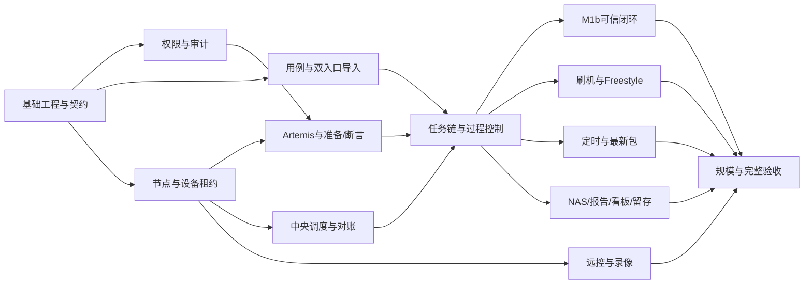

# Artemis 一站式 UI 测试平台任务规划

> 当前发布基线（2026-11-11）：平台名称为 Kraken，不提供工作区划分；默认免登录、免节点 Token；认证由部署方扩展；节点采用单进程 runtime 和中央状态对账，不依赖 SQLite。下文早期规划按日期保留，Google Workspace 内置登录、双进程节点等旧条目不再作为当前交付要求。

日期：2026-10-22。状态：规划基线 v1，开发持续推进；63 项任务的当前进展见下表。依据：[需求草案](platform.md)。

本规划覆盖当前 60 条需求和 23 个验收场景，分为 12 个工作包。工作包、依赖和交付顺序是实施建议；已确认的业务规则保持不变，未确认事项只影响对应任务，不阻塞无关工作。本文可作为创建项目任务的输入；已创建独立平台仓库并完成本地模拟闭环；未创建外部工单，尚未做本规划的真实设备验收。

M0 方案进展（2026-10-21）：已形成[技术选型与独立仓库方案](../architecture/m0-proposal.md)，M0-D01 已确认 A：Python/FastAPI 控制面 + Python 节点；M0-D02 已确认 A：React + TypeScript + Vite + Ant Design。M0-D03 已确认 B：PostgreSQL + RabbitMQ + Celery，保留业务调度器与节点恢复机制。M0-D04 已确认 A：HTTPS + 节点主动建立 WSS 双向连接。M0-D05 已确认 A：控制面 Docker Compose，Linux 节点 systemd + 独立 Python 环境。M0-D06 已确认 A：优先适配现有 API/CLI，必要时在原工程做最小兼容扩展。M0-D07 已确认在 <CHECKOUT_ROOT>/artemis-platform 创建独立本地仓库，远端留空。实现与验收状态见新仓库 docs/runbooks/m0-validation.md。

## 当前实施进展（2026-10-29）

| 范围 | 当前状态 | 尚待完成的边界 |
| --- | --- | --- |
| FND 基础工程与本地模拟闭环 | 已在独立仓库实现并验证，详情见 M0 验证记录 | Linux 部署与真机链路不以模拟结果替代 |
| FND-04 / NOD / SCH 本地 Linux 多节点验证 | 已实现独立 Podman 实验室、节点镜像、设备清单、身份绑定和持久卷；实测 3×20 同时模拟执行，代理/监督器/API 重启、Pod 重建、断网补传、取消及有限重试通过，整栈重建数据保持；[验证记录](../runbooks/podman-validation.md) | 覆盖 Linux ARM64 用户态与模拟协议；真实 Artemis 进程接管、systemd/整机、USB/Fastboot 与 60 台真机容量仍待验收 |
| CAS-01 分类、编辑与检索 | 已实现 OS/App 结构化字段、基础数据维护、组合检索、编辑入口 | 负责人、执行准备/清理结构、分类标签与完整迁移验收 |
| CAS-02 版本与 Stable | 已实现不可变版本、历史差异、显式 Stable、并发修改检查 | 真实执行证据及登录角色联调仍随关联任务验证 |
| CAS-04/05 导入引擎与 Excel | 已实现上传、工作表/列映射、逐行校验、差异、选择采纳、幂等与原文件追溯；本地自动和浏览器验证 | 目前支持文本 .xlsx；真实业务样例及复合断言/附件迁移待 Q06，不宣告 AC23 双入口完成 |
| CAS-07 来源冲突 | 已实现 Excel 来源身份、重复检测、平台与来源同时修改识别、逐行确认、预览过期整批拒绝 | 飞书跨入口关联、来源删除记录与真实样例验收 |
| CAS-06 飞书同步 | 已确认手动 + 定时，均人工采纳 | 来源配置、凭据引用、Sheets 读取与调度尚待开发 |
| RUN-01/02/03/04/05 任务与尝试 | 已实现先建任务、弹窗筛选添加已启用用例、排序/移除、配置版本、独立多用例批次、并发/顺序、有限自动重试与批次取消；模拟闭环验证 | 环境矩阵、完整任务链、真实引擎、准备/清理策略、暂停/恢复及证据文件仍待接入；刷机要求可保存但阻止执行 |
| TIM-01/02/03 定时基础 | 已实现每日/每周、时区、启停/下次触发、同任务批次排队、恢复只补最近一次、触发幂等 | 一次性/Cron、有效期、队列配额/维护窗口及真实部署故障验收尚待完成；最新包解析 TIM-04 未实现 |
| MOD-01 / IAM-03 模型与凭据基础 | 已实现八字段管理、启停、不可变配置版本、Key 加密与引用、控制面 OpenAI/Anthropic 文本检测、任务选择及批次模型版本冻结；本地协议服务与浏览器验证 | 节点侧实际模型交互、截图/日志输入、Artemis 参数适配及真实供应商兼容仍待 ENG-01/NOD 联调；不宣告 MOD-01 完整验收 |
| 其余运行、节点、引擎、刷机、远控、报告、权限 | M0 已有部分契约/模拟机制 | 依各任务完成真实能力；不视为功能交付 |

## 1 交付基线

- 独立平台仓库；一个逻辑控制面、多 Linux 节点、多 Artemis 实例；macOS 开发。约 3 节点、每节点约 20 部手机，必须并发；约 60 路是待实测的设计目标。
- 指定 SN + 控制面占用记录 + 节点统一锁/租约 + 独立进程与工作区。测试、刷机、安装、远控和维护共用同一设备占用入口。
- Case 是容器，每次修改产生不可变版本；只有显式设置 Stable 才生效。每次实际 attempt 开始读当前 Stable；历史报告保留实际执行内容。
- 文本操作支持受控 ADB；检查为 UI/日志。旧 Instrumentation/Python 测试迁移为文本，保留原断言；每个用例独立使用一部设备。
- 固定任务按任务链执行；Freestyle 在未明确的刷机/清数据等动作前确认。执行中禁止人工输入；远控只用于空闲设备。断言失败也可有限次数重跑。
- Fastboot 全量线刷；SMB/FTP 内网包源；Case 约束/标签决定设备范围，固件另做兼容校验。原 CLI 由节点适配到平台全流程。
- 开放模式免登录全权限；登录模式 Google Workspace + 管理员/测试人员/只读成员；认证权限独立模块。模型配置仅含既定八字段，可使用内网或云端，允许发送测试必要文本/截图/日志片段。
- 任务可配置录像，检查必需截图/日志保留；首跑全通过证据 3 天，失败/阻塞/证据不足/重跑后通过 30 天；报告 3 个自然月。文件集中在内网 NAS，结构化报告/索引在业务库。
- 同一定时规则重叠默认排队；停机恢复只补最近一次，已有队列保留；每次触发解析最新可用 APK/固件，本轮排队/重跑不换包。用例的 Stable 读取时点与包解析时点分别处理。
- 首期同时交付 Excel 导入和飞书普通电子表格（Sheets）同步。飞书多维表格、OTA、多手机协作用例、执行中接管及每设备 Docker 不在首期范围。

P0 表示优先建立可信执行闭环的工作，P1 表示首期完整平台仍须交付的配套和扩展；依赖任务优先于其后续任务，P1 不等于可省略。完整首期交付完成至 M2b，M1a/M1b 仅为内部里程碑。

## 2 里程碑与完成门槛

| 阶段 | 可评审交付物 | 完成门槛 |
| --- | --- | --- |
| M0：契约与接入核验 | 独立仓库骨架、技术选型、实体/状态/节点协议、开发环境、现用刷机 CLI 接入记录 | 核心接口可实现、设备锁边界一致；明确真实依赖及不支持能力 |
| M1a：单链路可运行 | 开放模式、用例/Stable、单节点执行、模型、准备/清理、任务链、基础证据；各模块包含最小可操作界面 | 从平台选 Case，经指定设备执行，原步骤与检查结果能追到证据；禁止把 completed 当 PASS |
| M1b：可信执行闭环 | 飞书 Sheets + Excel、Google Workspace、跨节点调度/对账、取消/重跑、过程页、NAS 和报告 | 在 2 台 Linux/4 部手机验证主流程及故障；两个导入入口可用；此阶段仍需后续完成刷机/远控/定时全流程 |
| M2a：完整功能集成 | Fastboot、五项远控、Freestyle、定时排队/补跑/最新包、录像、监控 | App 与 OS 全流程均在平台；刷机/测试/远控共用租约，运行时人工输入始终被拒绝 |
| M2b：规模与上线验收 | 看板、留存、备份恢复、全入口权限、容量实测、操作手册和发布候选 | 23 个场景有验证记录；约 3 节点/60 设备目标有实际容量结果；D18 的指标确认后完成发布判定 |
| M3：后续扩展 | 更大规模、高可用增强及确认后加入的深度集成 | 不作为首期缺失功能的替代；范围另行排定 |

阶段是依赖和验收边界，不是固定周数。人员投入及部署条件尚未确定，当前不承诺上线日期；M0 后对各任务估算并结合实际可投入人员排日历。

## 3 关键依赖与并行安排

图只表示工作包主要关系，逐项依赖以下表为准。节点租约和命令幂等是刷机、远控、执行共享的前置；前端可依据冻结契约与模拟数据并行开发，完成定义仍包含真实接口与异常状态验证。

建议并行四条工作流：控制面/数据与调度、Linux 节点/执行/刷机、Web 交互、测试与部署。可以由同一人兼任；人力减少时按依赖串行，不把多条工作流直接等同于已有四名成员。

## 4 工作包与任务清单

主责按角色分配，尚未指定个人。每项均包含必要的 API/节点实现、页面接线和针对其风险的验证；表中列出关键完成条件。依赖表示前置任务的接口/能力需要达到可集成状态，开发可提前基于契约开展。

| 工作包 | 主责 | 任务数 | 目标 |
| --- | --- | --- | --- |
| W01 基础工程与系统契约 | 控制面后端主责，前端、节点、测试参与 | 5 | 建立新仓库、领域模型、协议与可重复开发环境。 |
| W02 独立认证、权限与审计 | 控制面后端主责，前端、测试参与 | 4 | 同时交付免登录全权限模式和 Google Workspace 登录模式。 |
| W03 用例、版本与双入口导入 | 控制面后端与前端共同负责，测试提供样例 | 7 | 实现平台最终内容、显式 Stable、飞书 Sheets 同步及 Excel 导入。 |
| W04 节点代理、设备和本机执行隔离 | 节点工程主责，控制面后端及测试参与 | 6 | 把设备身份、写入互斥、进程与恢复事实落实到 Linux 节点。 |
| W05 Artemis、模型与可信判定 | 节点/执行引擎主责，后端和测试参与 | 5 | 复用执行内核，通过适配补齐平台能力，保留原始检查含义。 |
| W06 任务链、过程控制与 Freestyle | 控制面后端与前端主责，执行引擎参与 | 6 | 把任务编排、过程查看、确认和重跑接到同一执行模型。 |
| W07 多机器调度与恢复 | 控制面后端主责，节点工程和测试参与 | 4 | 中央调度决策与节点执行事实协同，支持真实并发。 |
| W08 包源与 PhoneAutomationTest 刷机 | 节点/刷机工程主责，后端和前端参与 | 6 | 先确认现用 CLI，再包装为精确设备、可观察和可恢复的流程。 |
| W09 实时画面与空闲设备远控 | 节点工程与前端主责，后端权限模块参与 | 4 | 交付五项控制能力，执行期间严格只读。 |
| W10 证据、NAS、报告与看板 | 控制面后端与前端主责，节点工程参与 | 6 | 让报告真实、证据可追溯、留存可执行。 |
| W11 定时触发、排队与最新包 | 控制面后端主责，前端和测试参与 | 4 | 准确落实三项已选 B：排队、只补最近一次、触发时取最新包。 |
| W12 部署、运维与系统验收 | 运维/测试主责，各模块负责人配合 | 6 | 将软件完成、硬件验证和可上线结论分层交付。 |

### W01 基础工程与系统契约

主责：控制面后端主责，前端、节点、测试参与。

| 任务 / 优先级 | 交付物 | 完成条件 | 直接依赖 | 阶段 | 需求与验收 |
| --- | --- | --- | --- | --- | --- |
| **FND-01 技术选型与独立仓库骨架** P0 | 技术选型记录、已初始化的独立平台仓库和模块骨架、依赖边界；模块包含控制面、Web、节点代理、执行适配、认证权限和共享契约。 | 记录语言/框架、数据库、消息传输与发布方式；最小服务可启动，规划文档迁入新仓库；保留一个逻辑控制面，不复用 Panoptes。本项 M0 本地骨架已实施；模拟与真机验收边界见 [M0 验收记录](../runbooks/m0-validation.md)。 | 无 | M0 | D01、D02；工程基础 |
| **FND-02 领域模型、状态与数据库迁移** P0 | 实体关系、迁移脚本、状态转换表；涵盖 Case/Version/Stable、Run/Case Run/Attempt、Lease、Schedule、Import Batch、Evidence 和访问主体。 | 执行状态、断言结论、证据完整度、清理状态分开；唯一键与并发约束可验证；匿名记录不要求真实登录用户。 | FND-01 | M0 | CASE03, RUN02, SCH04, REP02, ADM02 AC03, AC05 |
| **FND-03 控制面与节点协议** P0 | 命令、事件、文件清单、能力协商及错误码契约；定义 command_id、attempt_id、租约代次、事件序号和确认语义。 | 契约含重复/乱序/过期指令、取消待处理、未知状态和版本兼容案例；各适配器共用，不各自定义设备占用协议。 | FND-02 | M0 | SCH05, SCH07, RUN05 AC05, AC06 |
| **FND-04 macOS 开发与 Linux 验证环境** P0 | 本地启动说明、配置样例、CI、模拟节点及可注入时钟/故障的测试夹具；Linux 节点联调入口。 | macOS 可启动控制面/Web/模拟节点；Linux 可运行节点检查；模拟检查与真实 USB/Fastboot 验收分开记录。 | FND-01 | M0 | SCH01 AC06 |
| **FND-05 Web 框架与通用交互** P0 | 页面导航、列表/筛选/分页、表单校验、状态展示、错误反馈、实时事件连接及访问上下文接入。 | 能从测试对象进入用例、任务、设备、报告和设置；断线/过期状态明确，列表分页不会改变筛选语义。 | FND-04, IAM-01 | M1a | RUN01, RUN04, ADM01 AC13 |

### W02 独立认证、权限与审计

主责：控制面后端主责，前端、测试参与。

| 任务 / 优先级 | 交付物 | 完成条件 | 直接依赖 | 阶段 | 需求与验收 |
| --- | --- | --- | --- | --- | --- |
| **IAM-01 独立权限模块与开放模式** P0 | 统一访问上下文、操作权限接口、开放模式、匿名会话及前端能力查询。 | 无 SSO 配置即可使用全部平台操作；匿名会话互相区分；设备锁、任务确认及执行期间只读仍生效。 | FND-02, FND-03 | M1a | ADM01, REM05 AC13 |
| **IAM-02 Google Workspace 与三类角色** P0 | Google Workspace 认证适配、成员映射、管理员/测试人员/只读成员角色、登录和成员管理页。 | 角色权限按矩阵生效；登录失败不降级开放模式；真实接入受 Q04 的域、准入与配置影响。 | IAM-01, IAM-03 | M1b | ADM01 AC13 |
| **IAM-03 凭据引用与业务审计** P0 | 密钥引用及脱敏、配置变更历史、操作审计查询；区分成员、匿名会话、定时系统主体。 | Stable、任务链、模型、确认、取消和刷机均可追溯；Key 不进入测试上下文/明文日志；匿名审计不冒充真实人员。 | FND-02, IAM-01 | M1a | ADM02 AC13, AC15, AC18 |
| **IAM-04 全入口权限一致性验收** P0 | 回归 API、页面、媒体、下载、导出及设备控制入口的统一角色策略，补齐集成遗漏；各入口在所属任务实现时即接入 IAM-01/02。 | 直链和实时通道遵循同一权限规则；只读角色不能通过 API 写入；开放模式完整可用且不绕过执行约束。 | IAM-02, REM-03, DAT-04, RUN-06, FLA-06 | M2b | ADM01, REM05, REP05 AC10, AC13 |

### W03 用例、版本与双入口导入

主责：控制面后端与前端共同负责，测试提供样例。

| 任务 / 优先级 | 交付物 | 完成条件 | 直接依赖 | 阶段 | 需求与验收 |
| --- | --- | --- | --- | --- | --- |
| **CAS-01 测试对象、分类与用例编辑** P0 | App/OS、模块、负责人、分类标签、设备匹配标签；完整用例编辑页和组合检索。 | 保存准备/动作/逐项 UI 或日志预期/清理；分类标签不误作设备条件；一个 OS 用例可跨系统模块。 | FND-02, FND-05 | M1a | CASE01, CASE02, ENV01 AC02, AC07 |
| **CAS-02 不可变版本与 Stable 操作** P0 | 版本创建/历史/差异/停用、Stable 指针原子更新及实际执行内容快照接口。 | 保存/导入不自动设 Stable；无 Stable 阻塞；跨 Case 指向被拒绝；并发设置不静默覆盖；任务仅引用 case_id。 | CAS-01, IAM-03 | M1a | CASE03 AC03 |
| **CAS-03 测试集、参数与模块知识** P1 | Suite 版本、顺序/并行依赖、参数优先级、数据集、密钥引用、模块知识/提示组装结果。 | 参数按既定优先级解析；知识不修改原断言；用例内容在 attempt 开始时解析 Stable，历史组装可追溯。 | CAS-02, IAM-03 | M1a | CASE05, CASE07, CASE08 AC03, AC08 |
| **CAS-04 统一导入批次与差异引擎** P0 | 来源身份、映射模板、预览、逐条错误、差异、采纳、幂等批次及来源快照。 | 同批次重试不重复建 Case/版本；未变内容不生成修改版本；错误可定位；采纳不移动 Stable。 | CAS-02 | M1a | CASE06 AC23 |
| **CAS-05 Excel 导入页面与解析器** P0 | 文件上传、工作表/列映射、预览、采纳、批次结果与来源追溯。 | 用真实样例覆盖多步骤与复合断言；解析失败不损坏已有数据；原步骤/断言无遗漏；格式样例见 Q06。 | CAS-04 | M1b | CASE06 AC23 |
| **CAS-06 飞书 Sheets 读取与同步入口** P0 | 普通电子表格、工作表/范围、列映射、来源凭据、读取与差异预览；统一同步作业接口。 | 插行/排序不改变用例身份；缺失/重复编号提示；不将 Base 链接当 Sheets；已确认支持手动和定时读取，两者均需人工采纳；定时周期与重复触发处理见 Q01。 | CAS-04, IAM-03 | M1b | CASE06 AC23 |
| **CAS-07 来源冲突与跨入口关联** P0 | 平台/来源版本对比、冲突定位、明确采纳与跨入口关联界面；来源删除记录。 | 不按标题猜合并，不覆盖平台编辑，不自动删除历史或回写飞书；细化冲突策略受 Q02 影响。 | CAS-05, CAS-06 | M1b | CASE06 AC23 |

### W04 节点代理、设备和本机执行隔离

主责：节点工程主责，控制面后端及测试参与。

| 任务 / 优先级 | 交付物 | 完成条件 | 直接依赖 | 阶段 | 需求与验收 |
| --- | --- | --- | --- | --- | --- |
| **NOD-01 节点注册、心跳与能力上报** P0 | 注册/撤销、节点身份、心跳、工具链/资源/模型可达性/Worker 能力上报及列表。 | 过期状态标 stale；撤销后拒绝新指令；展示实际能力与版本，不能用进程在线代替节点可执行。 | FND-03, FND-04, IAM-03 | M1a | SCH01, ADM05 AC06 |
| **NOD-02 设备发现与稳定资产身份** P0 | 设备资产、节点、ADB endpoint、当前 SN、ADB/Fastboot 模式及可获取的 Hub/端口关联。 | 多节点相似 SN 不串机；重插和模式切换保持/核验身份；精确 SN 不存在时不退回首台在线手机。 | NOD-01 | M1a | ENV01, SCH02, SCH09 AC07 |
| **NOD-03 统一设备锁与租约执行** P0 | 节点原子设备锁、租约代次校验；测试/刷机/安装/远控/维护共用一个入口；协调 Artemis 内部锁。 | 同设备只能一个写入者；拒绝过期指令；共同锁目录有效且无重复取锁自锁；不同手机可并行。 | NOD-02, FND-03 | M1a | SCH04, SCH05 AC04, AC05 |
| **NOD-04 Worker 进程与工作区监督** P0 | 按 attempt 隔离进程、环境、工作目录、端口和停止标记；固定依赖；精确进程监督与能力上报。 | 单任务停止不影响其他 SN；不调用节点级 adb kill-server 作局部修复；收到取消与确认停稳是不同状态。 | NOD-03 | M1a | SCH01, RUN05, RUN06 AC05, AC10 |
| **NOD-05 本地执行日志、事件与恢复** P0 | 执行开始记录、进程身份、事件持久化/序号、补传、去重及重启后事实查询。 | 启动响应丢失可查同一 command；重启不重放设备动作；日志断点可续传且顺序可还原。 | NOD-04 | M1a | SCH07 AC05, AC06 |
| **NOD-06 设备健康、维护与节点排空** P1 | 连接/纳管/健康/占用分离；隔离、恢复检查、排空、Worker 升级与节点维护界面。 | 清理失败/刷机异常不自动回池；排空不接新任务；升级不静默替换在跑引擎；恢复先核对实际进程和设备。 | NOD-05 | M1b | SCH08, SCH09, ADM03 AC06, AC12 |

### W05 Artemis、模型与可信判定

主责：节点/执行引擎主责，后端和测试参与。

| 任务 / 优先级 | 交付物 | 完成条件 | 直接依赖 | 阶段 | 需求与验收 |
| --- | --- | --- | --- | --- | --- |
| **ENG-01 Artemis 执行适配与差距修复** P0 | 核验当前引擎提交/事件/停止接口，实现按 SN 的能力查询、提交、查询、事件和清理适配。 | 可完成 App 与跨模块 OS 文本任务；发现首设备选择或共享停止标记时以适配/必要内核扩展修复，单独回归原 CLI/MCP 契约。 | FND-03, NOD-04, MOD-01 | M1a | CASE04, RUN10 AC01, AC02, AC05 |
| **MOD-01 模型八字段配置与协议适配** P1 | 八字段管理页、配置版本/密钥引用、OpenAI/Anthropic 协议适配及节点端实际交互验证。 | 内网/云端均可按选定模型收发所需文本/截图/日志；思考参数按服务支持处理；在跑任务不换模型，不新增表单字段。 | IAM-03, NOD-01 | M1a | ADM03 AC18 |
| **ENG-02 UI/日志断言与结果归一** P0 | step/assertion 映射、截图/日志窗口证据、规则/模型结论及执行状态分离。 | completed 不等于 PASS；必需项未查或证据不足不通过；BLOCKED/INCONCLUSIVE/FAIL 原因可追踪，复合断言不省略。 | ENG-01, CAS-02, DAT-01 | M1a | CASE02, CASE04, REP01, REP02 AC08 |
| **ENG-03 准备、安装、清理与共享资源** P0 | 安装 App/辅助组件、授权/数据/系统初始化、清理、SIM/账号等资源占用和真实环境核验。 | 准备条件不足阻塞主体；清理失败隔离设备；版本从设备读回核对；共享账号资源不被不兼容任务同时占用。 | ENG-01, CAS-03, FLA-02 | M1a | ENV01, ENV02, ENV03, ENV04 AC07, AC12, AC14 |
| **ENG-04 既有代码用例的文本迁移样例** P0 | Instrumentation/Python 到文本的迁移规则和代表性 App/OS 样例，含单手机运营商客服电话场景。 | 保留 setup、原步骤、全部断言和 teardown；不可验证项登记缺口；拨号检查本机界面并挂断；不直接运行旧测试代码冒充文本迁移。 | ENG-02, ENG-03, CAS-07 | M1b | CASE02, CASE04, RUN10 AC02, AC08, AC14 |

### W06 任务链、过程控制与 Freestyle

主责：控制面后端与前端主责，执行引擎参与。

| 任务 / 优先级 | 交付物 | 完成条件 | 直接依赖 | 阶段 | 需求与验收 |
| --- | --- | --- | --- | --- | --- |
| **RUN-01 任务容器、用例集合与展开预览** P0 | TestTask/Run 分层；先建任务，再用筛选弹窗添加已启用用例并排序/移除，再配置执行规则；版本保存、幂等触发及历史批次。补齐 Plan、矩阵、设备范围、参数、录像及克隆。 | 创建不执行；跨筛选/分页保留选择；保存比较交换；每批冻结配置且只引用 Case ID；预览数量、匹配排除原因和准备影响；区分全设备覆盖与按规格抽取。 | CAS-03, FND-05 | M1a | RUN01, RUN02, RUN03 AC01, AC07 |
| **RUN-02 任务链与 Attempt 生命周期** P0 | 阶段编排、条件/操作范围、生效配置、实际开始读取 Stable、运行记录和清理回调。 | 新 attempt 读取当前 Stable；同 attempt 不中途换内容；固定链路范围内自动执行，越界阻塞；准备失败不启动主体。 | RUN-01, SCH-02, ENG-02, ENG-03, DAT-01 | M1a | RUN02, RUN03, ENV02, ENV03, CASE03 AC01, AC02, AC03, AC12 |
| **RUN-03 执行详情与实时过程视图** P0 | 任务树、原始步骤、阶段/等待原因、尝试次数、日志事件、证据链接和断线重连。 | 显示真实执行阶段与完整度；AI 动作数不冒充原用例完成数；事件重复不造成重复进度，错误不展示为全绿。 | RUN-02, NOD-05, DAT-01 | M1b | RUN04, REP01 AC08, AC12 |
| **RUN-04 取消、暂停与恢复控制** P0 | 任务/Case Run/attempt 定向取消、暂停派发、安全点暂停、能力不支持反馈与恢复核验。 | 取消处理中持续占用设备；暂停不开放人工输入；不可靠续跑建立新 attempt；刷机取消交由专用适配器。 | RUN-02, SCH-03, NOD-04 | M1b | RUN05, RUN06 AC06, AC10 |
| **RUN-05 有限重跑与允许的干扰恢复** P0 | 失败类型/重跑次数/间隔/环境重置配置，恢复白名单及动作预算，首跑和后续结果记录。 | 断言失败可按配置重跑，次数不含首次；取消/未知/未恢复不能直接重跑；不改原预期，重跑后通过与 recovered 分别留痕。 | RUN-04, ENG-02, CAS-02, NOD-06 | M1b | RUN08, RUN09 AC17 |
| **RUN-06 平台 Agent 与 Freestyle 确认** P0 | 目标对话、结构化方案、设备/包/影响展示、确认记录、拒绝/超时、任务派发与对话结果页。 | 确认绑定具体参数且重复答复幂等；已确认范围不重复询问；运行中的 Case 不接收人工改目标/输入；改动需结束受影响执行再建后续任务。 | RUN-04, MOD-01, IAM-03, FLA-06 | M2a | RUN02, RUN07, FLASH03 AC15, AC10 |

### W07 多机器调度与恢复

主责：控制面后端主责，节点工程和测试参与。

| 任务 / 优先级 | 交付物 | 完成条件 | 直接依赖 | 阶段 | 需求与验收 |
| --- | --- | --- | --- | --- | --- |
| **SCH-01 匹配、全局队列与公平调度** P0 | Case 约束/设备标签、节点能力、槽位/健康筛选，优先级、公平性、老化及任务/节点并发限制。 | 未知硬条件不匹配；指定 SN 不替换；排队原因可解释；缓存命中不能覆盖目标版本等硬约束。 | CAS-02, NOD-02, RUN-01 | M1a | SCH02, SCH03, RUN03, ENV01 AC01, AC07 |
| **SCH-02 预占、派发与幂等启动** P0 | 控制面预占、节点确认、本机锁、启动确认分阶段事务和指令代次。 | 重复提交/投递/响应丢失不造成重复设备执行；失效代次拒绝；数据库记录和实际执行可对账。 | SCH-01, NOD-03, NOD-04 | M1a | SCH04, SCH05 AC04, AC05 |
| **SCH-03 断连对账与任务恢复** P0 | needs_recovery、未启动重排、已启动状态核验、证据补传与恢复入口。 | 失联/租约超时不等于设备释放；只有证明旧动作停止且健康满足才接受新任务；不盲目重放。 | SCH-02, NOD-05, NOD-06, RUN-02 | M1b | SCH06, SCH07, SCH09 AC06, AC12 |
| **SCH-04 资源预算与并发管控** P1 | 模型并发/速率/预算、节点 CPU/内存、USB、下载、刷机、截图/录像采集配额及可视化。 | 可分别限制测试与刷机；不写死未经测量的并发；模型调用重试不重放已完成设备动作；配额排队有边界。 | SCH-02, MOD-01, NOD-01 | M1b | SCH03, SCH10, REP04 AC01, AC18, AC19 |

### W08 包源与 PhoneAutomationTest 刷机

主责：节点/刷机工程主责，后端和前端参与。

| 任务 / 优先级 | 交付物 | 完成条件 | 直接依赖 | 阶段 | 需求与验收 |
| --- | --- | --- | --- | --- | --- |
| **FLA-01 核验现用刷机 CLI 与适配方案** P1 | 定位实际脚本、参数、依赖、产品约束、合并步骤、可取消阶段和可获得的事件；形成接入记录。 | 不能仅凭 FlashEngine 文件名认定生产入口；若复用 GUI 逻辑，明确无界面改造点；校验失败阻止后续刷写；实际工具链见 Q05。 | 无 | M0 | FLASH04, FLASH05, FLASH08 AC11 |
| **FLA-02 APK/固件目录、包源与只读缓存** P1 | APK/固件元数据、内网 SMB/FTP 来源、凭据、下载临时区、摘要/完整性校验、去重缓存和包浏览选择。 | 两类来源均能读取目标包；中断/未完整文件不能使用；同名内容变化可发现；缓存容量受控，不扫描下载全目录。 | FND-02, IAM-03, NOD-01 | M1a | FLASH01, ENV02 AC11, AC22 |
| **FLA-03 刷机方案与设备兼容预检** P1 | 方案版本、分区/清数据影响、产品兼容、解锁/电量/连接/磁盘/工具能力预检及表单。 | Case 匹配与固件兼容分别校验；未知条件拒绝；无固定机型白名单假设；普通参数不扩大操作范围。 | FLA-01, FLA-02, NOD-02 | M2a | FLASH02, FLASH03, FLASH08 AC07, AC11 |
| **FLA-04 Fastboot 执行与阶段回传** P1 | 无界面 CLI 包装、独立工作目录、精确 SN、解压/合并/刷写/重启阶段和 stdout/stderr 回传。 | 必要合并失败立即阻断；实际阶段可追溯、不造进度；不同设备并发时工作文件与事件不串用。 | FLA-03, NOD-04, NOD-05 | M2a | FLASH04 AC11 |
| **FLA-05 安全取消、刷后验证与恢复** P1 | 阶段感知取消、失败/未知隔离、刷后身份/build/fingerprint/ADB/服务/Helper 核验及恢复流程。 | 不按普通 UI 超时强杀刷写；退出码 0 仍需刷后检查；未确认成功不进测试，不自动循环重刷。 | FLA-04, NOD-06 | M2a | FLASH05, FLASH06, FLASH08 AC11, AC12 |
| **FLA-06 独立刷机与测试链路集成** P1 | 版本与刷机页面、批量逐设备结果、刷后初始化与自动测试衔接。 | 刷机到测试使用同一占用链；仅准备成功设备进入测试，其他节点任务可继续；在平台完成完整操作链。 | FLA-05, RUN-02, RUN-04 | M2a | FLASH03, FLASH07 AC04, AC11 |

### W09 实时画面与空闲设备远控

主责：节点工程与前端主责，后端权限模块参与。

| 任务 / 优先级 | 交付物 | 完成条件 | 直接依赖 | 阶段 | 需求与验收 |
| --- | --- | --- | --- | --- | --- |
| **REM-01 按设备选取的实时画面** P1 | 按资产 ID/SN 的画面通道、时间戳、旋转/分辨率、重连及采集能力核验。 | 不选择首台在线设备；断流明确标冻结；显示实测延迟；观看不改变执行输入权。 | NOD-02, NOD-04, FND-03 | M2a | REM01 AC10, AC16 |
| **REM-02 五项远控动作** P1 | 点击、单指滑动、文字输入、系统按键及画面坐标映射，含中文/英文/符号。 | 缩放/旋转后准确落在目标设备；动作失败可见；音频、多指和文件传输不纳入此任务。 | REM-01, NOD-03 | M2a | REM02 AC16 |
| **REM-03 控制租约与运行中禁止输入** P1 | 独立远控会话、单写者令牌、超时撤销、读者并存及前端/服务端/节点三层校验。 | 准备/刷机/运行/暂停/待确认/取消中/清理都禁输入；匿名会话不共用令牌；真正释放后才可控制。 | REM-02, IAM-01, SCH-02, RUN-04 | M2a | REM03, REM04, REM05, SCH04 AC04, AC10, AC13, AC16 |
| **REM-04 设备墙与远控交互页面** P1 | 设备墙、设备详情、占用与控制者、只读/控制状态、健康与会话退出。 | 远控结束完成设备检查后才能新执行；不恢复已结束 attempt；占用原因与控制撤销状态对用户明确。 | REM-03, NOD-06, RUN-03 | M2a | REM01, REM03, REM04 AC10, AC16 |

### W10 证据、NAS、报告与看板

主责：控制面后端与前端主责，节点工程参与。

| 任务 / 优先级 | 交付物 | 完成条件 | 直接依赖 | 阶段 | 需求与验收 |
| --- | --- | --- | --- | --- | --- |
| **DAT-01 证据模型与采集关联** P0 | 证据索引、文件清单、摘要、step/assertion/attempt/设备/时间关联，截图和日志采集接口。 | 关闭录像也保留检查必需证据；日志属于本次时间窗口；采集失败、未检查和断言失败可区分。 | FND-03, NOD-05 | M1a | REP01, CASE02 AC08, AC12, AC19 |
| **DAT-02 NAS 归档与失败重传** P1 | 共享存储适配、上传校验、幂等归档、续传/重传、下载/视频读取及节点缓存阈值。 | NAS 断开保留唯一副本；恢复只补传不重跑；未校验文件不可用；只管理平台根目录，协议参数见 Q05。 | DAT-01, IAM-01, IAM-03 | M1b | ADM04, REP01 AC12, AC21 |
| **DAT-03 任务录像与断流说明** P1 | 任务录像开关、生效配置、按 attempt 录像分段和时间轴、重启/Fastboot 缺口记录。 | 无观看者也按配置采集；关闭与采集失败分开；不以旧画面补缺口；运行中不被配置修改静默切换。 | DAT-01, REM-01, RUN-02 | M2a | REP01, ADM04 AC19 |
| **DAT-04 报告、复核与导出** P0 | 单次/逐例/逐断言报告、首跑与重跑区分、内容快照、追加复核、JSON/可读导出及 JUnit 映射说明。 | 历史报告不读取当前 Stable 重建；缺证据不全绿；复核不覆盖原判定；不能原样映射的结果明确标记。 | RUN-03, ENG-02, DAT-02 | M1b | REP01, REP02, REP05 AC03, AC08, AC12, AC17 |
| **DAT-05 质量与运行看板** P1 | 首跑/最终通过率、阻塞/证据不足/重跑、设备利用率、排队、节点、模型和刷机指标及工作台。 | 每项展示分母/排除项，零分母不显示 100%；版本改变不冒充同条件恢复；无计费数据不造费用。 | DAT-04, SCH-04, TIM-03, FLA-06 | M2b | REP03, REP04 AC01, AC17 |
| **DAT-06 证据与报告生命周期** P1 | 可配置证据 3/30 天、报告 3 个自然月、到期清理、过期索引及设置页面。 | 首跑全通过 3 天；失败/阻塞/证据不足/重跑后通过 30 天；不删运行引用和未归档唯一副本；报告清理不删用例版本/Stable。 | DAT-02, DAT-03, DAT-04 | M2b | ADM04 AC20, AC21 |

### W11 定时触发、排队与最新包

主责：控制面后端主责，前端和测试参与。

| 任务 / 优先级 | 交付物 | 完成条件 | 直接依赖 | 阶段 | 需求与验收 |
| --- | --- | --- | --- | --- | --- |
| **TIM-01 定时规则与触发预览** P1 | 一次性/每日/每周/Cron、时区、有效期、下次触发、启停及历史页面。 | 规则变更不删除历史；按规则 ID+计划触发时刻去重；明确时区与夏令时行为。 | RUN-01, FND-02, IAM-01 | M1b | TIME01, TIME02 AC09 |
| **TIM-02 同规则串行与持久排队** P1 | 每次触发独立 Run、按计划时刻队列、等待原因、上限/超时和维护窗口。 | 上一轮未实际结束不启动下一轮，等待不占设备；单轮仍并发；已有队列重启后不丢，超限不静默丢弃。 | TIM-01, RUN-02, SCH-03 | M2a | TIME02, TIME03, TIME04 AC09 |
| **TIM-03 停机仅补最近一次** P1 | 持久检查点、错过区间计算、最近一次补建、较早未补留痕与恢复对账。 | 重复重启不逐次补出更早旧触发；恢复与正常触发去重；已有队列保留；人为停用时段不作为停机漏触发。 | TIM-02 | M2a | TIME02, TIME03, TIME04 AC09 |
| **TIM-04 触发时解析最新可用包** P1 | 包源/目标/完整性筛选与排序、每轮具体 APK/固件身份、版本/摘要及解析时间记录。 | 排队和同 Run 重跑不换包；补跑按恢复时解析并记原触发时刻；候选歧义/包变化阻塞；Case 仍执行时读 Stable。 | TIM-02, FLA-02, RUN-02 | M2a | TIME05, FLASH01 AC22 |

### W12 部署、运维与系统验收

主责：运维/测试主责，各模块负责人配合。

| 任务 / 优先级 | 交付物 | 完成条件 | 直接依赖 | 阶段 | 需求与验收 |
| --- | --- | --- | --- | --- | --- |
| **OPS-01 Linux 部署与发布包** P0 | 控制面/Web/节点部署脚本、版本固定、配置样例、迁移步骤、启动检查和回滚入口。 | 内网 Linux 可重复部署，macOS 用开发路径；开放模式无需 SSO；发布不覆盖执行中的运行配置。 | FND-04, IAM-01 | M1a | ADM05, SCH01 AC06, AC13 |
| **OPS-02 监控、阈值与平台告警** P1 | 节点/队列/模型/NAS/磁盘监控、平台内告警、告警去重和状态恢复记录。 | 失联/缓存逼近阈值可定位；异常不无限吞掉；飞书/邮件等通知发送待 Q03 决定，不假定已有渠道。 | NOD-01, RUN-03, DAT-02, SCH-04 | M2a | ADM05, TIME04, REP04 AC06, AC12, AC21 |
| **OPS-03 备份、恢复与运维手册** P1 | 业务库、文件索引、NAS 备份/恢复方案，演练脚本，维护、排空、异常刷机及回滚手册。 | 恢复后任务/文件可对账且不重复设备动作；记录实际恢复耗时和损失窗口；最终 RPO/RTO 门槛受 Q08 影响。 | OPS-01, DAT-06, SCH-03 | M2b | ADM05 AC06, AC20, AC21 |
| **QA-01 小规模端到端与故障注入** P0 | 模拟故障套件及 2 台 Linux/4 部手机的主流程验证记录；覆盖响应丢失、重启、断连、Stable 改变和清理失败。 | 硬件、日志与报告逐层对齐；每个故障有结果与残留占用检查；不以模拟测试通过替代真机验证。 | RUN-05, SCH-03, DAT-04, CAS-07, ENG-04, OPS-01 | M1b | RUN02, SCH05, SCH06, SCH07, REP02 AC01, AC02, AC03, AC05, AC06, AC07, AC08, AC12, AC14, AC17, AC23 |
| **QA-02 3 节点/约 60 设备容量验证** P1 | 按 1/5/10/20 路每节点及全平台目标做负载，记录 CPU/内存/USB/模型/NAS/掉线率、录像和观众组合。 | 分别得出测试与刷机并发配置和瓶颈；60 路为目标而非现有保证；每日吞吐、观看数及资源条件见 Q07。 | SCH-04, REM-04, FLA-06, DAT-03, TIM-04, OPS-02 | M2b | SCH01, SCH03, SCH10, REM01, REP04 AC01, AC04, AC11, AC16, AC19, AC21 |
| **QA-03 首期完整验收与发布检查** P1 | 完整验收记录、需求覆盖清单、遗留问题、部署/回滚结果及发布候选包。 | 23 个场景逐项有证据；无未解决双写/重复启动/错误 PASS；D18 的发布质量与恢复门槛确认后再作达标结论。 | QA-01, QA-02, IAM-04, RUN-06, DAT-05, DAT-06, TIM-03, OPS-03 | M2b | ADM05, REP01, RUN07, FLASH07 AC01, AC02, AC03, AC04, AC05, AC06, AC07, AC08, AC09, AC10, AC11, AC12, AC13, AC14, AC15, AC16, AC17, AC18, AC19, AC20, AC21, AC22, AC23 |

## 5 首批启动顺序

1. 先开 FND-01 与 FLA-01：确认独立仓库/技术选型和现用刷机 CLI。真实包源、NAS、样例与设备信息也在此阶段收集，发现条件缺失时记录到对应任务。
2. FND-01 完成后推进 FND-02、FND-04，再完成 FND-03：统一状态和协议，建可启动的模拟联调环境。
3. 契约具备后并行推进 IAM-01/IAM-03、NOD-01、FND-05；随后开展 CAS-01/02 与 NOD-02/03/04/05。
4. 接入 MOD-01、FLA-02、ENG-01/DAT-01，完成 ENG-02/03；同时推进 CAS-03/04 与 RUN-01/SCH-01/02。
5. RUN-02 打通首条真实链路后，进入 M1b 的导入、取消/重跑、对账与 NAS/报告联调，以 QA-01 形成第一个完整演示与故障验证记录。
6. 按依赖推进刷机、远控、定时和 Freestyle；最后集中进行容量、权限全入口、留存、恢复与 QA-03 完整验收。

第一份可运行演示建议使用人工编写并显式设 Stable 的少量文本 Case，验证技术链路；这不改变 M1b 必须交付飞书 Sheets 和 Excel 双入口的范围。

## 6 未决事项及影响范围

以下事项仍需补充，其中飞书手动和定时触发均已确认，均只产生待采纳预览。各项只约束表中对应任务，可先推进不依赖答案的部分。

| 编号 | 待定内容 | 影响任务 / 最晚确定点 | 现在可推进 |
| --- | --- | --- | --- |
| Q01 | 已确认手动和定时均支持、定时仍需人工采纳；待补充具体周期及重复触发处理 | CAS-06；同步入口完成前 | Sheets 读取适配、统一作业接口、字段映射与预览 |
| Q02 | 来源与平台同时修改时的具体采纳/冲突交互，跨入口关联细节 | CAS-07；导入验收前 | 差异、冲突识别、版本追加；保留不覆盖平台/不自动移动 Stable 的已定规则 |
| Q03 | 飞书消息、Jenkins、Jira、Allure 等首期集成范围、接收人/目标系统 | 条件任务 EXT-01～04；相关联调前 | 平台内部告警、通用提交 API、JSON/可读报告及 JUnit 映射 |
| Q04 | Google Workspace 公司域、成员准入、角色分配、初始管理员与接入配置 | IAM-02、IAM-04；SSO 真联调前 | 开放模式、独立权限模块与认证接口；不假设所有 Google 账号都可登录 |
| Q05 | Linux 节点/手机、现用刷机脚本及参数、固件完整发布标记、SMB/FTP、NAS 协议/目录/容量、模型端点 | FLA-01～06、DAT-02、MOD-01、OPS-03；各模块真联调前 | 适配契约、模拟来源和错误处理；凭据通过受控配置交付，不写入规划文件 |
| Q06 | 飞书与 Excel 样例布局、稳定编号列、原断言/附件格式、待迁移代码用例清单 | CAS-05/06/07、ENG-04；真实样例验收前 | 通用批次模型、可配置字段映射；不默认现有用例已可完全 UI 化 |
| Q07 | 每日 Case Run 数、同时观看人数、节点实际硬件与并发预算；人员/上线目标（D17） | SCH-04、QA-02 与日历排期；容量/工期承诺前 | 约 3×20 规模设计、压力工具、指标采集；不据此声称已达 60 路 |
| Q08 | D18 发布质量门槛、recovered 处理、控制面可停机时长、业务数据/媒体 RPO/RTO；审计保留及录像/队列默认参数 | OPS-03、QA-03 及相关配置；最终验收前 | 基础恢复机制、真实测量、可配置开关/阈值；不虚设已同意的合格线 |

以下为条件任务，不计入 63 项已列核心任务，也不自动纳入首期承诺：

| 条件任务 | 内容 | 前置 / 条件 |
| --- | --- | --- |
| EXT-01 | 飞书消息或邮件通知：任务完成/失败/需处理事件、去重、接收人及内网报告链接 | Q03 确认渠道与对象；依赖 OPS-02、DAT-04、IAM-01 |
| EXT-02 | Jenkins 集成：提交、查询、取消、幂等触发及结果回传 | Q03 确认需要；依赖 RUN-01、RUN-04、DAT-04；不绕过节点租约 |
| EXT-03 | Jira 缺陷关联/创建：结果及证据引用、重复缺陷处理 | Q03 确认写入范围；依赖 DAT-04、IAM-03；不在规划阶段创建工单 |
| EXT-04 | Allure 专用结果适配与发布 | Q03 确认需要；依赖 ENG-02、DAT-04；保留无法原样映射的状态 |

## 7 需求到任务覆盖

此表给出每条需求的实现归属；前端、节点与控制面的接口需共同满足该需求。覆盖映射说明工作已规划，不代表实现或验收已经通过。

| 需求 ID | 负责实现/验证的任务 |
| --- | --- |
| CASE01 | CAS-01 |
| CASE02 | CAS-01, ENG-02, ENG-04, DAT-01 |
| CASE03 | FND-02, CAS-02, RUN-02 |
| CASE04 | ENG-01, ENG-02, ENG-04 |
| CASE05 | CAS-03 |
| CASE06 | CAS-04, CAS-05, CAS-06, CAS-07 |
| CASE07 | CAS-03 |
| CASE08 | CAS-03 |
| ENV01 | CAS-01, NOD-02, ENG-03, SCH-01 |
| ENV02 | ENG-03, RUN-02, FLA-02 |
| ENV03 | ENG-03, RUN-02 |
| ENV04 | ENG-03 |
| RUN01 | FND-05, RUN-01 |
| RUN02 | FND-02, RUN-01, RUN-02, RUN-06, QA-01 |
| RUN03 | RUN-01, RUN-02, SCH-01 |
| RUN04 | FND-05, RUN-03 |
| RUN05 | FND-03, NOD-04, RUN-04 |
| RUN06 | NOD-04, RUN-04 |
| RUN07 | RUN-06, QA-03 |
| RUN08 | RUN-05 |
| RUN09 | RUN-05 |
| RUN10 | ENG-01, ENG-04 |
| SCH01 | FND-04, NOD-01, NOD-04, OPS-01, QA-02 |
| SCH02 | NOD-02, SCH-01 |
| SCH03 | SCH-01, SCH-04, QA-02 |
| SCH04 | FND-02, NOD-03, SCH-02, REM-03 |
| SCH05 | FND-03, NOD-03, SCH-02, QA-01 |
| SCH06 | SCH-03, QA-01 |
| SCH07 | FND-03, NOD-05, SCH-03, QA-01 |
| SCH08 | NOD-06 |
| SCH09 | NOD-02, NOD-06, SCH-03 |
| SCH10 | SCH-04, QA-02 |
| TIME01 | TIM-01 |
| TIME02 | TIM-01, TIM-02, TIM-03 |
| TIME03 | TIM-02, TIM-03 |
| TIME04 | TIM-02, TIM-03, OPS-02 |
| TIME05 | TIM-04 |
| REM01 | REM-01, REM-04, QA-02 |
| REM02 | REM-02 |
| REM03 | REM-03, REM-04 |
| REM04 | REM-03, REM-04 |
| REM05 | IAM-01, IAM-04, REM-03 |
| FLASH01 | FLA-02, TIM-04 |
| FLASH02 | FLA-03 |
| FLASH03 | RUN-06, FLA-03, FLA-06 |
| FLASH04 | FLA-01, FLA-04 |
| FLASH05 | FLA-01, FLA-05 |
| FLASH06 | FLA-05 |
| FLASH07 | FLA-06, QA-03 |
| FLASH08 | FLA-01, FLA-03, FLA-05 |
| REP01 | ENG-02, RUN-03, DAT-01, DAT-02, DAT-03, DAT-04, QA-03 |
| REP02 | FND-02, ENG-02, DAT-04, QA-01 |
| REP03 | DAT-05 |
| REP04 | SCH-04, DAT-05, OPS-02, QA-02 |
| REP05 | IAM-04, DAT-04 |
| ADM01 | FND-05, IAM-01, IAM-02, IAM-04 |
| ADM02 | FND-02, IAM-03 |
| ADM03 | NOD-06, MOD-01 |
| ADM04 | DAT-02, DAT-03, DAT-06 |
| ADM05 | NOD-01, OPS-01, OPS-02, OPS-03, QA-03 |

## 8 验收场景到任务覆盖

每个验收场景需记录环境/版本、输入、执行步骤、实际结果与证据位置。已有定义见需求草案，本表只标定责任任务。

| 场景 | 关联任务 |
| --- | --- |
| AC01 App 用例跨两台机器分片 | ENG-01, RUN-01, RUN-02, SCH-01, SCH-04, DAT-05, QA-01, QA-02 |
| AC02 OS 用例跨多个系统模块 | CAS-01, ENG-01, ENG-04, RUN-02, QA-01 |
| AC03 保存新版本、设置稳定版本及执行交接 | FND-02, CAS-02, CAS-03, RUN-02, DAT-04, QA-01 |
| AC04 测试、刷机、人工同时争用一部手机 | NOD-03, SCH-02, FLA-06, REM-03, QA-02 |
| AC05 重复提交与启动响应丢失 | FND-02, FND-03, NOD-03, NOD-04, NOD-05, ENG-01, SCH-02, QA-01 |
| AC06 控制面重启、节点失联和重连 | FND-03, FND-04, NOD-01, NOD-05, NOD-06, RUN-04, SCH-03, OPS-01, OPS-02, OPS-03, QA-01 |
| AC07 用例约束/标签匹配及指定设备不可用 | CAS-01, NOD-02, ENG-03, RUN-01, SCH-01, FLA-03, QA-01 |
| AC08 文本用例执行完成但 UI/日志检查未查或失败 | CAS-03, ENG-02, ENG-04, RUN-03, DAT-01, DAT-04, QA-01 |
| AC09 定时链路、重复触发与同规则排队 | TIM-01, TIM-02, TIM-03 |
| AC10 任务占用期间远控只读 | IAM-04, NOD-04, RUN-04, RUN-06, REM-01, REM-03, REM-04 |
| AC11 平台从内网取包、Fastboot 全量刷机并衔接测试 | FLA-01, FLA-02, FLA-03, FLA-04, FLA-05, FLA-06, QA-02 |
| AC12 清理或证据上传失败 | NOD-06, ENG-03, RUN-02, RUN-03, SCH-03, FLA-05, DAT-01, DAT-02, DAT-04, OPS-02, QA-01 |
| AC13 免登录全权限、Google Workspace 角色与独立权限模块 | FND-05, IAM-01, IAM-02, IAM-03, IAM-04, REM-03, OPS-01 |
| AC14 单设备拨号及通话界面检查 | ENG-03, ENG-04, QA-01 |
| AC15 Freestyle 操作确认与恢复 | IAM-03, RUN-06 |
| AC16 空闲设备基础远控五项能力 | REM-01, REM-02, REM-03, REM-04, QA-02 |
| AC17 断言失败按配置次数自动重跑 | RUN-05, DAT-04, DAT-05, QA-01 |
| AC18 内网/云模型八字段配置与调用 | IAM-03, MOD-01, SCH-04 |
| AC19 任务录像开关与必需检查证据 | SCH-04, DAT-01, DAT-03, QA-02 |
| AC20 按任务结果清理到期证据 | DAT-06, OPS-03 |
| AC21 多节点向 NAS／共享存储归档 | DAT-02, DAT-06, OPS-02, OPS-03, QA-02 |
| AC22 定时触发解析最新可用 APK/固件 | FLA-02, TIM-04 |
| AC23 飞书 Sheets 同步与 Excel 导入双入口 | CAS-04, CAS-05, CAS-06, CAS-07, QA-01 |

所有场景最终汇总到 QA-03。

## 9 验证与交付要求

| 层次 | 验证内容 | 证明范围 |
| --- | --- | --- |
| 契约/本地 | 状态、Stable、权限、导入、幂等、调度时钟、保留期限及前端交互 | 证明规则和接口；不证明 USB、刷机或容量 |
| Linux 节点集成 | 精确 SN、互斥、并发进程、重启对账、取消、画面/文字输入、CLI 适配 | 证明节点行为；记录实际工具和版本 |
| 真机小规模 | App、跨模块 OS、单机呼叫、清理失败、Fastboot、运行时只读、重跑及 NAS 断连 | 证明所测设备/固件组合；不自动外推其他机型 |
| 目标容量 | 3 节点约 60 设备、不同录像/观看/模型负载、包源和 NAS 吞吐 | 形成实际容量与限制；不以设备数等同可用并发数 |
| 恢复与发布 | 数据/媒体备份恢复、部署回滚、断点补传、未完成任务对账及完整验收 | 以确认的 D18 指标作最后判断 |

任务完成需提交：对应实现与必要迁移/配置、页面和 API 行为、异常与边界验证记录、相关需求/AC 状态、部署与回滚影响、仍未满足的外部条件。根据变化风险安排测试；设备互斥、幂等、版本、取消/刷机安全点、清理和恢复必须有能验证失败路径的检查。

前端完成标准包括可实际操作的数据流与错误/等待/空状态；节点完成标准包括真实设备行为；报告完成标准包括原始断言和证据一致性。接口返回 200、进程退出 0、模型 completed 都不能单独作为业务成功证明。

首期候选发布前，至少解决同设备双写、重复指令导致重复执行、错误 PASS、运行中人工输入和错误清理唯一证据等问题。性能建议值及 RPO/RTO 在确认后纳入门槛，不能把尚未确认或未运行的检查写为已通过。

## 10 排期与任务管理方式

- 当前可以确定依赖顺序和任务归属，不能在缺少团队投入与接入条件时给出可靠上线日期。先完成 M0 并取得实际样例/环境，再对每个任务估算工作量、外部等待和联调成本。
- 排期取各工作流依赖路径与可用人员容量，不将 63 项任务直接换算成 63 个工作日，也不简单相加当作日历工期。前端、后端、节点和验证工作可并行，但共享契约和真实环境是共同前置。
- 建议项目状态为待开始、进行中、待外部条件、待联调、待验收、完成；条件缺失需写明影响与可继续部分。当前状态按下方进展表维护；未列出的任务仍待开发或真实联调。
- 创建项目工单时沿用本文任务 ID、范围、依赖、完成条件和需求映射；某项仍过大时拆实现/界面/验证子任务，保留父任务统一验收。需用户指定项目后再创建外部工单。
- 当 Q01～Q08 得到答案或接入核验发现真实限制时，更新受影响任务和里程碑，不覆盖此前已确认的 Stable、设备互斥、无人工介入及数据留存规则。
