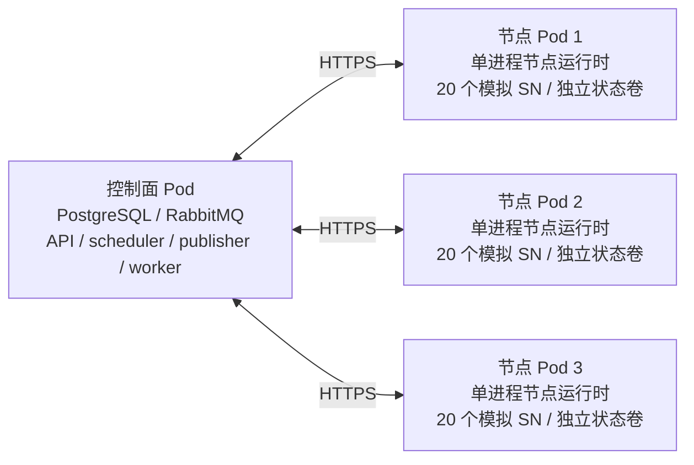

# 本地 Linux 多节点 Pod 验证

此环境用于 macOS 或 Linux 上的 Podman 集成验证。一个独立控制面 Pod 管理三个执行节点 Pod，默认每节点 20 个模拟设备。它有独立数据库、消息队列、网络、TLS CA 和状态卷，不使用现有 `5178/8100` 开发栈的数据。原网页继续显示原开发环境；本验证栈入口为 `https://127.0.0.1:18100` 的 API。

正式部署仍沿用控制面 Compose、Linux 节点 systemd + 独立 Python 环境。本地 Pod 验证不改变该决策，不挂载 USB，不安装或调用 ADB/Fastboot/Artemis，不执行真实手机操作。



## 启动与停止

前置条件：本机 Podman 服务可用，Python 依赖已按仓库 README 安装。命令在仓库根目录运行：

```sh
uv run python scripts/pod_lab.py up
uv run python scripts/pod_lab.py status
uv run python scripts/pod_lab.py verify
uv run python scripts/pod_lab.py down
```

没有 `uv` 全局命令时使用 `.bootstrap/bin/uv`。`up` 构建控制面和专用节点镜像，初始化有独立标签的资源、运行迁移，再等待三个节点注册。再次启动已有实验室时复用原配置与持久卷；修改代码后再次 `up` **不会替换已经运行的容器**，应先 `down`，再 `up`。`--skip-build` 仅用于确认镜像与代码一致时。

可创建另一套互不影响的实验室：

```sh
uv run python scripts/pod_lab.py up --name artemis-lab-small --port 18101 --devices 2
uv run python scripts/pod_lab.py verify --name artemis-lab-small
uv run python scripts/pod_lab.py down --name artemis-lab-small
```

`--devices` 为每节点 1～20，默认 20；`--duration` 为每个模拟尝试的持续秒数，默认 45，允许 30～300。这两个参数及端口只在首次初始化时生效。容量检查要求所有任务曾同时处于 running；较慢机器可新建一个持续时间更长的实验室，不能把未达到该条件的测试记录为并发通过。

`down` 在本地实验室目录的 `logs/` 保存容器日志，然后只移除该实验室的 Pod 和容器，保留网络、数据卷及本地证据。再次停止会更新日志文件。脚本在修改资源前核对持久化实例 ID 标签，拒绝处理同名但不属于该实验室的资源；不执行全局 prune，也不操作其他项目。实验室数据与密钥没有自动清理期限。

## 配置与持久性

- `.runtime/pod-labs/<name>/lab.json` 保存实例 ID 和首次配置；`*.env` 保存随机凭据，权限为 0600，整个目录被 Git/镜像忽略。
- 每节点拥有独立 node_id、待上传事件/证据目录和工作目录。一个 agent 容器运行通信与模拟监督，持有 runtime.lock；业务状态及启动许可由控制面保存。
- `SIM_DEVICE_SERIALS` 为 JSON 数组，仅接受 1～100 个唯一的 `SIM-` 序列号；`SIM_DEVICE_TAGS` 必须包含 `simulator`。正式注册真实设备仍未开放。
- 证据目录绑定 node_id；其他节点身份不能复用。旧 SQLite 状态卷必须先停进程并迁移，详见 [节点运行说明](node-runtime.md)；历史验证实验室建议另起新名称验证新版。
- 模拟监督器只接受本节点清单中的 SN。Pod 重建后复用原状态卷和 node_id；更换 Pod 不等于重新开始设备动作。模拟状态及截止时间从控制面重建；真实设备接管需要独立验证。
- 节点镜像仅安装节点代理及契约依赖，以 UID 10001、只读根文件系统运行。所有节点均无 privileged 模式、宿主 PID 或 USB 设备映射。
- 本地 CA 签发仅供该实验室使用的服务端证书，客户端正常验证 CA 和主机名；不会关闭证书校验或扩大原有 HTTP loopback 豁免。服务端证书有效期 90 天，过期后需另建验证实验室。CA 签名私钥不落盘。
- TLS 私钥及模型主密钥仅挂载给 API；节点卷只持有公开 CA，节点通过内网直接通信。模型主密钥独立生成，不读取原开发环境主密钥。
- 实验室设置 `SCHEDULER_POLL_SECONDS=0.1` 以在模拟任务结束前填满 60 个槽位。默认生产/原开发行为仍为 1 秒；此值不是实测生产吞吐承诺。

## 自动验证与证据

`verify` 会创建标有 `LAB-` 随机前缀的用例、Stable 版本、任务及批次，使用实际 PostgreSQL、RabbitMQ/Celery、HTTPS、Linux 文件锁和容器进程。开始前要求实验室没有未完成工作。每轮记录 `.runtime/pod-labs/<name>/verification-LAB-*.json`，包含时间、批次 ID、每节点并发租约数、检查项和明确未验证范围；失败保留数据以便排查，不自动抹除未完成任务。

检查包括：

1. 三节点注册、60 个设备清单、免 Token 连接与非法设备清单拒绝、日志身份及监督器互斥。
2. 所有模拟槽位同时 running，每设备恰好一个活动租约。
3. 重启节点 runtime；SIGKILL 节点后从中央许可恢复；移除并重建第三个节点 Pod，状态卷保持。
4. API 重启后恢复 HTTP 对账、事件与批次状态；每个尝试中央启动许可仅一条，快照未变，完成后全部租约释放。
5. 真正断开第一个节点 Pod 的容器网络；过期心跳阻止新分配，其他节点仍执行，离线完成留在节点事件文件中，控制面收到清理结果前保持租约。恢复网络后补传并释放。
6. 运行中取消等待节点确认清理；配置一次重试产生第二个独立尝试，保留第一次结果；结束后没有遗留活动租约。

正常模拟完成只能为 `completed / inconclusive / verified / partial`，不能产生真实测试 PASS。每节点的模拟监督器维护并发作业状态，这不是启动了 60 个真实 Artemis 进程。并发和容器故障检查通过也不代表 3 台物理 Linux 主机、USB Hub、Fastboot 切换、systemd 整机恢复、模型视觉能力或 60 台真机吞吐已经验收。

2026-10-29 的实际执行与证据位置见 [Podman 验证记录](podman-validation.md)。

查看资源和日志：

```sh
podman pod ps --filter name=artemis-lab
podman logs --tail 80 artemis-lab-node-1-agent
curl --cacert .runtime/pod-labs/artemis-lab/tls/ca.pem https://127.0.0.1:18100/readyz
```

故障验证会暂时停止实验室中的进程或网络，应在无人操作该实验室时运行。脚本的 finally 分支会恢复注入的网络断开；若强制杀死验证脚本，使用该实验室的 `down` 后 `up --skip-build` 恢复容器，保留持久日志进行对账。
